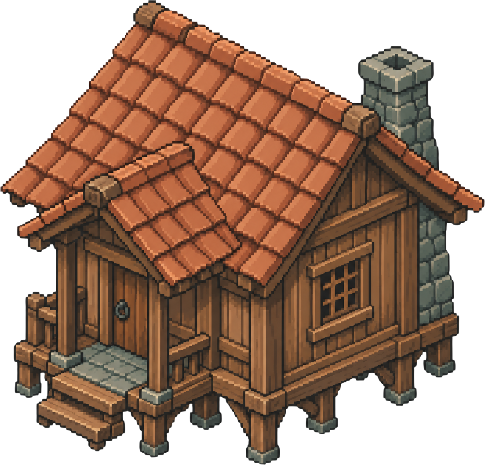

<div align="center">

# 🌾 Seasons of Home (Lembah Rimbun)

**A cozy, restorative 2D isometric rural life simulation game inspired by tropical Indonesian village heritage.**

[](https://phaser.io/)
[](https://developer.mozilla.org/en-US/docs/Web/JavaScript)
[](docs/specs.md)
[](#-automated-testing)
[](index.html)
[](package.json)

<br/>

<p align="center">
  
  &nbsp;&nbsp;&nbsp;&nbsp;
  
  &nbsp;&nbsp;&nbsp;&nbsp;
  
  &nbsp;&nbsp;&nbsp;&nbsp;
  
  &nbsp;&nbsp;&nbsp;&nbsp;
  
</p>

*Menghidupkan kembali kebun warisan kakek di lembah terasering berbukit, bersahabat dengan warga desa, dan menyambut tradisi Malam Lentera Panen.*

</div>

---

## 📖 Daftar Isi

- [✨ Gambaran Proyek](#-gambaran-proyek)
- [🎮 Fitur Utama & Progress Terkini](#-fitur-utama--progress-terkini)
- [🛠️ Tech Stack & Arsitektur](#️-tech-stack--arsitektur)
- [🗺️ Tata Letak Dunia (32×32 Lembah Rimbun)](#️-tata-letak-dunia-3232-lembah-rimbun)
- [🕹️ Kontrol & Panduan Bermain](#️-kontrol--panduan-bermain)
- [🚀 Menjalankan Permainan Lokal](#-menjalankan-permainan-lokal)
- [🧪 Pengujian Unit Otomatis](#-pengujian-unit-otomatis)
- [📁 Struktur Repositori](#-struktur-repositori)
- [📈 Roadmap Pengembangan](#-roadmap-pengembangan)
- [📜 Standar Desain & Anti-AI-Slop Manifesto](#-standar-desain--anti-ai-slop-manifesto)

---

## ✨ Gambaran Proyek

**Seasons of Home (Lembah Rimbun)** adalah game simulasi kehidupan pedesaan isometrik 2D berbasis peramban web modern. Berlatar belakang di sebuah lembah pegunungan tropis-hangat yang tenang, protagonis (Joni) kembali untuk memulihkan pondok kayu tua dan petak kebun terasering peninggalan sang kakek.

Game ini mengusung pendekatan **cozy living**:
- ❌ **Tanpa Kekerasan & Tanpa Tekanan:** Tidak ada mekanik pertarungan, monster perusak, atau *time-pressure* yang agresif.
- 🌿 **Nuansa Nusantara Otentik:** Memadukan arsitektur panggung kayu, dinding papan, genteng tanah liat, petak sawah berundak, tanaman lokal (*Sunroot*, *Mossberry*, *Goldenleaf*), dan perayaan syukur "Malam Lentera Panen".
- ⚡ **Zero-Build Architecture:** Berjalan langsung melalui Native ES Modules (ESM) peramban murni tanpa proses *compilation/bundling* runtime yang rumit.

---

## 🎮 Fitur Utama & Progress Terkini

### 1. 🌾 Sistem Pertanian & Siklus Agrikultur (Phase 2 — Selesai)
- **12 Petak Kebun Terasering (3×4):** Setiap petak memiliki state mesin terisolasi (`soilState`: rumput, gembur/dicangkul, basah/disiram).
- **Siklus 4 Fase Tumbuh:** *Seed (benih) $\to$ Sprout (tunas) $\to$ Leaf (daun) $\to$ Mature (siap panen)*.
- **Pergantian Hari & Cuaca:** Tanaman bertumbuh otomatis saat jam dunia berganti pagi (pukul 06:00) atau disiram air hujan.
- **Proteksi Panen Aman:** Mencegah kehilangan hasil panen bila kapasitas tas inventaris sedang penuh (*Safe Harvest Abort*).

### 2. 🏡 Dunia Isometrik 32×32 Terbuka (Phase 1 & 3 — Selesai)
- **True 2:1 Isometric Projection:** Perhitungan matematis koordinat $64\text{px} \times 32\text{px}$ dengan *inverse screen-to-tile hit-testing*.
- **Dynamic Foot-Y Depth Sorting:** Z-ordering presisi berbasis tapak kaki ($500 + \text{footY}$) memastikan Joni dan NPC ter-render natural di depan atau di belakang pohon dan bangunan.
- **Two-Axis Collision Sliding:** NavGrid 2D dengan resolusi tumbukan dua sumbu independen agar karakter dapat meluncur mulus di sepanjang dinding atau sudut rintangan.
- **Bangunan & Landmark Ikonik:** Pondok Joni, Paviliun Kebun Suri, Kios Pasar Nara, Bengkel Besi Bima, Dermaga Pancing Kolam Nila, dan Gerbang Hutan Lumut.

### 3. 💬 Dialog Desa Bercabang & Sistem Sosial (Phase 3 — Selesai)
- **Naskah Indonesia Pedesaan Hangat:** Ditulis dengan gaya bahasa tutur nusantara yang sopan, santun, dan mengalir natural tanpa gaya terjemahan kaku.
- **Potret Bust Pixel-Art (128×128):** Tampilan dialog modal bergaya perkamen dan kayu dengan animasi potret ekspresif.
- **Sistem Hubungan Warga (RelationshipSystem):** Skor afeksi 0–100, sapaan harian (`talkedToday` +2 poin), bonus misi (+8 poin), serta 3 tingkatan hubungan (*Kenalan*, *Sahabat Lembah*, *Keluarga Lembah*).
- **Logika Hadap Otomatis (`facePlayer`):** NPC otomatis memutar arah hadap memandang Joni saat diajak berinteraksi.

### 4. 📜 Finite State Machine Misi & Idempotent Rewards (Phase 3 — Selesai)
- **3 Beat Narasi Terhubung:**
  1. *Benih Pertama (Nenek Suri):* Mencangkul, menanam, menyiram, dan memanen Sunroot.
  2. *Tangan untuk Desa (Paman Bima):* Mengumpulkan Kayu Rimba dan Batu Kali untuk rangka lentera festival.
  3. *Lentera untuk Semua (Nara):* Melengkapi seserahan hasil kebun matang menyambut Malam Lentera Panen.
- **Pelacakan Event Terdesentralisasi:** Memanfaatkan `EventBus` (`PLOT_WATERED`, `CROP_HARVESTED`, `ITEM_ACQUIRED`, `NPC_TALKED`).
- **Idempotent Reward Token:** Hadiah dilindungi token unik (`reward_token_${questId}`) yang menjamin imbalan uang, item, dan poin afeksi tidak dapat diduplikasi saat percakapan ulang atau muat save.

### 5. 🎒 Tas Inventaris 16-Slot & Jurnal Misi (Phase 2 & 3 — Selesai)
- **Manajemen Slot Cerdas:** Fitur klik-pilih untuk menukar (*swap*) posisi atau menggabungkan tumpukan (*stack merge* hingga 99 item).
- **Quick Hotbar 4-Slot:** Akses instan alat cangkul, penyiram, dan benih melalui tombol `1`–`4` atau sentuhan layar.
- **Jurnal Misi (`J`):** Menampilkan daftar misi aktif, ceklis penyelesaian target `[✓]`, dan hadiah secara real-time.

---

## 🛠️ Tech Stack & Arsitektur

```
┌─────────────────────────────────────────────────────────────┐
│                 PRESENTATION LAYER (DOM/CSS)                │
│   HUDController  •  MenuController  •  DialoguePanel        │
│   (Parchment UI, 44px+ touch targets, CSS Design Tokens)    │
└──────────────────────────────▲──────────────────────────────┘
                               │ EventBus / Input Freeze
┌──────────────────────────────▼──────────────────────────────┐
│                  SCENE LIFECYCLE (Phaser 3.88)              │
│   BootScene ──► PreloadScene ──► TitleScene ──► GameScene    │
│                                           │        │        │
│                                           ▼        ▼        │
│                                        UIScene  WorldClock  │
└──────────────────────────────▲──────────────────────────────┘
                               │
┌──────────────────────────────▼──────────────────────────────┐
│                    DOMAIN SIMULATION SYSTEMS                │
│   MovementSystem     • InteractionSystem • FarmingSystem    │
│   RelationshipSystem • QuestSystem (FSM) • DialogueSystem   │
└──────────────────────────────▲──────────────────────────────┘
                               │
┌──────────────────────────────▼──────────────────────────────┐
│                  WORLD & GEOMETRY FOUNDATION                │
│   isoMath (2:1)      • NavGrid (Sliding) • DepthSorter      │
│   IsoWorldRenderer   • ZoneDefinitions (32x32 Lembah)       │
└─────────────────────────────────────────────────────────────┘
```

- **Core Engine:** [Phaser 3.88.2](https://phaser.io/)
- **Module Format:** Native ECMAScript Modules (ESM)
- **UI Architecture:** Decoupled DOM overlay (`UIScene`) dengan Zero UI Framework overhead
- **Persistensi Data:** IndexedDB & JSON Storage Serialization
- **Automated Testing:** Node.js native assert test runner (ESM)
- **Asset Pipeline:** Python 3.12 (Pillow / OpenCV) Nearest-Neighbor slicer

---

## 🗺️ Tata Letak Dunia (32×32 Lembah Rimbun)

Peta permainan berukuran **32×32 ubin isometrik** yang menghubungkan empat area tematik:

```
                          [UTARA]
                 (12,4) Paviliun Suri ── [Nenek Suri]
                           │
  (6,4) Pondok Joni ───────┴──────── (22,5) Kios Pasar ── [Nara]
         │ (Pintu & Kasur)  │                 │
  (4,10) 12 Petak Kebun     │           Alun-alun Desa
         │ (Terasering)     │        (Lentera Festival)
         │                  │                 │
  (6,22) Dermaga Pancing    └─────── (19,14) Bengkel Besi ── [Paman Bima]
         │ (Kolam Nila)                       │
  [BARAT]└────────────────────────── (28,12) Gerbang Hutan & Tambang [TIMUR]
                          [SELATAN]
```

---

## 🕹️ Kontrol & Panduan Bermain

Permainan mendukung kontrol penuh menggunakan **Keyboard / Mouse** maupun **Layar Sentuh (Touchscreen)**:

| Aksi | Keyboard (Desktop) | Kontrol Sentuh (Mobile) |
|---|---|---|
| **Navigasi Karakter** | `W`, `A`, `S`, `D` atau `Tombol Panah` | Virtual D-Pad (Kiri Bawah) |
| **Aksi Kontekstual** | Tombol `E` atau `Spasi` | Tombol Aksi Bulat (Kanan Bawah) |
| **Pilih Slot Hotbar** | Angka `1`, `2`, `3`, `4` | Ketuk Slot Hotbar |
| **Buka/Tutup Tas (16 Slot)** | Tombol `I` | Tombol `🎒 Tas [I]` di HUD |
| **Buka/Tutup Jurnal Misi** | Tombol `J` | Tombol `📜 Jurnal [J]` di HUD |
| **Pilih Opsi Dialog** | Angka `1`–`9` / `E` / `Spasi` | Ketuk Opsi Pilihan Dialog |
| **Tidur & Maju ke Pagi** | Dekati Kasur lalu tekan `E` | Dekati Kasur lalu ketuk Aksi |
| **Tutup Modal / Batalkan** | Tombol `Esc` | Tombol `✕` di Pojok Modal |

---

## 🚀 Menjalankan Permainan Lokal

Karena arsitektur game ini murni berbasis ES Modules peramban tanpa build tools, Anda dapat menjalankannya langsung menggunakan server HTTP statis standar:

### 1. Clone Repositori
```bash
git clone https://github.com/tamaproject360/season-of-home.git
cd season-of-home
```

### 2. Jalankan Server Lokal
Pilih salah satu metode server berikut:

**Opsi A (Python 3 — Rekomendasi):**
```bash
python -m http.server 8080
```

**Opsi B (Node.js npx):**
```bash
npx serve -l 8080
```

### 3. Buka di Browser
Buka tautan berikut di peramban modern (Chrome, Edge, Firefox, Safari):
```
http://localhost:8080
```

---

## 🧪 Pengujian Unit Otomatis

Seluruh logika matematika isometrik, transaksi kapasitas inventaris, siklus pertumbuhan tanaman, dan alur FSM misi dilindungi oleh rangkaian test suite unit otomatis:

```bash
# Menjalankan seluruh test suite sekaligus
npm test
```

### Rincian Test Suite:
```bash
node tests/isoMath.test.js    # Invariant proyeksi tileToScreen <-> screenToTile (akurasi ±1e-6)
node tests/inventory.test.js  # Batas stack 99, penolakan saat penuh, dan slot swap/merge
node tests/farming.test.js    # 4 siklus tumbuh tanaman dan pembatalan panen aman
node tests/quests.test.js     # FSM quest, tangkapan domain events, dan token reward idempoten
```

Output pengujian:
```text
✓ All isoMath tests PASSED successfully!
✓ All InventorySystem unit tests PASSED successfully!
✓ All FarmingSystem unit tests PASSED successfully!
✓ All QuestSystem unit tests PASSED successfully!
```

---

## 📁 Struktur Repositori

```
d:\GAME\SOH\
├── index.html                  # Dokumen utama & mounting canvas game
├── package.json                # Skrip test runner & konfigurasi proyek
├── blueprint.md                # Dokumen master game design v1.0
├── task.md                     # Pelacak WBS bertahap (Phase 0 - 6)
├── asset/                      # Seluruh aset visual pixel art terpotong
│   ├── building/               # Tekstur bangunan (pondok, bengkel, kios, dll.)
│   ├── characters/             # Spritesheet karakter 313x313 & potret 256x256
│   ├── crops/                  # Varietas tanaman stage 1 s/d 4
│   ├── items/                  # Alat pertanian, bibit, koin, dan hasil panen
│   ├── nature/                 # Pohon tropis, semak, batu bijih, dan lentera
│   └── terrain/                # Ubin rumput, jalan setapak, dermaga kolam
├── docs/
│   └── specs.md                # Spesifikasi arsitektur komprehensif untuk Agentic AI
├── lib/
│   └── phaser.min.js           # Phaser engine bundle 3.88.2
├── src/
│   ├── config/                 # Konstanta game & palet anti-slop
│   ├── data/                   # Katalog tanaman, item, quest, dan naskah dialog
│   ├── entities/               # Player (Joni), NPC, dan FarmPlot
│   ├── input/                  # Router input multi-platform (Desktop & Touch)
│   ├── scenes/                 # BootScene, PreloadScene, TitleScene, GameScene, UIScene
│   ├── styles/                 # Desain token CSS & styling UI
│   ├── systems/                # Gerak, interaksi, bertani, hubungan, quest, dan dialog
│   ├── ui/                     # Kontroller HUD, Menu Modal, dan Dialog Panel
│   ├── utils/                  # EventBus pub/sub & kalkulasi matematika
│   └── world/                  # Grid navigasi, depth sorting, dan definisi ubin 32x32
└── tests/                      # Suite unit test otomatis
```

---

## 📈 Roadmap Pengembangan

Berdasarkan dokumen perencanaan [task.md](task.md):

- [x] **Phase 0:** Fondasi Sistem, Palet Kurasi, Pipeline Pemotongan Aset & Booting
- [x] **Phase 1:** Mesin Isometrik 2:1, Pergerakan Dua Sumbu, NavGrid, Depth Sorting & Multi-Input
- [x] **Phase 2:** Sistem Pertanian Terasering (12 Petak), Tas 16-Slot, Jam Dunia, & HUD UI
- [x] **Phase 3:** Entitas NPC, Dialog Bercabang Bahasa Indonesia, Hubungan Sosial, FSM Quest, & Dunia Luas 32×32
- [ ] **Phase 4:** Sistem Persistensi IndexedDB Multi-Slot & Kustomisasi Karakter
- [ ] **Phase 5:** Gathering Kayu/Batu, Minigame Pancing Kolam Nila, & Companion Pet Kiko
- [ ] **Phase 6:** Meja Kerajinan (Crafting), Audio Prosedural Web Audio, & Polish Malam Lentera Panen

---

## 📜 Standar Desain & Anti-AI-Slop Manifesto

Proyek ini menjunjung tinggi standar kualitas visual sesuai spesifikasi Section 5.5 [blueprint.md](blueprint.md):

1. **Larangan Hex Primer Jenuh:** Tidak diperkenankan menggunakan warna digital murni (`#FF0000`, `#00FF00`, `#0000FF`, `#FFFF00`). Semua warna wajib diturunkan dari 14 palet tanah terkurasi (*Deep Pine*, *Moss*, *Warm Cream*, *Clay Brown*, *Terracotta*, dll.).
2. **Keterbacaan Siluet Pixel Art:** Setiap entitas memiliki kontur yang jelas tanpa efek glow murahan atau gradient plastik artifisial.
3. **Penyajian Sentuh Nyaman:** Semua target tombol memenuhi batas minimum aksesibilitas $\ge 44\text{px} \times 44\text{px}$ dengan padding yang ramah jari pada layar sentuh ponsel pintar.

---

<div align="center">
  <sub>Dibangun dengan dedikasi untuk menghadirkan pengalaman simulasi pedesaan yang menenangkan dan hangat.</sub><br/>
  <strong>Seasons of Home © 2026 Lembah Rimbun Project</strong>
</div>
