# MASTER ASSET REQUIREMENT & PROMPT SPECIFICATION (PART 2) — SEASONS OF HOME

> **Dokumen Spesifikasi Aset:** Production Visual Asset List (Phase 4–6 & UI Expansion) & AI Prompt Engineering Guide  
> **Target Generator:** GPT Image 2.5 (DALL-E 3 / Modern Image Model)  
> **Target Engine:** Phaser 3.88.2 (HTML5 Canvas / WebGL 2D)  
> **Fokus Ekspansi:** Menu Utama, Perluasan Pondok (Home & Crafting), Ekosistem Danau & Jembatan, HUD Komprehensif ala Stardew Valley (Nusantara Theme), Landmark & Bangunan Tambahan Desa  
> **Format Proyeksi:** 2D Isometric / Dimetric Projection (Rasio 2:1, Base Tile 64×32 px) & Pixel UI 2D Orthographic  
> **Dokumen Pendukung:** [asset.md](file:///d:/GAME/SOH/asset.md), [blueprint.md](file:///d:/GAME/SOH/blueprint.md), [task.md](file:///d:/GAME/SOH/task.md), [docs/specs.md](file:///d:/GAME/SOH/docs/specs.md)

---

## 1. ATURAN BAKU PROMPTING & ANTI-AI-SLOP MANIFESTO

Untuk memastikan semua aset lanjutan dari GPT Image 2.5 memiliki bahasa visual yang 100% harmonis dengan aset yang sudah ada di repositori (`main.png`, `nara.png`, `bima.png`, `suri.png`, `joni_cottage.png`, dll.), gunakan parameter master berikut:

### A. Template Prompt Master — Aset Isometrik Dunia (World & Buildings)
```text
[Subject & Specific Details], 2D pixel art game asset, true 2:1 dimetric isometric projection, cozy rural tropical Indonesian highland aesthetic, clean crisp pixel contours, handcrafted pixel clusters, limited earthy color palette (#304B43 deep pine, #4C6B55 moss, #76936B sage, #87674E clay brown, #59483B soil, #BC7654 terracotta, #D9AE6B golden straw, #697A77 slate stone, #EEE1C4 warm cream, #749C9A pond blue), isolated on solid pure white background, no gradients, no glow, no bloom, no blurry antialiasing, no 3D render look, crisp transparent-ready cutout edges.
```

### B. Template Prompt Master — Aset Antarmuka Pengguna & HUD (UI & Icons)
```text
[UI Element Details], 2D pixel art UI game asset, orthographic front-facing view, cozy Stardew-Valley-inspired rural rustic aesthetic, handcrafted wooden and parchment texture, limited warm earthy palette (#87674E clay brown wood border, #F2E8D5 parchment background, #D9AE6B golden bronze accents, #2D3835 dark ink contour), clean pixel outlines, crisp readable silhouette at small scale, isolated on solid pure white background, no modern neon glow, no blur, transparent cutout ready.
```

### C. Parameter Negatif Wajib (Negative Constraints)
- **DILARANG:** Hex primer jenuh neon (`#FF0000`, `#00FF00`, `#0000FF`, `#FFFF00`), efek *photorealistic 3D*, *radial lens flare*, *soft drop shadow* semburat blur, *glassmorphism*, gradient plastik modern, serta tekstur *dithering* berisik tak beraturan.
- **WAJIB:** Sudut pandang isometrik murni 2:1 untuk objek dunia; sudut ortografis datar untuk elemen HUD; bayangan kontak tegas (*hard pixel shadow*) di dasar tanah; dan pemisahan warna terang-gelap dalam blok piksel diskrit (*cel-shaded pixel clusters*).

---

## 2. TABEL LENGKAP KEBUTUHAN ASET & SPESIFIKASI PROMPT GPT IMAGE 2.5

| No | Kategori | Nama Aset | Dimensi Target (px) / Skala Tile | Deskripsi & Variasi State | Spesifikasi Prompt Bahasa Inggris Lengkap (Siap Copy-Paste ke GPT Image 2.5) |
|:---:|---|---|---|---|---|
| **A** | **TAMPILAN MENU UTAMA & UI SHELL (TITLE SCREEN)** | | | | |
| 1 | Menu Utama | **Latar Panorama Menu Utama (Title Screen Panorama)** | Rasio 16:9<br>(1280×720 atau 1920×1080 px) | Lukisan panorama pixel art pemandangan Lembah Rimbun: bukit sawah terasering berundak, kabut pagi pegunungan tropis tipis, pondok Joni di kejauhan dengan asap tipis dari cerobong genteng terakota, dan cabang pohon rindang berdaun moss/sage di bingkai depan. | `Cozy panoramic title screen landscape background for a 2D pixel art farming RPG, 16:9 widescreen ratio. Sweeping morning vista of tropical highland valley terraces, misty mountain ridges in soft distance (#354D5C to #749C9A), distant rustic stilt cottage with faint chimney smoke nestled in lush green fields, weeping flowering tree branch framing the foreground corner. Warm soft dawn sunlight (#EEE1C4 and #D9AE6B), handcrafted scenic pixel art, peaceful atmosphere, painterly discrete pixel clusters, strictly no photorealism, no modern glow.` |
| 2 | Menu Utama | **Logo Game & Plakat Judul (Game Title Plaque)** | Lebar ~480 px<br>Tinggi ~180 px | Plakat kayu berukir ukiran sulur dedaunan tropis bertuliskan "SEASONS OF HOME" dengan font serif pixel tebal warna krem berbingkai tembaga, di bawahnya terdapat pita kain bertuliskan "Lembah Rimbun" dan hiasan lentera bambu kecil di sisi kiri-kanan. | `Game title logo header plaque for a cozy rural RPG titled 'SEASONS OF HOME' with subtitle 'Lembah Rimbun', 2D pixel art. Hand-carved rustic dark timber wooden signboard (#87674E) decorated with creeping green vines and miniature dangling paper harvest lanterns on each side. Bold readable pixel lettering in warm cream (#EEE1C4) with aged copper border trim (#BC7654). Discrete pixel contours, handcrafted fantasy countryside aesthetic. Isolated on solid white background.` |
| 3 | Menu Utama | **Set Tombol Menu Kayu (Main Menu Button Frames)** | 160×44 px per tombol<br>(3 State: Normal, Hover, Active) | Tombol menu horizontal bertekstur papan kayu balok dengan paku tembaga di 4 sudut dan aksen permukaan perkamen; 3 variasi: 1) Normal, 2) Hover (aksen daun emas menyala), 3) Pressed (kayu tertekan ke dalam). | `Set of 3 state variations of a rustic wooden UI button for game menu, 2D pixel art. Size 160x44 pixels each. 1) Normal idle state: aged timber plank with brass corner rivets and warm parchment center; 2) Hover/Focused state: golden leaf vine highlight trim (#D9AE6B) and brightened wood texture; 3) Pressed state: recessed darker wood bevel (#59483B). Crisp pixel contours, high contrast, clean readable borders. Isolated side by side on solid white background.` |
| **B** | **HUD & WIDGET ALA STARDEW VALLEY (NUSANTARA THEME)** | | | | |
| 4 | HUD Widget | **Kotak Dial Jam & Kalender Musim (Clock & Calendar Widget)** | ~180×110 px visual | Widget pojok kanan atas ala Stardew Valley bergaya ukiran kayu Nusantara: kotak jam kayu jati, dial lingkaran matahari/bulan yang berputar sesuai waktu, slot digital jam/menit, penanda hari/angka kalender, dan ikon musim bergambar bunga mekar. | `Retro cozy HUD clock and calendar UI widget box inspired by farming sims, 2D pixel art. Handcrafted dark wood frame with ornate corner carvings (#87674E). Features a round rotating sun-and-moon sky dial, clear pixel text display area for digital time (e.g. 06:00), day counter display box, and an embossed seasonal emblem badge showing blooming spring flowers. High contrast readable pixels, warm cream and terracotta accents. Isolated on solid pure white background.` |
| 5 | HUD Icon | **Set Indikator Cuaca Lengkap (Weather Icons Set)** | 32×32 px per ikon<br>(6 variasi cuaca) | 6 ikon pixel art cuaca desa: 1) Cerah Matahari Hangat, 2) Terik Siang Lembah, 3) Berawan Mendung, 4) Hujan Tropis Rintik, 5) Hujan Deras Petir Lembah, 6) Kabut Tebal Pegunungan. | `Set of 6 weather status HUD icons for a rural simulation game, 2D pixel art. Each strictly 32x32 pixels. 1) Gentle morning radiant sun (#D9AE6B); 2) Bright afternoon sun; 3) Soft grey-blue overcast clouds (#697A77); 4) Gentle diagonal rain shower drops; 5) Dark thunderstorm cloud with small copper lightning bolt; 6) Mountain morning mist fog waves. Bold readable silhouettes, clean dark outline, limited earthy palette. Arranged in a horizontal row on solid white background.` |
| 6 | HUD Widget | **Kotak Saldo Koin Daun (Leafcoins Currency Display Bar)** | ~140×36 px visual | Kotak display saldo mata uang berbentuk batang kayu ramping beralaskan kain tenun dengan emblem koin daun timbul di kiri dan slot angka koin di kanan. | `Horizontal currency HUD display bar for a farming RPG, 2D pixel art. Rustic polished wood trim with a gleaming embossed bronze leafcoin medallion (#D9AE6B) locked into the left side, and a recessed warm cream parchment slot on the right to display number digits. Crisp pixel art borders, warm cozy tones, no blur. Isolated on solid pure white background.` |
| 7 | HUD Icon | **Ikon Tas Ransel Anyaman Rotan (Backpack / Rattan Bag)** | 40×40 px visual<br>(2 state: Normal & Terbuka) | Ikon tombol pembuka inventaris berupa tas punggung anyaman rotan/bambu tradisional pedesaan dengan tali kulit cokelat; 2 state: 1) Tas tertutup rapi, 2) Tas terbuka sedikit dengan kilau bibit di dalamnya. | `Set of 2 backpack inventory UI icons, 2D pixel art. 40x40 pixels each. 1) Traditional woven rattan bamboo backpack (#D9AE6B and #87674E) with brown leather buckle straps, closed neatly; 2) Open backpack with top flap unbuckled showing small green plant sprout peeking out. Crisp dark outline, rich textured weave, highly readable silhouette. Isolated side by side on solid white background.` |
| 8 | HUD Icon | **Ikon Jurnal Misi Kulit Kayu (Journal Book Icon)** | 40×40 px visual<br>(2 state: Normal & Alert) | Ikon tombol jurnal misi berupa buku catatan bersampul kulit cokelat tua dengan jilid tali rami dan pita pembatas daun; 2 state: 1) Buku tertutup anggun, 2) Buku dengan lencana seru merah terakota menandai ada misi baru. | `Set of 2 quest journal book UI icons, 2D pixel art. 40x40 pixels each. 1) Thick leather-bound traveler's journal book (#59483B) tied with twine rope and a green leaf bookmark hanging out; 2) Same journal with an embossed terracotta exclamation badge (#BC7654) on the corner signifying an active quest update. Sharp pixel styling, warm paper and leather tones. Isolated on solid white background.` |
| 9 | HUD Gauge | **Pengukur Stamina & Energi Bambu (Bamboo Stamina Bar)** | ~28×140 px vertikal<br>(atau 140×24 px horizontal) | Bar meteran pengukur stamina Joni berbentuk tabung bambu beruas dengan tutup tembaga; memiliki meteran isi cairan hijau sage/moss, dan ikon keringat kecil saat energi kritis menipis. | `Vertical stamina energy meter gauge bar for cozy farming game HUD, 2D pixel art. Carved natural green-yellow bamboo stalk frame with polished copper caps at top and bottom. Fill gauge displays vibrant lime-sage green energy liquid (#76936B to #4C6B55) that depletes cleanly, with small warning sweat drop icon at the base. Crisp pixel art contours, clear readability. Isolated on solid pure white background.` |
| 10 | HUD Frame | **Bingkai Hotbar Cepat 10-Slot (Modular Hotbar Grid)** | Panjang modul ~420×44 px<br>(Slot 36×36 px) | Deretan 10 slot hotbar cepat berornamen ukiran kayu desa; slot kosong bernuansa perkamen krem muda dengan slot seleksi aktif menyala tembaga/keemasan. | `10-slot quick access inventory hotbar frame widget, 2D pixel art. Long horizontal segmented bar composed of interlocking dark timber wood (#87674E) with 10 square item slots (36x36 px each) in warm parchment beige (#FCF9F2). Includes one highlighted active selection cursor bracket with golden corner accents (#D9AE6B). Handcrafted pixel art, zero blurry scaling. Isolated on solid white background.` |
| **C** | **DANAU MEMANCING, KEPULAUAN KECIL & JEMBATAN PENGHUBUNG** | | | | |
| 11 | Infrastruktur Air | **Jembatan Lengkung Kayu Danau (Wooden Arch Bridge)** | Base: 256×128 px (4×2 tile)<br>Tinggi visual: ~90 px | Jembatan lengkung kayu isometrik 2:1 melintasi air; lantai papan kayu bersusun, pagar tiang kayu di kedua sisi berikat tali tambang tambat, dan bayangan kontak lengkung di atas permukaan air. | `Rustic wooden arched footbridge sprite for crossing an isometric lake, 2D pixel art. Spans across 4x2 isometric tiles (2:1 projection). Curved wooden timber walkway planks (#87674E), low rustic post-and-rope railings on both sides, mossy damp wooden pilings submerged at water level (#59483B), casting a gentle pixel shadow onto the water below. Walkable path across the bridge, handcrafted pixel art, clean borders. Isolated on solid white background.` |
| 12 | Tileset Perairan | **Tepian Danau & Garis Pantai Lengkung (Lake Shoreline Tileset)** | Modul 64×32 px (diamond iso)<br>(Set 8 variasi tepi) | Set ubin transisi danau toska tenang ke daratan rumput: tepi lurus utara/selatan/barat/timur, sudut luar lengkung, sudut dalam teluk, dan tepian batu kali halus. | `Comprehensive 2D isometric lake shoreline terrain tileset, pixel art game assets. 64x32 pixel diamond tiles in 2:1 projection. Includes straight shoreline transitions between emerald grassy banks (#4C6B55) and clear turquoise pond water (#749C9A), outer corner bends, inner water coves, and smooth river pebble water-edges. Seamless tileable edges, discrete pixel water ripples, no blurry noise. Arranged in a neat grid on solid white background.` |
| 13 | Lanskap Danau | **Pulau Kecil Tengah Danau (Lake Islet / Secret Island)** | Base: 256×256 px (4×4 tile)<br>Visual: ~260×180 px | Daratan pulau kecil di tengah danau terhubung jembatan; memiliki satu pohon rindang menunduk ke air, bebatuan kali berlumut, bunga teratai di tepian, dan tanah berumput lembut tempat memancing ikan langka. | `Scenic miniature secret island islet sprite in an isometric lake, 2D pixel art. Spans roughly 4x4 isometric tiles. Grassy earthen mound surrounded by smooth lake stones and water edges, featuring one elegant weeping tropical tree leaning over the water, mossy boulders, and tiny yellow shoreline flowers. True 2:1 isometric angle, tranquil fishing sanctuary atmosphere, handcrafted pixel clusters. Isolated on solid white background.` |
| 14 | Properti Danau | **Perahu Sampan Kayu & Dayung (Wooden Canoe & Oars)** | Base: 128×64 px (2×1 tile)<br>Visual: ~110×45 px | Perahu sampan kayu kecil tradisional pedesaan bersandar di tepi air, terdapat sepasang dayung kayu di dalamnya, terikat pada tiang tambang kayu di tepi danau. | `Small rustic wooden dugout canoe rowboat sprite floating at lake edge, 2D isometric pixel art. Hand-hewn dark wood boat hull (#87674E) resting at 2:1 dimetric angle, pair of simple wooden oars laying across seats, tied with coiled hemp rope to a stout wooden mooring stake on shore. Gentle contact water ripple underneath, crisp pixel art details. Isolated on solid white background.` |
| 15 | Tanaman Air | **Rumpun Teratai & Bunga Lotus (Water Lilies & Lotus)** | Base: 64×32 px (1 tile)<br>(Set 3 variasi) | 3 variasi tanaman air terapung di danau: 1) Kelompok daun teratai hijau bundar mengapung, 2) Daun teratai dengan bunga teratai putih mekar, 3) Daun teratai dengan bunga kuncup merah muda lembut. | `Set of 3 floating water lily pad and lotus flower cluster sprites, 2D isometric pixel art. Each fits on a 64x32 pixel water tile surface. 1) Clustered emerald green lily pads with notched edges; 2) Lily pads with one radiant blooming white lotus blossom and yellow center; 3) Lily pads with delicate soft pink lotus bud. Flat floating perspective, crisp pixel art edges, zero alpha blur. Isolated in a row on solid white background.` |
| 16 | Interaksi Air | **Titik Riak Ikan Melompat (Fish Jumping Ripple Spot)** | Base: 64×32 px visual<br>(Animasi 3 frame) | Titik interaksi memancing khusus di air danau tempat ikan berkumpul: riak air melingkar berbusa putih dengan siluet ikan perak melompat sesaat ke udara. | `3-frame animation spritesheet of a freshwater fish splashing ripple spot on water, 2D isometric pixel art. Fits 64x32 water tile. Frame 1: Expanding concentric white-and-teal pixel water ripples; Frame 2: Sleek silver riverfish leaping gracefully above the surface; Frame 3: Water splash droplets dispersing. Discrete pixel art effects, high contrast readability. Arranged horizontally on solid white background.` |
| **D** | **PERLUASAN PONDOK JONI (HOME, COOKING & CRAFTING)** | | | | |
| 17 | Perabot Dapur | **Tungku Masak Pawon Tanah Liat (Clay Cooking Hearth)** | Base: 64×64 px (1×1 tile)<br>Tinggi: ~60 px | Tungku masak tradisional pedesaan dari tanah liat merah bakar, kayu bakar membara di bawahnya, kuali tanah liat bertutup kayu di atasnya, dan rak bumbu kecil di samping. | `Traditional rustic clay cooking stove hearth (Pawon) for a cozy village home interior, 2D isometric pixel art. Baked terracotta clay furnace structure (#BC7654) with glowing orange pixel wood embers inside hearth, cast-iron cooking wok pot on top with wooden lid, small clay spice jar sitting beside stove. Handcrafted pixel details, warm firelight feel without artificial glow, 1x1 tile base. Isolated on solid white background.` |
| 18 | Stasiun Kerja | **Meja Kerajinan Kayu Tukang (Sturdy Crafting Bench)** | Base: 128×64 px (2×1 tile)<br>Tinggi: ~65 px | Meja kerja kayu jati tebal dengan laci perkakas, catok kayu di samping, gergaji tangan dan palu tergeletak rapi, serta serutan kayu tipis berhamburan di dasar kaki meja. | `Heavy artisan woodcraft workbench furniture sprite, 2D isometric pixel art. 2x1 tile base footprint. Sturdy timber construction with side wood vise clamp, forged hand-saw and mallet laying on table surface, small hanging blueprint sketch on front panel, and neat wood shavings on floor. True 2:1 isometric view, crisp wood grain pixel shading (#87674E and #59483B). Isolated on solid white background.` |
| 19 | Perabot Kamar | **Lemari Pakaian Kayu Ukir (Rustic Wardrobe Cabinet)** | Base: 64×64 px (1×1 tile)<br>Tinggi: ~95 px | Lemari pakaian kayu dua pintu berukir ornamen flora sederhana dengan pegangan logam kuningan antik; tempat Joni berganti variasi busana. | `Cozy rustic wooden wardrobe armoire cabinet, 2D isometric pixel art. Tall 1x1 tile footprint. Two hinged panel wooden doors carved with subtle leaf swirl motifs, antique brass metal keyhole pulls, solid crown molding top. Rich warm timber tones (#87674E), distinct pixel clusters, clean vertical silhouette. Isolated on solid white background.` |
| 20 | Perabot Makan | **Set Meja Makan & Kursi Bundar (Dining Table & Stools)** | Base: 64×64 px (1×1 tile)<br>Tinggi: ~50 px | Meja makan kayu bundar beralaskan taplak tenun sage green, teko teh keramik dan mangkuk umbi di atasnya, ditemani dua bangku kayu bulat kecil di sampingnya. | `Small rustic circular wooden dining table set with two round wooden stools, 2D isometric pixel art. Fits 1x1 to 1.5x1.5 tile space. Table covered with a woven sage-green placemat holding a ceramic teapot and two bowls of steamed root vegetables. Handcrafted pixel style, warm homey dining feel, clean contact shadows. Isolated on solid white background.` |
| 21 | Logistik Kebun | **Peti Pengiriman Hasil Panen (Shipping / Selling Bin)** | Base: 64×64 px (1×1 tile)<br>Tinggi: ~48 px | Peti kayu besar kokoh berpenutup engsel kayu dengan tiang bendera kecil di sampingnya (bendera naik saat ada barang yang dimasukkan untuk dijual ke desa). | `Sturdy wooden produce shipping bin container box for farmstead exterior, 2D isometric pixel art. Heavy slatted wooden chest with hinged lid, iron corner braces, and a small wooden post with a raised terracotta fabric flag indicating goods ready for evening village collection. 1x1 tile base footprint, clean pixel art silhouette. Isolated on solid white background.` |
| **E** | **BANGUNAN & LANDMARK DESA TAMBAHAN (VILLAGE EXPANSIONS)** | | | | |
| 22 | Fasilitas Desa | **Papan Pengumuman & Misi Desa (Village Notice Board)** | Base: 64×32 px (1 tile)<br>Tinggi: ~85 px | Papan pengumuman kayu besar beratap genteng terakota mini di alun-alun desa, ditempeli 4 lembar kertas perkamen permintaan warga desa, pengumuman festival, dan peta rute. | `Village community wooden quest notice board landmark sprite, 2D isometric pixel art. Two sturdy timber support posts with a small terracotta clay roof awning on top. The cork-wood board is pinned with four distinct rustic parchment paper notes, letters, and quest flyers (#F2E8D5) with tiny pixel wax seals. 1x1 tile footprint, crisp pixel contours. Isolated on solid white background.` |
| 23 | Landmark Desa | **Pohon Rimba Raksasa Festival (Village Sacred Great Tree)** | Base: 256×256 px (4×4 tile)<br>Tinggi visual: ~220 px | Pohon beringin/rimba raksasa di tengah alun-alun Desa Rimbun; memiliki tajuk daun rindang bertingkat, akar gantung alami, bangku kayu membulat di sekeliling batangnya, dan hiasan untaian lentera kertas festival. | `Colossal ancient sacred banyan tree landmark in a village plaza, 2D isometric pixel art. Massive 4x4 tile base footprint. Majestic twisting timber trunk with cascading aerial vine roots, voluminous layered canopy of lush moss and emerald leaves (#304B43, #4C6B55), circular wooden seating bench built wrapping around the trunk, and colorful paper harvest lanterns strung between branches. Centerpiece visual asset, handcrafted pixel clusters. Isolated on solid white background.` |
| 24 | Arsitektur Desa | **Lumbung Padi Tradisional Leuit (Traditional Granary Stilt Leuit)** | Base: 128×128 px (2×2 tile)<br>Tinggi visual: ~140 px | Lumbung padi panggung tradisional dengan 4 tiang kayu berlempeng bulat anti-hama, dinding anyaman bambu bermotif kepang, dan atap ijuk jerami hitam-cokelat menjulang tinggi. | `Traditional Indonesian stilt granary storehouse (Leuit) building sprite, 2D isometric pixel art. Elevated on four timber stilts with circular wooden rodent-guard disks, woven patterned bamboo slat walls (#D9AE6B and #87674E), small bamboo access ladder leading to high doorway, and a steep soaring dried thatch palm-fiber roof (#59483B). True 2:1 isometric view, 2x2 tile base, authentic rural vernacular architecture. Isolated on solid white background.` |
| 25 | Fasilitas Air | **Sumur Batu Desa & Kerekan Timba (Village Stone Water Well)** | Base: 64×64 px (1×1 tile)<br>Tinggi visual: ~70 px | Sumur air bundar dari tumpukan batu kali berlumut, rangka atap kayu bertiang dua dengan kerekan kayu, tali rami tebal, dan ember kayu berisi air jernih bersandar di bibir sumur. | `Round village water well landmark sprite, 2D isometric pixel art. Circular rustic river-stone well wall (#697A77) with green moss patches, wooden A-frame timber roof shingled in clay tile, wooden crank winch with coiled hemp rope, and sloshing wooden water bucket resting on stone ledge. True 2:1 dimetric angle, 1x1 tile ground footprint, clean pixel styling. Isolated on solid white background.` |
| 26 | Fasilitas Desa | **Pos Ronda & Bale-Bale Bambu (Village Guard Post Gazebo)** | Base: 128×128 px (2×2 tile)<br>Tinggi visual: ~110 px | Gazebo panggung bambu terbuka tempat warga berkumpul santai; lantai bilah bambu beralaskan tikar pandan, atap rumbia jerami, kentongan kayu gantung dengan pemukulnya di tiang depan. | `Open-air traditional bamboo relaxation gazebo shelter (Bale-Bale / Pos Ronda), 2D isometric pixel art. 2x2 tile footprint. Polished bamboo slat raised floor with woven pandanus mat inside, rustic thatched palm roof, and a carved hollow wooden slit-drum (kentongan) hanging on the front support pole with a wooden mallet. Warm countryside community atmosphere, discrete pixel clusters. Isolated on solid white background.` |
| 27 | Pintu Masuk Gua | **Mulut Gua Tambang Batu Embun (Mine Cave Portal Entrance)** | Base: 192×96 px (3×2 tile)<br>Tinggi visual: ~120 px | Gerbang mulut tambang menembus tebing bukit batu cadas; diperkuat balok kayu penyangga (*timber shoring*), rel besi mini mencuat ke luar dengan gerobak dorong kayu tua berisi batu, dan lentera minyak di tiang. | `Rustic underground mine cave entrance portal embedded in a rocky cliffside, 2D isometric pixel art. 3x2 tile base footprint. Dark arched stone cave opening braced with heavy wooden support timber beams (#87674E), narrow rusty iron minecart track extending out of entrance, vintage wooden ore pushcart loaded with rocks, unlit oil lantern mounted on wooden post. Rugged mountain feel, sharp pixel rock facets. Isolated on solid white background.` |
| 28 | Tempat Doa Alam | **Altar Batu Persembahan Syukur (Nature Offering Stone Altar)** | Base: 64×64 px (1×1 tile)<br>Tinggi visual: ~55 px | Altar batu kali datar berlumut di tepi hutan rimba, terdapat mangkuk tanah liat berisi kelopak bunga kuning-merah, dupa batu kecil mengeluarkan asap piksel tipis, dan pahatan simbol roh daun lembah. | `Ancient sacred nature offering shrine stone altar sprite, 2D isometric pixel art. Weathered flat-topped slate boulder table covered with velvety green moss and creeping ivy fronds, holding a small terracotta bowl with scattered flower petals and a miniature stone incense burner emitting a tiny spiral of pixel smoke. Mystic peaceful woodland sanctuary vibe, 1x1 tile base. Isolated on solid white background.` |
| **F** | **MINIGAME FISHING & MODAL UI WINDOWS** | | | | |
| 29 | Minigame UI | **Bar Minigame Tangkap Ikan (Fishing Minigame Catch Bar Gauge)** | ~64×220 px vertikal | Tampilan mekanik minigame memancing vertikal: tabung air toska transparan dengan bingkai kayu ukir, kotak tangkap hijau bergerak (*capture bar*), ikon ikan lincah berenang naik-turun, dan meteran progress ketegangan tali di sebelah kanan. | `Vertical fishing minigame catch gauge widget inspired by Stardew Valley, 2D pixel art. Ornate rustic wooden column frame housing a narrow clear water column. Inside the water column is a movable translucent moss-green catch bar box (#76936B) and an active leaping silver fish icon. Right flank features a thin vertical progress tension meter tube filled with golden amber liquid. High contrast pixel art, clean sharp boundaries. Isolated on solid white background.` |
| 30 | Modal Window | **Bingkai Buku Jurnal & Misi Terbuka (Open Journal Book Modal Window)** | ~540×360 px ortografis | Tampilan pop-up modal layar penuh dua halaman buku jurnal kuno terbuka; halaman kiri untuk daftar misi dan stempel afeksi warga desa, halaman kanan untuk rincian objektif dan ceklis imbalan, tepian kertas perkamen bertekstur serat alami dengan sudut pelindung tembaga. | `Large two-page open adventurer's journal diary book UI modal window, 2D pixel art game interface. Roughly 540x360 pixels, orthographic front view. Two open weathered parchment paper pages (#F2E8D5) bound with a central dark leather spine and brass corner protector brackets. Left page has faint ruled lines for quest headers; right page has space for objective checkboxes and reward preview stamps. Handcrafted rustic storybook aesthetic, high readability, discrete pixel borders. Isolated on solid white background.` |

---

## 3. CHECKLIST INTEGRASI & POST-PROCESSING DI GITHUB REPO

Bila gambar di atas telah selesai di-generate oleh GPT Image 2.5, ikuti alur standar berikut untuk memasukkannya ke dalam game:

```mermaid
flowchart LR
    A[Generate di GPT Image 2.5] --> B[Simpan PNG Resolusi Tinggi]
    B --> C[Background Cutout: Hard Alpha Mask]
    C --> D[Nearest-Neighbor Rescaling ke Ukuran Target]
    D --> E[Pengelompokan ke Folder asset/ Subdirektori]
    E --> F[Registrasi di PreloadScene.js]
    F --> G[Hubungkan ke GameScene & UIScene]
    G --> H[Verifikasi via npm test & Server 8080]
```



### A. Panduan Penamaan & Direktori Target:

1. **Aset UI, HUD & Menu Utama:**
   - `asset/ui/title_screen_panorama.png` (Latar Menu Utama)
   - `asset/ui/game_logo_plaque.png` (Logo Game Plakat Kayu)
   - `asset/ui/menu_button_set.png` (Set 3 State Tombol Menu)
   - `asset/ui/hud_clock_calendar_widget.png` (Widget Jam & Kalender Stardew-Style)
   - `asset/ui/hud_weather_set.png` (6 Ikon Cuaca Lengkap)
   - `asset/ui/hud_leafcoins_bar.png` (Kotak Saldo Koin Daun)
   - `asset/ui/hud_backpack_icon.png` (Ikon Tas Rotan)
   - `asset/ui/hud_journal_icon.png` (Ikon Buku Jurnal)
   - `asset/ui/hud_stamina_bamboo_bar.png` (Pengukur Stamina Bambu)
   - `asset/ui/hud_hotbar_modular_frame.png` (Bingkai Hotbar 10 Slot)
   - `asset/ui/fishing_minigame_gauge.png` (Bar Minigame Pancing)
   - `asset/ui/modal_journal_open_book.png` (Bingkai Jurnal Terbuka 2 Halaman)

2. **Aset Bangunan & Landmark Baru:**
   - `asset/building/granary_leuit.png` (Lumbung Padi Leuit)
   - `asset/building/village_stone_well.png` (Sumur Batu Desa)
   - `asset/building/village_notice_board.png` (Papan Pengumuman Desa)
   - `asset/building/village_bamboo_gazebo.png` (Pos Ronda / Bale-bale)
   - `asset/building/mine_cave_portal.png` (Mulut Gua Tambang)
   - `asset/building/nature_stone_altar.png` (Altar Persembahan Alam)
   - `asset/building/village_sacred_tree.png` (Pohon Rimba Raksasa Festival)

3. **Aset Danau & Perairan:**
   - `asset/terrain/wooden_arch_bridge.png` (Jembatan Lengkung Kayu)
   - `asset/terrain/lake_shoreline_sheet.png` (Tileset Tepian Danau & Sudut Lengkung)
   - `asset/terrain/lake_islet_island.png` (Pulau Kecil Tengah Danau)
   - `asset/terrain/wooden_canoe_boat.png` (Perahu Sampan Kayu)
   - `asset/nature/water_lilies_lotus.png` (Rumpun Teratai & Bunga Lotus)
   - `asset/nature/fish_jumping_ripple.png` (Riak Ikan Melompat)

4. **Aset Interior & Perabot Tambahan:**
   - `asset/building/clay_cooking_hearth.png` (Tungku Pawon Masak)
   - `asset/building/artisan_crafting_bench.png` (Meja Kerja Tukang Kayu)
   - `asset/building/rustic_wardrobe_cabinet.png` (Lemari Pakaian Kayu)
   - `asset/building/dining_table_stools.png` (Meja & Kursi Makan)
   - `asset/building/shipping_produce_bin.png` (Peti Pengiriman Hasil Panen)

---

## 4. CONTOH CARA COPY-PASTE PROMPT SECARA CEPAT

Contoh bila Anda ingin membuat **Widget Jam & Kalender Musim ala Stardew Valley**:
1. Sorot dan salin teks pada kolom paling kanan No. 4:
   > `Retro cozy HUD clock and calendar UI widget box inspired by farming sims, 2D pixel art. Handcrafted dark wood frame with ornate corner carvings (#87674E). Features a round rotating sun-and-moon sky dial, clear pixel text display area for digital time (e.g. 06:00), day counter display box, and an embossed seasonal emblem badge showing blooming spring flowers. High contrast readable pixels, warm cream and terracotta accents. Isolated on solid pure white background.`
2. Paste ke kolom prompt ChatGPT / GPT Image 2.5.
3. Gambar yang dihasilkan dijamin memiliki sudut, warna, dan pencahayaan yang langsung serasi dengan dunia **Seasons of Home (Lembah Rimbun)**!
