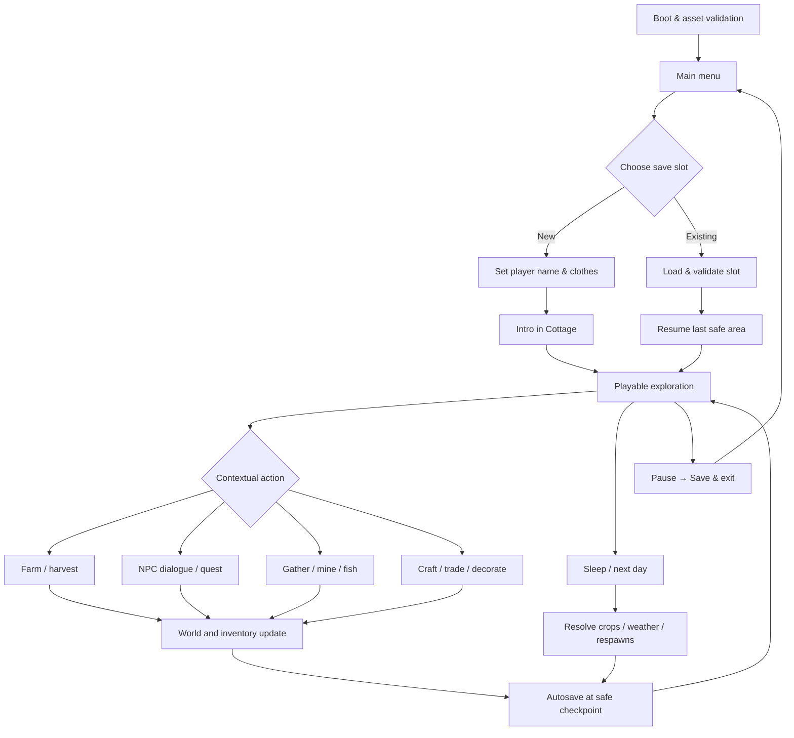

# GAME BLUEPRINT — LEMBAH RIMBUN

> **Dokumen:** Game Design Document (GDD) + Technical Design Document (TDD) + Production Plan  
> **Versi:** 1.0 — 17 Oktober 2026  
> **Status:** Blueprint implementasi, belum merupakan game yang telah dikembangkan/diuji  
> **Target pembangunan:** Gemini 4 Argon melalui Gemini Web Canvas  
> **Prioritas:** *Polished playable vertical slice*, bukan game penuh  
> **Bahasa spesifikasi:** Indonesia; nama variabel, kode, ID data: Inggris

---

## Keputusan desain utama (ringkasan eksekutif)

**Judul kerja:** **Seasons of Home** *(orisinal; dapat diganti tanpa memengaruhi arsitektur).*  
**Premis:** Pemain mewarisi kebun kecil di pinggir Desa Rimbun yang nyaris terlupakan. Dengan bertani, mengenal warga, merawat seekor hewan sahabat, dan memulihkan kegiatan komunitas, pemain secara bertahap menghidupkan kembali festival panen desa. Tidak ada pertarungan, tekanan kompetitif, monetisasi, ataupun mekanik menghukum yang agresif. Konflik hadir lewat penemuan cerita, kebutuhan warga, dan pilihan investasi waktu/sumber daya.

**Pilar pengalaman:** (1) ritme hidup nyaman; (2) tindakan sederhana yang punya akibat terlihat; (3) eksplorasi isometrik yang indah dan terbaca; (4) hubungan sosial hangat; (5) kerajinan tangan dan visual yang spesifik, bukan ornamen generik; (6) progres dapat disimpan dan dilanjutkan.

**Keputusan teknologi:** **Phaser 3.88.2 (pin versi yang sudah terverifikasi)**, JavaScript ES modules, HTML5 Canvas/WebGL 2D, prosedural pixel art melalui `CanvasRenderingContext2D` yang dirasterisasi menjadi tekstur sprite Phaser, CSS khusus untuk shell/menu aksesibel, dan **IndexedDB** untuk tiga save slot. Three.js **tidak** diperlukan. Phaser menyediakan dukungan tilemap isometrik, tetapi karena seluruh aset dibuat secara prosedural dan map berskala kecil, implementasi awal memakai proyeksi isometrik mandiri dengan scene graph Phaser, lalu dapat beralih ke tilemap native setelah hasil proof-of-concept benar. Hindari dependensi pada API Phaser yang belum diuji di Canvas.

**Scope guardrail:** 12 sistem pilihan pengguna tetap tercakup dalam roadmap, tetapi **hanya 5 loop inti dikerjakan mendalam** pada vertical slice: bergerak/menjelajah, farming, NPC+quest, crafting+ekonomi, dan save/load. Sistem lainnya diperkenalkan sebagai **irisan tipis yang dapat dimainkan** secara berurutan setelah fondasi stabil, bukan 12 sistem dangkal yang saling tidak berfungsi.

**Syarat kemenangan vertical slice:** Dalam satu sesi 15–25 menit, pemain mampu membuka save, bergerak ke kebun, menanam dan memanen, berbicara dengan warga, menyelesaikan quest festival, mengumpulkan bahan di hutan/tambang, membuat item, menjual hasil, bermain satu aktivitas santai pilihan, dan me-load save dengan progres utuh. Semua harus nyaman di desktop dan touchscreen.

---

# 1. OVERVIEW

## 1.1 Identitas game

| Aspek | Ketetapan |
|---|---|
| Genre | Cozy Farming RPG + Life Simulation + Light Exploration |
| Subgenre | Narrative sandbox, non-combat, relationship-driven |
| View | 2D isometric pixel art, kamera ortografis semu melalui proyeksi tile |
| Platform | Browser desktop & mobile modern, input keyboard/mouse/touch |
| Mode | Single-player, offline-first setelah berkas/aplikasi berhasil dimuat |
| Game length target | Vertical slice 15–25 menit; dunia data-driven untuk ekspansi |
| Mood | Hangat, rural, handcrafted, meditatif; tanpa kesan plastik/glossy/glowing |
| Audience | Pemain kasual dan penggemar life-sim; usia umum |
| Monetisasi | Tidak ada dalam scope |
| Bahasa awal | Bahasa Indonesia untuk cerita/UI; architecture siap i18n |
| Save | Tiga slot, autosave + manual save, lokal perangkat/peramban |

## 1.2 Fantasy, premise & *core emotional promise*

> “Sehari yang kecil tetap berarti.”

Pemain merasakan bahwa menyiram satu tanaman, berbagi masakan dengan tetangga, menemukan batu mineral, atau mengajak hewan berjalan membentuk perubahan visual dan sosial pada lingkungan. Dunia tidak menghukum pemain karena bermain pelan. Aktivitas dapat dilakukan dalam urutan bebas, dengan satu rangkaian quest utama sebagai arah yang ringan.

**Pembeda dari Stardew Valley:** identitas desa berbukit tropis-hangat, arsitektur rumah kayu-batu, pola ladang terasering kecil, tanaman dan tumbuhan fiktif bernuansa lokal, festival "Malam Lentera Panen" yang sederhana tanpa efek cahaya berlebihan. **Jangan menyalin** karakter, map, UI, dialog, melodi, sprite, mekanik angka, atau aset dagang dari judul referensi.

## 1.3 High-level gameplay loop

`Bangun di rumah → cek cuaca & rencana hari → rawat kebun → jelajahi desa/hutan/tambang → temui NPC dan kumpulkan material → crafting/cooking/fishing/decorating → jual/beli/selesaikan quest → pulang/istirahat → waktu maju & progres tersimpan`.

Loop mikro: `lihat affordance → dekati → interaksi/aksi → feedback audio-visual → state berubah → UI dan dunia konsisten → dapat disimpan`.

## 1.4 Dunia dan wilayah

| Area | Fungsi | Konten pada vertical slice |
|---|---|---|
| **Pondok & Kebun** | Home base; farming, crafting, dekorasi, companion | Rumah luar+dalam, 12 plot, 1 pet, 1 crafting bench, 3 objek dekorasi |
| **Desa Rimbun** | Sosialisasi, ekonomi, quest | Alun-alun, kios Nara, 3 NPC berbicara, papan permintaan, papan festival |
| **Hutan Lumut** | Foraging, gathering, penemuan cerita | 5 titik kumpul, 1 batang penghalang non-combat yang bisa dibersihkan, jalan setapak |
| **Tambang Batu Embun** | Mining santai | 6 batu mineral, 2 jenis ore, drop deterministik, tanpa musuh |
| **Kolam Nila** | Fishing minigame | 1 fishing spot yang terhubung ke rute desa; 2 jenis ikan |

Peta boleh tersambung dengan portal antarzona yang memiliki fade **solid-color singkat** (bukan gradient/glow); ukuran area kecil agar bisa dipoles. Interior rumah adalah scene/sub-area tersendiri.

## 1.5 Karakter dan arah cerita

- **Pemain:** tanpa opsi gender yang membatasi; pilihan nama dan satu dari 3 variasi warna pakaian; sprite isometrik konsisten.
- **Nara:** pengelola kios; orientasi ekonomi & bibit, dialog ringan, hubungan sosial.
- **Bima:** pengrajin desa; crafting/upgrade, quest alat festival.
- **Suri:** penjaga kebun komunitas; farming, pengantar narasi festival.
- **Kiko:** pet kecil mirip musang/kucing hutan imajiner; mengikuti pemain, memiliki status `follow/rest`, reaksi saat dielus; tidak membantu bertarung.

**Quest cerita utama, tiga beat:**
1. **Benih Pertama** — tanam, siram, dan panen hasil pertama; ajarkan sistem kebun.
2. **Tangan untuk Desa** — berikan bahan hasil gathering ke Bima, buat satu perlengkapan festival; ajarkan crafting dan sosial.
3. **Lentera untuk Semua** — sumbangkan hasil/makanan dan aktifkan area festival kecil; perubahan dekor lingkungan permanen, cutscene pendek yang dapat dilewati.

Keputusan pemain tentang urutan aktivitas tetap bebas; quest tidak memiliki tenggat yang menyebabkan gagal total.

## 1.6 Prinsip tidak dilakukan (non-goals)

Tidak ada combat, multiplayer, backend/account/cloud sync, microtransactions, algoritme cuaca realistis, pathfinding kompleks seluruh dunia, ratusan jenis tanaman, procedural infinite terrain, AI NPC berbasis API, voice/chat online, maupun simulasi ekonomi kompleks dalam versi pertama.

---

# 2. REQUIREMENT

## 2.1 Functional requirements (FR)

| ID | Wajib dapat dilakukan | Prioritas | Bukti keberhasilan |
|---|---|---|---|
| FR-01 | Start, resume, pilih 1 dari 3 slot, buat/hapus slot dengan konfirmasi | P0 | Slot baru/loading tidak saling menimpa |
| FR-02 | Bergerak 8 arah dan menabrak solid obstacle dengan benar | P0 | Tidak menembus bangunan, pohon, pagar |
| FR-03 | Berinteraksi melalui proximity + tombol tunggal | P0 | Hanya target paling relevan dipilih |
| FR-04 | Menyiapkan tanah, menanam, menyiram, merawat, memanen | P0 | State pertumbuhan valid dan persistent |
| FR-05 | Transisi Pondok ↔ Desa ↔ Hutan ↔ Tambang; kolam jadi titik interaksi | P0 | Zona aktif, spawn point, dan kamera tepat |
| FR-06 | Inventory stack, kapasitas, pickup, pemakaian/penjualan | P0 | Tidak ada duplikasi/hilang item |
| FR-07 | Dialog bercabang ringan; NPC relationship dan quest flags | P0 | Dialog responsif terhadap state |
| FR-08 | Crafting bench dan pembelian/penjualan melalui kios | P0 | Resep memerlukan material dan transaksi atomic |
| FR-09 | Save/load konsisten lintas 3 slot; autosave aman | P0 | Uji reload browser lulus |
| FR-10 | Adaptasi desktop/touch dan UI terbaca | P0 | Seluruh loop utama dapat dimainkan di touch |
| FR-11 | Siang/malam, cuaca, musim; perubahan visual & gameplay ringan | P1 | Time advance benar; cuaca memodifikasi penyiraman |
| FR-12 | Pet follow/rest, petting, relationship sederhana | P1 | Pet bergerak benar tanpa clipping fatal |
| FR-13 | Mining/foraging dengan respawn harian | P1 | Item, node state, reset harian konsisten |
| FR-14 | Fishing minigame sederhana | P1 | Bisa menang/kalah tanpa softlock |
| FR-15 | Cooking dan alchemy dengan masing-masing minimal 1 resep | P1 | Stasiun aktif, hasil masuk inventory |
| FR-16 | Dekorasi interior dengan 3 objek ditempatkan di snap grid | P1 | Layout tersimpan/restored |
| FR-17 | Festival musiman kecil yang dipicu quest/kalender | P1 | Event, penanda hadiah, world state bertahan |
| FR-18 | Settings audio, pause, accessibility, cara bermain | P1 | Preferensi tidak hilang setelah reload |
| FR-19 | Ekspor/impor save sebagai JSON dengan validasi | P2 | Diusulkan untuk ekspansi, tidak wajib v1 |

P0 = *blocking vertical slice*; P1 = *thin vertical feature after P0 stable*; P2 = roadmap. Bukan janji bahwa semua P1 hadir di implementasi awal satu prompt.

## 2.2 Non-functional requirements (NFR)

| ID | Target desain & pengukuran |
|---|---|
| NFR-01 | Render bertarget 60 FPS desktop dan 30–60 FPS mobile menengah; target terukur, bukan klaim capaian |
| NFR-02 | Hindari update node dunia di luar viewport; frame time budgeting desktop ~16,7 ms untuk 60 FPS, mobile ~33,3 ms untuk 30 FPS |
| NFR-03 | 2D pixel art nearest-neighbor tanpa blur tekstur; UI CSS dapat tetap tajam di resolusi CSS normal |
| NFR-04 | Internal baseline scene 960×540 CSS-like game units **dengan skala kamera terkontrol**; orientasi mobile boleh memotong ulang area kamera, bukan stretch rasio |
| NFR-05 | Input tidak boleh menyebabkan scroll halaman, zoom gesture tak disengaja saat di area game, atau ghost click |
| NFR-06 | Tidak ada fetch aset eksternal runtime selain dependensi engine yang diperlukan untuk bootstrap; jika CDN gagal beri pesan & recovery |
| NFR-07 | Tidak mengumpulkan personal data; save lokal, privacy notice singkat; storage browsing incognito bisa sementara |
| NFR-08 | Save versioned, tervalidasi, atomic transaction, dan kegagalan storage dijelaskan ke pemain |
| NFR-09 | Hindari kombinasi rendah kontras, teks pixel mungil, state hanya diindikasikan warna; opsi reduced motion |
| NFR-10 | Kode modular, deterministic world RNG, batas update yang eksplisit, audit console error nol pada happy path |

**Performance budgets indikatif**, harus diprofilkan pada browser sasaran: peta aktif ≤ 64×64 tile, objek aktif tersortir ≲ 250, NPC aktif ≤ 6, animasi partikel aktif ≤ 40, procedural texture generation maksimal sekali per key/variant (bukan setiap frame), save payload sasaran < 500 KB/slot. Angka ini target awal, bukan batas engine absolut.

## 2.3 Kompatibilitas dan validasi Gemini Canvas

1. Sasaran prototipe: dapat dipreview lewat **Gemini Canvas** yang mendukung pembuatan/editing/pratinjau aplikasi web; namun lingkungan preview bisa membatasi import, paket, asset fetch, IndexedDB, atau penyimpanan antar-sesi. **Jangan mengasumsikan** semua API/fitur tersedia tanpa pengujian.
2. Mulai dari *spike* kecil: Bootstrap HTML + Phaser, render 1 objek, input keyboard/touch, create canvas texture, simpan satu record IndexedDB, reload. Catat hasil lulus/gagal sebelum implementasi game.
3. Jika preview tidak mendukung ES modules atau CDN engine, gunakan bundel yang kompatibel atau jalankan versi standalone di hosting statis; **jangan mengganti engine secara diam-diam**.
4. Jika IndexedDB diblokir di preview, gunakan memory demo **dengan banner jelas "Progres hanya sesi ini"**; localStorage fallback hanya untuk data kecil dengan validasi dan quota checks. Tidak mengklaim progres persisten apabila belum diuji.
5. Minta Gemini menghasilkan file terpisah bila Canvas mendukung; jika hanya satu dokumen dapat dipreview, buat artefak *single-file bootstrap* terlebih dahulu lalu refactor ke modul; hindari file monolit permanen.

## 2.4 Definition of Done (DoD)

Fitur dianggap selesai hanya jika: bisa diakses pemain; memiliki feedback visual/audio (audio opsional ketika browser menolak autoplay); bekerja dengan mouse+keyboard dan touch; tidak menyebabkan error saat cancel/pause/resume; state valid sesudah save/load; responsif pada 3 rasio layar; dan minimal satu test manual/otomatis sesuai AC. **Ilustrasi tanpa aksi yang berfungsi bukan fitur.**

---

# 3. CORE FEATURE

## 3.1 Loop inti, prioritas, dan vertical slice inventory

**Deep / P0:** navigation & interaction; farming; NPC/dialog & quest; crafting & shop; save state.  
**Thin-but-real / P1:** seasons/weather; pet; mining/gathering; fishing; cooking/alchemy; home decoration; seasonal festival.

### A. Sistem farming

- Grid kebun: 12 slot interaktif (3×4), tanpa rotasi perspektif palsu; setiap plot punya `soilState` (`grass|tilled|watered`), `cropId|null`, `growthStage`, `plantedDay`, `wateredOnDay`.
- Peralatan: tangan (interact), hoe, watering can, seed bag, harvest mode via contextual action; dalam P0 gunakan satu tombol konteks untuk mengurangi UI/kompleksitas dan 4 item hotbar opsional.
- Tanaman awal: `sunroot` (2 hari), `mossberry` (3 hari), `goldenleaf` (4 hari); angka sementara yang harus diuji agar 15–25 menit tetap mencakup panen menggunakan *sleep to next day*.
- Growth: ketika hari maju dan syarat air pada hari sebelumnya terpenuhi, stage naik; hujan menghitung sebagai penyiraman; musim membatasi benih tertentu, tetapi tanaman pertama valid pada musim awal.
- Penanda tahap visual minimal `seed → sprout → leaf → mature`, semua sprite unik dan siluet terbaca pada ukuran target.
- Aksi gagal tidak menghapus item; panen saat kapasitas penuh memberi peringatan dan tidak menghilangkan hasil.
- Onboarding: 3 plot awal dipersiapkan/1 bibit tersedia agar momen sukses cepat tanpa menghilangkan mekanik.

### B. Eksplorasi dan interaksi dunia

- Isometric free movement 8 arah di atas navigation grid, 4 frame/arah yang simetris/mirrored hanya jika visual tetap konsisten.
- Interaksi radius basis tile `≤1.15 tile`; pilih target terdekat dalam world coordinates dengan prioritas `active quest > contextual node > NPC > decor` bila jarak setara.
- Collision memakai 2D nav grid/polygon sederhana; jangan menggunakan physics engine berat jika tidak diperlukan. Pilar/pohon tetap solid, rumpun daun bisa overlap atas pemain.
- Kamera mengikuti dengan lerp eksponensial dan clamp batas zona, tidak bergoyang berlebihan.
- Transition di area portal; simpan lokasi aman terakhir; jangan spawn di tile solid.
- Interaksi tidak boleh mengubah state dua kali akibat key repeat atau sentuhan ganda.

### C. NPC + relationship

- Tiga NPC: Nara, Bima, Suri dengan `friendship` 0–100, tahap hubungan 0/1/2, dialog berdasarkan quest progress dan kondisi waktu.
- Dialog pendek 1–3 kotak per percakapan; maksimal tiga pilihan yang jelas; `talkedToday` mencegah farming poin berulang tanpa batas.
- Gain per interaksi: sapaan harian +2, bantuan quest +8, hadiah relevan +5 (semua values config).
- NPC memiliki jadwal sederhana di node lokasi yang ditentukan; tidak ada pathfinding kompleks antarzona. Ketika NPC pindah lokasi saat tak terlihat, posisi di-update deterministik.

### D. Quest & storyline

- Quest menggunakan finite state machine: `locked → available → active → completed → rewarded` dengan objective JSON data-driven.
- Objective `plant/harvest/collect/craft/deliver/talk/activate`; progress event-driven; grant reward **tepat sekali** menggunakan idempotency marker.
- UI quest journal menampilkan 1 quest utama + hingga 2 tugas opsional; pin arah tidak berbentuk panah besar generik mengotori permainan, cukup label zona/minimap sederhana.
- Semua NPC tetap punya dialog sosial saat quest selesai; dialog tidak kosong.

### E. Crafting + upgrade

- Satu crafting bench, 3 resep awal: `wooden_planter` (wood + stone), `lantern_frame` (wood + ore), `watering_can_upgrade` (ore + coins).
- Preview bahan tersedia vs diperlukan; output bisa dibuat hanya jika valid; mutasi input/output dilakukan dalam satu transaksi state.
- Upgrade meningkatkan capacity watering can dari 5 ke 8 penyiraman; tidak memerlukan item art baru bila icon state jelas.

### F. Ekonomi dan perdagangan

- Uang awal 80 `leafcoins`; harga ditentukan tabel tetap, tidak ada random price exploit.
- Kios Nara menjual 3 bibit dan membeli crop/fish/foraging; input quantity punya max berdasarkan stock/inventory.
- Jual item ditandai `sellable`, quest-critical item punya proteksi tidak dapat dijual kecuali memang diperbolehkan.
- UI transaksi memberi pesan jumlah dan perubahan saldo.

### G. Waktu, cuaca, musim

- 1 hari game = 10 menit waktu bermain aktif; jam dibekukan saat dialog, inventory, crafting, dan menu besar terbuka.
- Waktu pagi mulai 06:00, malam mulai 18:00; tidur di rumah melompat ke hari berikutnya dan menjalankan sistem growth/restock/forage reset.
- 4 musim, masing-masing 7 hari game untuk skala prototipe (konfigurabel); starting season Spring Day 1. **Pada vertical slice cukup satu musim aktif dengan dukungan pergantian data-driven dan debug time-skip** agar fitur musiman dapat diuji; jangan menjanjikan konten penuh 28 hari.
- Weather seeded deterministic per hari: `clear | cloudy | rain` (mis. peluang 55/25/20%; tuning); rain menyiram plot otomatis tanpa partikel berat; suasana berubah lewat palet, pola raindrop diskrit, dan ambience.
- Perubahan siang/malam: **tidak menggunakan gradient full-screen**; lakukan palet swap bertahap dan overlay flat-color transparan yang halus, tanpa glow/bloom.

### H. Pet companion

- Kiko mengikuti posisi sebelumnya dengan *follow offset*, path paling sederhana menggunakan breadcrumb sample dengan fixed interval. Teleport recover jika tersangkut dan jauh di luar layar.
- Status `following`, `resting`, `petting`; petting sekali per hari memberi affection; sprite idle/walk/fidget; tidak melakukan hal yang meniru hewan nyata secara tidak pantas.

### I. Mining + gathering

- Tambang memiliki 6 node, resource batu dan ore, membutuhkan aksi beberapa kali **tanpa** bar energi keras yang menghukum.
- Hutan memiliki jamur, serat, wood; node respawn pada pergantian hari jika telah dipanen.
- Mining memberikan umpan balik sprite `intact/cracked/depleted`, audio ringan opsional, dan item pickup text singkat tanpa fireworks.

### J. Fishing

- Pemain berinteraksi dengan 1 spot air; minigame `tahan/lepas` sederhana dengan progress capture bar, bukan physics rumit; hasil `riverfish` atau `silverfin` seeded.
- Mobile menggunakan tombol besar, desktop menahan Space; fail tidak menghilangkan pancing, cooldown singkat; disabled jika sedang membuka overlay.

### K. Cooking + alchemy

- Dapur rumah: 2 resep (`herb_soup`, `berry_pie`), mengubah bahan menjadi consumable buff ringan/quest donation.
- Meja alkimia: 1 resep (`dew_tonic`) dari herbs + ore; tidak ada efek magis neon; UI memakai botol tanah liat dan perubahan icon status.
- Bahan punya IDs stabil, hasil tersimpan dengan stack dan metadata seperlunya.

### L. Dekorasi rumah

- Interior rumah dengan grid snap sederhana; 3 props (`rug`, `plant_pot`, `small_shelf`), bisa place/move/pick-up selama bukan collision area penting.
- Preview placement semi-transparan **flat alpha**, hijau/tanah kurasi ketika valid, terakota saat invalid; tidak menggunakan gradient/glow.
- Penempatan divalidasi terhadap furnitur lain, doorway, dan zona interaksi.

### M. Festival dan event musiman

- `harvest_lantern_night` di plaza desa, **satu versi demo**: aktif setelah quest ke-3 dan pada malam yang diizinkan; banner UI menyebut jadwal ulang jika diperlukan.
- Saat event: dekor banner/lantern statis yang artistik, 3 NPC berkumpul, 1 dialog singkat/bonus item, perubahan flag persisted.
- Tidak menyalin festival Stardew Valley. Siklus event lain hanya hook data untuk roadmap.

## 3.2 Content matrix vertical slice

| Konten | Kuantitas awal | Kualitas minimum |
|---|---:|---|
| Zone | 4 luar + 1 interior; kolam di salah satu zona | Navigable, collisions tepat, komposisi jelas |
| NPC | 3 | 2 mood animasi, dialog contextual |
| Pet | 1 | Follow, idle, petting |
| Tanaman | 3 | 4 fase visual masing-masing |
| Resource node | 11 | State depletion + respawn |
| Quest utama | 3 beat | Bisa diselesaikan tanpa dead end |
| Resep crafting | 3 | Transactional ingredients |
| Resep cooking/alchemy | 3 total | Stasiun bekerja |
| Fishing | 1 spot/2 ikan | Minigame menyenangkan |
| Home props | 3 | Bisa tempatkan dan simpan |
| Festival | 1 | Trigger, dialog, reward |
| Save slots | 3 | Isolasi state, reload, delete confirmation |

---

# 4. USER FLOW

## 4.1 Main player journey



## 4.2 Pembukaan 5 menit pertama

1. **00:00–00:30**: title screen handcrafted; New Game / Continue / Settings. Mulai dari slot 1 dan pilih nama.
2. **00:30–01:00**: pemain di depan Pondok; satu pop-up arah gerak yang menghilang setelah input pertama.
3. **01:00–02:00**: Suri mengarahkan 1 petak; tutorial *diegetic* memakai cangkul/benih/air.
4. **02:00–03:00**: pemain menanam; journal menandai progress, NPC mengajak ke desa.
5. **03:00–05:00**: bertemu Nara dan Bima, membuka kios/crafting; pemain dapat memilih lanjut eksplorasi atau istirahat untuk panen.

UI tidak menumpuk teks tutorial; gunakan maksimal satu instruksi kontekstual pada saat yang sama dan opsi Help permanen.

## 4.3 Flow khusus desktop & mobile

**Desktop:** WASD/arrow keys untuk gerak; `E` interaksi; `Space` aksi fishing; `1–4` hotbar; `J` journal; `I` inventory; `Esc` pause; mouse klik tombol UI dan opsi dialog. Mencegah scroll saat tombol relevan aktif pada game canvas.

**Mobile:** D-pad virtual kiri bawah atau joystick diskrit; satu tombol Aksi kanan bawah, tombol Menu dan Journal di pojok aman; drag gesture tidak menyebabkan scroll page di area game; target kontrol sentuh ideal ≥44 CSS px; UI mengikuti safe-area insets; layar portrait menampilkan kamera lebih sempit dengan HUD vertikal, tidak memperkecil font hingga sulit dibaca. Pause otomatis saat `visibilitychange` dan hindari mengasumsikan audio autoplay.

**User flows penting:**
- **Inventory penuh:** tindakan diblokir dengan feedback, dunia tidak kehilangan item.
- **Save error:** tampilkan status *unsaved*, tawarkan Retry; jangan menutup menu sambil menyatakan berhasil.
- **Scene transition saat interaksi:** debouncing, simpan state sebelum pindah, target dibatalkan.
- **Cancel dialog atau shop:** tidak mengurangi item/uang; UI kembali ke game dalam keadaan input stabil.
- **Delete save:** dialog konfirmasi menyebut slot/nama, satu tombol berbahaya dengan deskripsi jelas.

## 4.4 Scene states & overlay hierarchy

`BOOT → PRELOAD → TITLE → SLOT_SELECT → CHARACTER_SETUP → GAMEPLAY_ZONE`.

Overlay saat gameplay (satu modal aktif): `DIALOGUE | INVENTORY | JOURNAL | SHOP | CRAFTING | COOKING | ALCHEMY | DECORATING | FISHING | PAUSE`; HUD non-modal: `TIME_WEATHER | GOLD | CONTEXT_ACTION | QUEST_HINT | HOTBAR`. Overlay membuat world time pause; tutup saat transisi zona untuk menghindari input tertinggal.

---

# 5. ARCHITECTURE

## 5.1 Keputusan stack dan alasan

- **Phaser 3.88.2, disematkan versi eksplisit:** mature untuk permainan 2D berbasis browser, animasi, input, kamera, scene, WebGL/Canvas. API tilemap mendukung orientasi isometrik; untuk generasi tekstur prosedural kita bisa mulai dari custom isometric renderer berbasiskan sprite/graphics daripada mewajibkan Tiled.
- **JavaScript ES modules:** lebih ringan untuk iterasi Gemini Canvas daripada pipeline TypeScript kompleks. Boleh upgrade TypeScript bila toolchain nyata mendukung.
- **Native browser Canvas2D sebagai authoring surface:** menggambar sprite deterministik ke offscreen canvas, lalu memanggil Phaser textures manager dengan cache key; efeknya tetap render Phaser WebGL/Canvas.
- **CSS UI tersuai:** main menu, slots, dialog, panels, tooltip dibuat dengan tokens/stylesheet, bukan HTML default. Opsi memakai Phaser UI untuk overlay game; keyboard focus & aksesibilitas lebih mudah di DOM shell yang dirancang.
- **IndexedDB:** satu database, satu store save records dan metadata; localStorage khusus setting kecil, dengan pengecekan quota/availability; `structuredClone` optional, data serializable plain JSON.
- **No backend:** semua save lokal; jangan membuat klaim sinkron antarperangkat.

## 5.2 Proposed project tree

```text
lembah-rimbun/
├── index.html
├── package.json                  # optional bila Canvas menyediakan bundler
├── src/
│   ├── main.js                   # bootstrap, config, capability checks
│   ├── styles/
│   │   ├── tokens.css
│   │   └── ui.css
│   ├── config/
│   │   ├── balance.js             # recipes, day-length, economy
│   │   ├── palette.js
│   │   └── constants.js
│   ├── scenes/
│   │   ├── BootScene.js
│   │   ├── TitleScene.js
│   │   ├── GameScene.js
│   │   └── UIScene.js
│   ├── world/
│   │   ├── isoMath.js
│   │   ├── zoneDefinitions.js
│   │   ├── navGrid.js
│   │   ├── IsoWorldRenderer.js
│   │   ├── DepthSorter.js
│   │   └── WorldClock.js
│   ├── graphics/
│   │   ├── proceduralSpriteFactory.js
│   │   ├── terrainPatterns.js
│   │   ├── buildingSprites.js
│   │   ├── characterSprites.js
│   │   ├── vegetationSprites.js
│   │   └── spriteCache.js
│   ├── entities/
│   │   ├── Player.js
│   │   ├── NPC.js
│   │   ├── Pet.js
│   │   ├── ResourceNode.js
│   │   └── FarmPlot.js
│   ├── systems/
│   │   ├── InteractionSystem.js
│   │   ├── MovementSystem.js
│   │   ├── FarmingSystem.js
│   │   ├── InventorySystem.js
│   │   ├── QuestSystem.js
│   │   ├── DialogueSystem.js
│   │   ├── RelationshipSystem.js
│   │   ├── CraftingSystem.js
│   │   ├── EconomySystem.js
│   │   ├── FishingSystem.js
│   │   ├── WeatherSeasonSystem.js
│   │   └── DecorationSystem.js
│   ├── data/
│   │   ├── items.js
│   │   ├── crops.js
│   │   ├── npcDialogue.js
│   │   ├── quests.js
│   │   ├── recipes.js
│   │   └── events.js
│   ├── persistence/
│   │   ├── SaveRepository.js
│   │   ├── SaveSerializer.js
│   │   └── migrations.js
│   ├── input/
│   │   ├── InputRouter.js
│   │   ├── DesktopInput.js
│   │   └── TouchControls.js
│   ├── ui/
│   │   ├── MenuController.js
│   │   ├── DialoguePanel.js
│   │   └── HUDController.js
│   └── utils/
│       ├── rng.js
│       ├── math.js
│       ├── asserts.js
│       └── EventBus.js
└── tests/
    ├── isoMath.test.js
    ├── inventory.test.js
    ├── quests.test.js
    ├── save-roundtrip.test.js
    └── manual-checklist.md
```

Jika lingkungan Canvas hanya menyediakan satu file, buat **single-file proof-of-concept** yang mempertahankan batas modul secara logis (`const Graphics = ...`, `const Farm = ...`) lalu ekstraksi ke tree di atas segera setelah bootstrap berhasil. **Tidak boleh mengirim `index.html` sangat panjang yang hanya menampilkan dekor statis dan mengklaim semua fitur sudah ada.**

## 5.3 Isometric projection specification

- World space disimpan sebagai grid `tileX`, `tileY` dan fractional offset bagi movement; **jangan simpan posisi layar sebagai sumber kebenaran**.
- Sprite tile ukuran output `tileW = 64`, `tileH = 32` pada resolusi internal; posisi sprite prop dihitung relatif ke pivot/tapak kaki.

```js
const TILE_W = 64;
const TILE_H = 32;

function tileToScreen(tx, ty, originX = 0, originY = 0) {
  return {
    x: originX + (tx - ty) * TILE_W / 2,
    y: originY + (tx + ty) * TILE_H / 2,
  };
}

function screenToTile(sx, sy, originX = 0, originY = 0) {
  const x = (sx - originX) / (TILE_W / 2);
  const y = (sy - originY) / (TILE_H / 2);
  return { tx: (x + y) / 2, ty: (y - x) / 2 };
}
```

Aturan: kameranya dihitung setelah proyeksi, `screenToTile` memperhitungkan camera `scroll`, `zoom`, dan viewport; hit test klik menggunakan inverse transform yang divalidasi dengan unit test. Bila memakai Phaser built-in isometric tilemap sebagai pengganti, **pakai helper native yang konsisten, jangan campur konvensi origin secara sembarang**.

**Depth/occlusion:** render ground terlebih dahulu, lalu entities/props dengan key berdasarkan **screen-space foot y**, bukan top-left bounding box. Untuk objek tinggi (bangunan/pohon), pisahkan komponen `base/trunk` sebagai obstacle dan `upper/canopy/roof` sebagai foreground yang dapat menutup pemain setelah depth sort. Tidak cukup satu setDepth hardcoded untuk semua roof. Interior memakai metadata `occluderGroup` dan doorway. Decorative z-offset hanya untuk penampilan, bukan collision.

## 5.4 Procedural pixel-art pipeline (critical)

**Pilar teknis:** Semua aset tetap dibuat oleh kode, tetapi **bukan** hanya primitive rectangle acak di runtime. Buat *authoring functions* deterministik berlapis pada grid pixel rendah, rasterkan sekali ke spritesheet/texture atlas, lalu animasikan frame secara eksplisit.

1. Definisikan tiap aset melalui **silhouette template** (mis. kepala, tubuh, kaki, topi, bayangan kontak) dalam koordinat piksel logis.
2. Layer render `shadow → main mass → outline selective → texture clusters → accents → details`; 4–8 komponen bermakna adalah target visual desain untuk entitas kompleks 2D, **bukan** tuntutan THREE meshes.
3. Pakai kelompok piksel/cluster yang disengaja, tidak menyebarkan dithering/noise acak merata; kontur tangga pixel rapi, shadow tidak di semua sisi, aksen berdasarkan fungsi.
4. Buat variasi `variantSeed` deterministik untuk tanaman/pohon, pilih dari 2–3 bentuk siluet; beda karakter harus nyata dalam bentuk, bukan recolor saja.
5. Sprite animasi dibuat sebagai atlas frame kecil: player 4 arah tampak utama + mirror yang terkontrol, frame idle minimal 2, walk 4; interaksi 3, watering 4, NPC idle 2, pet walk 4. Untuk 8 arah input, animasi bisa memetakan ke 4 arah visual pada slice sambil tetap gerakan diagonal akurat.
6. Simpan hasil sprite `createCanvas`/`addCanvas` atau API tekstur Phaser sesuai versi yang di-pin; **test di bootstrap** sebelum mengandalkannya. Selalu nearest-neighbor, disable smoothing, tidak scale pada fractional factor yang menimbulkan shimmer.
7. Gunakan cache berdasarkan key: `kind:variant:pose:direction:frame:palette`; **tidak** memanggil drawing procedural setiap `update()`.
8. Animasi weather sebagai frame/pola diskrit; hindari blur, gaussian shader, glow, bloom, dan full-screen gradient.

### Silhouette-level visual acceptance

- Player mudah dibedakan dari NPC pada zoom default; kepala/tangan/kaki terbaca setidaknya pada ukuran tampilan mobile.
- Rumah tidak tampak sebagai satu kotak berwarna: terdiri dari pondasi, dinding, atap berlapis, pintu/jendela, bayangan bawah, detail kayu.
- Pohon memiliki batang, cabang implied, kelompok daun besar, 2–3 tingkat nilai warna, bayangan kontak.
- Perbedaan tahap tanaman tetap terlihat **dalam grayscale**: bentuk lebih tinggi/lebih lebar/ada buah, tidak hanya mengubah hue.
- Batu tambang memiliki kontur asimetris yang konsisten, cluster shadow, highlight datar dan retakan berbeda per state.

## 5.5 Palet visual kurasi (anti-ai-slop)

| Peran | Hex | Penggunaan |
|---|---|---|
| Deep pine | `#304B43` | Outline terbatas, pohon shadow, header |
| Moss shade | `#4C6B55` | Dedaunan gelap, struktur semak |
| Sage leaf | `#76936B` | Tanaman, ground, soft accent |
| Dry grass | `#A6AB78` | Rumput terang, padang |
| Warm cream | `#EEE1C4` | Teks panel gelap, highlight lembut |
| Clay brown | `#87674E` | Kayu, tanah, outline hangat |
| Rich soil | `#59483B` | Lahan, depth shading |
| Terracotta | `#BC7654` | Atap, button highlight, perhatian |
| Golden straw | `#D9AE6B` | Panen, sinar hangat solid |
| Stone slate | `#697A77` | Batu, tambang, bayangan dingin |
| Pond blue | `#749C9A` | Air (flat tones + pixel ripple) |
| Night blue | `#354D5C` | Aksen malam tidak neon |
| UI ink | `#2D3835` | Teks gelap |
| UI parchment | `#F2E8D5` | Panel latar & dialog |

**Larangan eksplisit:** `#FF0000`, `#00FF00`, `#0000FF`, `#FFFF00` sebagai warna visual, warna neon jenuh, gradient siap pakai, unmotivated glow, glassmorphism, garis outline hitam seragam dan terlalu tebal, shadow generik yang menempel di setiap komponen. Warna error gunakan terracotta `#B15F50`, success moss `#54765B`, focus outline yang jelas namun bukan neon.

**Visual motifs:** batu tidak beraturan, kisi taman kecil, dedaunan berkelompok, genteng tanah liat, papan kayu sederhana, petak sawah-teras kecil, rangkaian kerajinan. Setiap zona memiliki *composition rhythm* dan negative space yang memberi navigasi, bukan dipenuhi props sampai padat.

## 5.6 Frame-time correctness, game feel, animation

**Jangan pernah memakai `position += konstanta` per frame.** Gunakan `delta` yang dibatasi, gerak dengan kecepatan per detik serta smoothing berbasis exponential decay. Contoh Phaser scene:

```js
function update(time, deltaMs) {
  const dt = Math.min(deltaMs / 1000, 0.1);
  const move = inputRouter.getMovementVector(); // normalisasi diagonal
  const targetVX = move.x * PLAYER_SPEED;
  const targetVY = move.y * PLAYER_SPEED;
  const follow = 1 - Math.exp(-12 * dt);
  player.vx = Phaser.Math.Linear(player.vx, targetVX, follow);
  player.vy = Phaser.Math.Linear(player.vy, targetVY, follow);
  movementSystem.tryMove(player, player.vx * dt, player.vy * dt);
  worldClock.update(dt, uiController.isWorldPaused());
  depthSorter.updateVisible();
}
```

Catatan: `PLAYER_SPEED` didefinisikan dalam unit world/tile per detik; diagonal input dinormalisasi. `tryMove` menyelesaikan collision X/Y dalam **world space** sebelum proyeksi. `Math.min(...,0.1)` menahan lompatan waktu ketika tab kembali; jangan menggandakan pertumbuhan tanaman karena frame spike. *Game calendar* berjalan saat world active, bukan saat dialog/hidden.

- **Animation:** langkah tubuh *bob* maksimum 1–2 logical px, shadow tetap menempel tanah; watering arc sederhana 3–4 frame, pet tail 2–3 frame; frame rate animasi umumnya 6–10 FPS sprite, terpisah dari 60 FPS render.
- **Camera:** smoothing frame-independent; stop precision saat radius kecil untuk hindari jitter.
- **Micro-feedback:** 1-frame tool anticipation, 2–4 frame action, text pickup tidak lebih dari 1 detik; shake sangat kecil hanya saat mining dan bisa dimatikan.
- **Audio:** soft, nonintrusive procedural Web Audio jika diberi izin user gesture; mix master/music/sfx, mute; fallback silent sepenuhnya playable. Jangan klaim ada musik profesional apabila belum dibuat.

## 5.7 Domain state & deterministic event architecture

`InputRouter → Commands → Systems → GameState → Domain Events → UI/Renderer & SaveScheduler`.

Contoh events: `DAY_ADVANCED`, `PLOT_WATERED`, `CROP_HARVESTED`, `ITEM_ACQUIRED`, `ITEM_SPENT`, `NPC_TALKED`, `QUEST_PROGRESS`, `QUEST_REWARDED`, `SCENE_ENTERED`, `FESTIVAL_ACTIVATED`, `SAVE_REQUESTED`. Semua systems membaca state, hanya command handlers memutasi state; mencegah renderer diam-diam mengubah inventory.

**Atomic operations:** `purchase`, `craft`, `deliver`, `harvest` validate first then commit state, emit single event and request save. Tidak melakukan save terpisah di tengah operasi atau berulang tiap frame.

**RNG:** generator PRNG seeded (`worldSeed + gameDay + nodeId`) untuk weather, respawn, fishing; save seed dan RNG state bila diperlukan agar load tidak mengubah outcome yang sudah terjadi.

## 5.8 Input / physics / camera detail

- World movement two-axis collision resolution; navgrid tile blocked/floor flags; dekor yang bisa dilalui (rumput) tidak memasuki collision.
- Interaksi pilih objek berdasarkan jarak ke kaki karakter, bukan pusat sprite tinggi.
- Depth sorter memprioritaskan sprite visible; update key bila gerak memengaruhi y; batching bila perlu.
- `ResizeObserver` / window resize + Phaser Scale manager: integer zoom bila memungkinkan dan letterbox; pada viewport sempit gunakan safe camera bounds dan responsive DOM HUD. Jangan stretch tile isometrik.
- Focus management: jika dialog/shop DOM terbuka, disable input dunia dan restore fokus setelah ditutup.
- **No physics deadlocks:** saat bertemu pet/NPC, soft avoidance atau non-solid collision pet; NPC positioned so quest-giver reachable.

## 5.9 Failure modes & fallback plan

| Risiko | Tanda | Recovery |
|---|---|---|
| CDN Phaser tidak dapat diakses | layar blank/import error | tampilkan error bootstrap, build versi statis/bundled; bukan diam-diam rewrite ke Three.js |
| IndexedDB tidak tersedia | save API throw/security error | status unsaved + fallback session/memory; warning eksplisit |
| Procedural drawing terlalu berat | stutter saat enter zona | cache prewarm beberapa aset, progress preload, reuse texture key |
| Sort depth salah | karakter tampil di depan atap saat seharusnya tertutup | split foreground/roof layer, foot-y sort, golden screenshot tests |
| Collision isometric keliru | terjebak di tepi bangunan | world-space navgrid; debug collision view |
| Mobile tap ganda | quest reward ganda/items hilang | debounced action IDs, transaction guards |
| Save crash di tengah write | corrupted slot | atomic IndexedDB transaction + `lastGoodSnapshot` revision; validasi on load |
| Scope terlalu luas | 12 sistem parsial, tidak playable | prioritaskan P0 dan nonaktifkan menu P1 hingga fungsinya tuntas |

---

# 6. LOCAL STORAGE SCHEMA

## 6.1 Storage architecture

**Database:** `lembah-rimbun-db`; **IDB DB version** `1`. Object stores:

| Store | Primary key | Index | Isi |
|---|---|---|---|
| `saveSlots` | `slotId` (number, 1–3) | `updatedAt` | Complete canonical GameState snapshot + metadata |
| `saveBackups` | compound concept `slotId:revision` string | `slotId`, `createdAt` | Last known good backup (maks 2 per slot) |
| `appMeta` | `key` string | none | Schema flags, migration info, last slot |

**`localStorage` hanya** untuk `lembah-rimbun.settings.v1` (volume, controls, accessibility) jika diizinkan. Alternatif bila `localStorage` tidak tersedia: `appMeta` IndexedDB. Gunakan satu sumber canonical per jenis data, bukan dua yang konflik.

**Transactional save algorithm**:
1. Freeze consistent plain JSON snapshot pada boundary command/scene; sanitize data (no sprite/canvas/Phaser objects/functions).
2. Validate required fields, integer slot range, finite numbers, known IDs, inventory quantities ≥0, uniqueness of world object ids.
3. `revision = previous + 1`; tulis backup last-good lalu save baru **dalam satu IndexedDB readwrite transaction** untuk stores terkait; jaga maksimal dua backups setelah transaksi berhasil.
4. Hanya tampilkan status "Tersimpan" setelah `transaction.oncomplete`, bukan saat request dibuat.
5. On error: state tetap playable, banner unsaved, retry, prevent false-positive.
6. On load: validate schema version, migrate older versions idempotently, fallback backup bila data utama invalid; jangan overwrite backup sebelum user menyetujui recovery.
7. Autosave pada `sleep`, `quest reward`, `transition zone`, `manual save`, dan debounced perubahan penting (contoh 10–20 detik) **bukan setiap update()**; hindari balapan request save menggunakan save queue serial.
8. Menghapus slot: transaksi hapus slot + seluruh backup terkait setelah konfirmasi, tanpa memengaruhi dua slot lain.

## 6.2 Canonical slot JSON example (schemaVersion = 1)

```json
{
  "schemaVersion": 1,
  "slotId": 1,
  "revision": 7,
  "createdAt": "2026-10-17T01:00:00.000Z",
  "updatedAt": "2026-10-17T01:25:00.000Z",
  "meta": {
    "saveName": "Kebun Pertama",
    "playtimeSeconds": 1500,
    "gameVersion": "0.1.0",
    "lastZoneId": "farm"
  },
  "world": {
    "worldSeed": 47021,
    "rngState": 47021,
    "day": 3,
    "season": "spring",
    "year": 1,
    "timeMinutes": 540,
    "weather": "clear",
    "festivalState": { "harvest_lantern_night": "inactive" },
    "zoneStates": {
      "forest": { "collectedNodeIdsToday": ["forest_herb_01"] },
      "mine": { "depletedNodeIdsToday": ["mine_stone_02"] },
      "village": { "decorationsActivated": [] }
    }
  },
  "player": {
    "name": "Ayu",
    "appearanceId": "outfit_sage",
    "zoneId": "farm",
    "position": { "tileX": 5.25, "tileY": 4.5 },
    "facing": "south_east",
    "coins": 92,
    "stamina": 100,
    "maxStamina": 100,
    "toolLevel": { "wateringCan": 1 },
    "hotbar": ["hoe", "watering_can", "sunroot_seed", null]
  },
  "inventory": {
    "capacitySlots": 16,
    "stacks": [
      { "instanceId": "stack_001", "itemId": "sunroot_seed", "quantity": 4 },
      { "instanceId": "stack_002", "itemId": "wood", "quantity": 6 }
    ]
  },
  "farm": {
    "plots": {
      "farm_plot_01": {
        "soilState": "watered",
        "cropId": "sunroot",
        "growthStage": 1,
        "plantedDay": 2,
        "wateredOnDay": 3
      },
      "farm_plot_02": {
        "soilState": "grass",
        "cropId": null,
        "growthStage": 0,
        "plantedDay": null,
        "wateredOnDay": null
      }
    }
  },
  "quests": {
    "main_first_seed": {
      "state": "active",
      "objectives": { "plant_one": 1, "harvest_one": 0 },
      "rewardClaimed": false
    }
  },
  "relationships": {
    "nara": { "friendship": 8, "talkedOnDay": 3 },
    "bima": { "friendship": 4, "talkedOnDay": 2 },
    "suri": { "friendship": 12, "talkedOnDay": 3 }
  },
  "pet": {
    "petId": "kiko",
    "affection": 14,
    "mode": "following",
    "lastPettedDay": 2
  },
  "housing": {
    "placedObjects": [
      { "objectId": "decor_001", "itemId": "plant_pot", "gridX": 2, "gridY": 3, "rotation": 0 }
    ]
  },
  "flags": {
    "introSeen": true,
    "tutorialFarmDone": true,
    "festivalEndingSeen": false
  }
}
```

**Catatan:** `createdAt` dan `updatedAt` adalah contoh ISO timestamp, bukan waktu nyata yang harus dipakai; waktu game berada di `world` dan tidak tergantung jam perangkat. Save harus memiliki semua 12 plot terserialisasi (contoh diringkas menjadi 2), serta quest flags lengkap. `stamina` ada sebagai extensibility; vertical slice tidak boleh membuatnya sebagai punishment loop sebelum balancing.

## 6.3 Static data versus save data

**Static content** (`items`, `recipes`, `crop growth tables`, dialogue, maps, NPC schedule) ada di `src/data` dengan ID immutable; **jangan duplikasi seluruh definisi** ke dalam slot. Yang tersimpan hanya IDs, quantities, state, timestamp/gameDay. Invalid/unknown IDs saat load ditangani migration atau `unknown_item` quarantine, **bukan crash**.

Examples:

```js
export const ITEM_DEFS = {
  sunroot_seed: { category: 'seed', maxStack: 99, buyPrice: 8, sellPrice: 3 },
  sunroot: { category: 'crop', maxStack: 99, sellPrice: 16 },
  wood: { category: 'material', maxStack: 99, sellPrice: 2 },
  riverfish: { category: 'fish', maxStack: 30, sellPrice: 14 },
  lantern_frame: { category: 'quest', maxStack: 1, sellable: false }
};

export const RECIPES = {
  lantern_frame: {
    station: 'crafting_bench',
    inputs: [{ itemId: 'wood', quantity: 3 }, { itemId: 'ore', quantity: 1 }],
    output: { itemId: 'lantern_frame', quantity: 1 }
  }
};
```

## 6.4 Validasi, migrasi, integrity invariants

- `schemaVersion` integer; migrasi berurutan `v1 -> v2` di masa depan, setiap migrasi pure function + tests, *copy-on-migrate* sebelum commit.
- `slotId ∈ {1,2,3}`, `coins >= 0`, semua kuantitas integer positif dan ≤ maxStack, `timeMinutes` dalam rentang 0–1439, `season` enum, `growthStage` sesuai crop stage, inventory instances unique.
- `world.zoneStates` key hanya zone ID terdaftar; map objects dengan UUID stabil; posisi pemain divalidasi nearest walkable tile jika world berubah.
- Rewards: `rewardClaimed === true` tidak bisa diulang; transaction check tidak bisa mengurangi sumber daya di bawah nol.
- Penggantian versi game tidak boleh merusak save; ketidakcocokan versi masa depan ditampilkan sebagai pesan tanpa menghapus slot.
- Kegagalan kuota/perizinan storage harus terlihat dan disertai tindak lanjut; private browsing dapat menghapus data saat sesi berakhir.

## 6.5 Save/load acceptance test matrix

| ID | Skenario | Expected |
|---|---|---|
| SAVE-01 | Slot 1 berubah, Slot 2 tidak | Isolasi 100% |
| SAVE-02 | Panen → autosave → reload | Crop hilang dari plot, item dan uang benar |
| SAVE-03 | Reward quest → reload → ulang trigger | Hadiah tidak digandakan |
| SAVE-04 | Place decor → save → reload | Posisi dekor identik |
| SAVE-05 | Sleep → rainy next day → reload | Growth/weather/day sama |
| SAVE-06 | Invalid snapshot terbaru, backup valid | Pemulihan ditawarkan, tidak overwrite diam-diam |
| SAVE-07 | IndexedDB throw/quota exceeded | Gameplay tetap jalan dan status tidak tersimpan terlihat |
| SAVE-08 | Hapus slot 2, reload | Slot 1 dan Slot 3 utuh |
| SAVE-09 | Save saat perpindahan zona | Spawn benar, tidak softlock |
| SAVE-10 | Simulasi refresh saat write | Tidak ada slot setengah transaksi |

---

# 7. ART DIRECTION & ANTI-AI-SLOP MANIFESTO (ENFORCEABLE)

## 7.1 Pemetaan manifesto awal 3D ke 2D pixel art

| Larangan asli | Implementasi relevan untuk 2D |
|---|---|
| Hex warna primer mentah | **Tetap berlaku penuh**; hanya curated palette section 5.5 |
| Entitas hanya satu `THREE.BoxGeometry` | Three.js tidak digunakan; semua karakter/prop penting **wajib punya silhouette dengan 4–8 elemen visual bermakna**, bukan satu kotak atau placeholder geometris |
| `MeshBasicMaterial` untuk objek utama | Tidak relevan pada render 2D; **gantinya** gunakan shape/value/material readability (kayu, daun, tanah, batu, air) melalui pixel clusters, outline selektif dan pencahayaan baked sederhana; bukan flat satu warna tanpa tekstur yang bermakna |
| `pos.x += 0.1` per frame | **Tetap berlaku secara prinsip**; gunakan `deltaMs` Phaser dibatasi `≤ 0.1 s`, frame-independent movement, damping/interpolation, fixed domain tick bila perlu |
| UI HTML default & gradient AI slop | **Tetap berlaku penuh**; CSS custom, ukuran sentuh, kontras, focus state, panel pixel-art, tanpa gradient & glassmorphism |

## 7.2 Additional hard bans

1. Dilarang menggunakan AI-generated generic stock icons, random emoji sebagai aset game utama, hero card gradient, radial glow, neon aura, holographic UI, glassmorphism, glossy CTA.
2. Dilarang membuat semua pohon identik ukuran/bentuk hanya recolor; harus ada 2–3 siluet bermakna.
3. Dilarang menggunakan noise/dither acak setiap frame (texture crawl) atau particle spam.
4. Dilarang menerapkan anti-aliasing/filter bilinear ke sprites; secara sengaja UI teks boleh memakai font layar yang terbaca.
5. Dilarang menjadikan teks debugging, FPS, hitboxes sebagai bagian desain produksi (boleh lewat mode developer toggle).
6. Dilarang menampilkan tombol nonfunctional, quest palsu, NPC dialog generik berulang, tile tidak clickable padahal disinyalkan interaktif.
7. Dilarang menyalin layout, karakter, tiles, musikalitas, atau UI Stardew Valley. Referensi sebatas genre dan rasa bermain.
8. Dilarang mengklaim mobile support tanpa uji touch pada viewport nyata/simulasi perangkat.
9. Dilarang menyebut persistence berhasil bila browser preview memblokir penyimpanan.
10. Dilarang membangun semua sistem P1 sebelum P0 end-to-end dapat dimainkan.

## 7.3 Visual quality gates

| Gate | Lulus jika |
|---|---|
| Palette compliance | Semua CSS/art colors audited; tidak ada 4 primer mentah |
| Silhouette readability | Player/NPC/plot/ore/pet dapat diidentifikasi tanpa membaca label pada ukuran default |
| Isometric consistency | Semua objek punya anchor kaki/base tile konsisten, layer tertutup dengan benar |
| Animation quality | Sprite phase terstruktur, loop halus, dt-independent motion, idle tidak jitter |
| World composition | Navigasi jelas, tidak repetitif, fokus visual per zona, no prop clutter |
| UI quality | Menu/slots/dialog/shop/journal memiliki visual grammar yang sama; tidak terlihat elemen HTML unstyled |
| Interface effectiveness | Tidak ada tombol palsu; keyboard/touch dapat menuntaskan quest pertama |
| Mobile QA | 360×800 portrait, 390×844 portrait, 844×390 landscape diuji; safe area dan teks terbaca |
| Persistence | Semua SAVE-01 sampai SAVE-10 diuji atau kekurangan terdokumentasi |
| Authenticity | Tidak ada asset/lore yang menyalin IP referensi |

---

# 8. UX, ACCESSIBILITY & GAME FEEL

## 8.1 Design tokens & UI system

- Panel: parchment `#F2E8D5`, frame kayu `#87674E`, ink `#2D3835`; dekor sudut pixel 2–3 steps, tanpa chrome sintetis.
- Tombol primary: clay `#BC7654` dengan state hover/focus lebih gelap, dan dark border non-glowing. Press state terasa tactile memakai 1–2 px inset.
- UI hierarchy: HUD ringkas tetap di sisi atas, contextual action dekat avatar tidak menutup tile penting, drawer inventory/journal pusat.
- Typeface: fallback web-safe sans untuk keterbacaan + custom pixel font hanya bila tersedia legal/offline; jangan menjadikan font dekoratif kecil sebagai body text.
- Ikon aksi: sprite kecil fungsional (seed, watering, coin, quest paper), masing-masing mempunyai 2–3 value levels agar readable.

## 8.2 Accessibility

- Pengaturan `reducedMotion`, `screenShake=false`, `textScale` 100/125/150%, `masterVolume`, `musicVolume`, `sfxVolume`, `touchControlSize`.
- UI level WCAG-inspired: focus indicators, labels for controls, meaningful error text, distinct interaction icon, contrast legibility, captions/subtitle untuk semua informasi penting, pause saat tab hidden.
- Pixel art game visual tidak sepenuhnya screen-reader operable secara otomatis; berikan alternatif menu dan pesan DOM yang dapat dibaca (ARIA labels) untuk interaksi vital; dokumentasikan batasan.

## 8.3 Micro-interaction direction

- Aksi menanam: tanah berubah dari soil flat menjadi retakan ringan, seed masuk, pop-up icon + bunyi kecil.
- Panen: crop sprite dikurangi dari plot, satu cluster pixel bergerak ke inventory dalam 150–250 ms, *no confetti shower*.
- NPC: ikon percakapan pixel yang baru muncul saat dekat, tidak membayang 24/7.
- Festival: lampion tergantung dengan animasi 2-frame lembut, tanpa glow, transisi suasana terjadi karena prop & dialog, bukan bloom.

---

# 9. IMPLEMENTATION ROADMAP FOR GEMINI CANVAS

## 9.1 Production stages & entry/exit gates

| Tahap | Deliverables | Exit gate (jangan lanjut bila gagal) |
|---|---|---|
| **0 — Capability spike** | Phaser boot, procedural tile, keyboard/touch, storage probe, console checks | Dapat dilihat & diinteraksikan pada preview sebenarnya; keterbatasan tercatat |
| **1 — Iso core** | Proyeksi + inverse, kamera, 8-way movement, solid collision, tree/building depth split | Tidak blur, tidak clipping mayor, test isometric conversion lulus |
| **2 — Farm loop** | 12 plots, crop lifecycle, inventory, day-sleep, basic HUD | Menanam→menyiram→tidur→panen→inventory works |
| **3 — Village & quests** | 3 NPC, dialogue engine, 3-beat story, journal | Main quest finishable, reward sekali, no softlock |
| **4 — Craft/economy/save** | Crafting bench, kiosk, 3 slot IndexedDB, load/resume | SAVE-01–05 dan 08–10 lulus dalam lingkungan persistence enabled |
| **5 — World & delight** | Forest/mine gathering, pet, weather/time, fishing, cooking, alchemy, decor, mini festival | Tiap fitur P1 yang ditandai selesai sungguh playable dan persisted |
| **6 — Polish** | Assets variation, anim fixes, responsive touch, accessibility, sounds, performance | Quality gates section 7 & playtest 15–25 menit lulus |

Jika tahap 5 tidak dapat dituntaskan berkualitas di Canvas, **bekukan tahap 4 sebagai vertical slice pertama** dan dokumentasikan P1 sebagai backlog nyata. Jangan menyatakan semuanya complete.

## 9.2 Prompt protocol (penting untuk coding bersama AI)

Setiap iterasi Gemini harus mengikuti: **Goal → Scope → Files changed → Implementation → Test evidence → Known limitations → Next safe step**.

- Berikan AI **satu tahap/sistem saja per giliran**; jangan meminta seluruh game penuh dalam satu prompt.
- Sertakan blueprint.md sebagai *single source of truth*. Jika konteks Canvas tidak membaca attachment, salin bagian blueprint yang relevan.
- Setiap iterasi harus memperbaiki error saat ini sebelum menambah fitur.
- Larang stub/placeholder yang mengaku sukses; tanda `TODO` harus tertulis di daftar gap yang diketahui.
- Minta screenshot/hasil preview hanya jika platform sungguh mendukung. Jangan membuat klaim screenshot yang tidak pernah dilihat.
- Minta hasil akhir dikembalikan dalam bentuk berkas sumber yang dapat dirun, bukan penjelasan saja.
- Validasi bahwa API yang disebut ada di versi Phaser yang di-pin. Hindari mengganti library tanpa persetujuan.

## 9.3 MASTER PROMPT — tahap 0 (copy to Gemini Canvas)

```text
ROLE:
Act as Principal HTML5 Game Engineer, Phaser 3.88.2 Specialist,
Isometric Pixel Art Technical Artist, Game Systems Designer,
and Senior QA Engineer.

SOURCE OF TRUTH:
Use the attached blueprint.md (Lembah Rimbun v1.0), especially
Sections 1, 2, 5, 6, 7 and 9. Do not invent new game directions.

TASK FOR THIS TURN — STAGE 0 ONLY:
Build a genuinely runnable browser proof-of-concept for Lembah Rimbun.
1. Initialize HTML5 + Phaser 3.88.2 using a verified loading method.
2. Show an original procedural isometric terrain patch (at least 8x8 tiles),
   using the palette specified in the blueprint, pixel-perfect nearest-neighbor.
3. Show a clearly layered procedural player sprite, not a colored box.
4. Move player 8 ways with keyboard WASD/arrows; add visible touch controls.
5. Implement tileToScreen and screenToTile, with origin/camera conventions explicit.
6. Add one solid tree, collision, stable foot-y depth ordering,
   and a camera that follows without jitter.
7. Probe IndexedDB availability, display status truthfully, and make a small
   test record write+read only when permitted. Do NOT pretend persistence works.
8. Display basic console/onscreen error feedback if a required dependency fails.

HARD VISUAL RULES:
No default primary hex colors; no gradients, glow, glassmorphism,
AI-looking generic cards/icons, blurry art, or particle spam.
Use deliberate sprite silhouette, limited earthy palette and cluster-based pixels.
No static position increments per frame. Use deltaMs capped at 100ms
and frame-rate-independent movement and exponential damping.
No Three.js or 3D geometry/material APIs.

ENGINEERING RULES:
Do not build the full farming game in this step.
No nonworking fake buttons. Do not silently switch from Phaser.
If Gemini Canvas preview has restrictions, report the exact error and
supply a standalone HTML fallback compatible with a static file host.
Keep the code readable, modular where the editor supports it, and functional.

ACCEPTANCE:
The preview shows an isometric pixel-art landscape with moving protagonist,
one properly colliding tree, keyboard+touch input, clear pixel edges,
and a truthful storage capability indicator.

DELIVER:
Runnable code; list of implemented features; exact test instructions;
known environment limitations; no claims of tests not actually run.
```

## 9.4 PROMPT — tahap 1–2 (pakai setelah tahap 0 lulus)

```text
Use blueprint.md as the authoritative specification. Preserve the working
Phaser boot, sprite palette, save probe, input router and isometric projection.
Implement STAGE 1 and STAGE 2 ONLY:
- stable isometric zone, ground/prop/roof layers, collision and camera bounds;
- 12 farmland tiles and FarmPlot state machine;
- three original crops with 4 clearly differentiated growth stages;
- till/plant/water/sleep/harvest contextual interaction;
- data-driven inventory + 4-slot hotbar;
- time advanced by resting; rain counts as plot watering;
- corresponding HUD with polished handcrafted pixel-art framing;
- a small test suite for iso math and farming invariants.
Implement all actions with real domain state. Do not introduce NPC economy,
festival, fishing or any unrelated P1 features before this loop works.
Verify on keyboard+touch and refresh; report actual observed results.
Never use blurred textures, gradients, glow, generic rectangles as character
art, or position += constant per frame. Explain any tradeoff honestly.
```

## 9.5 PROMPT — stage 3–4 (pakai setelah farming berhasil)

```text
Preserve all existing playable systems and follow blueprint.md precisely.
Implement Stage 3 then Stage 4:
- Village scene, Suri/Nara/Bima NPCs and contextual dialogue;
- the three narrative quest beats with idempotent rewards;
- CraftingSystem, EconomySystem and UI for kiosk/bench;
- three IndexedDB save slots, autosave and safe reload;
- collision/depth consistency at transitions and inside village;
- settings/pause, accessible desktop and touch menus.
Do not add P1 mini-games yet. Use normalized GameState, event-driven
progress and transactional inventory mutations. Prove that quests cannot
duplicate rewards and that each save slot is isolated. Include a tested
manual acceptance matrix with pass/fail, not unsupported success claims.
```

## 9.6 PROMPT — stage 5–6 (setelah P0 stabil)

```text
Now implement the Stage 5 thin-but-functional feature set one subsystem at a
time, preserving Stage 0-4 features. Order: gather/mine -> pet -> weather/season
-> fishing -> cooking/alchemy -> home decoration -> festival -> final polish.
For each subsystem, deliver runnable gameplay, touch controls, save/load
serialisation, a small test, and explicit visual quality audit.
Do not claim all features implemented if any remains a stub.
After each feature is verified, continue to the next only in a separate
iteration. Finish with mobile tests at 360x800, 390x844 and 844x390,
performance profiling, accessibility review, and Anti-AI-Slop compliance.
```

---

# 10. TEST STRATEGY & RELEASE CHECKLIST

## 10.1 Automated tests (target)

- `isoMath`: tile→screen→tile tolerance ±1e-6 for fractional coordinates; 4 quadrants, origin/camera offset, negative offsets.
- `movement`: diagonal normalized, equivalent displacement across 30/60 FPS delta sequences within tolerance, collision on corners, return-from-hidden huge delta clamped.
- `farming`: valid planting/watering transitions, rainy watering, one growth/day, growth cannot skip stages, inventory full no lost crop.
- `economy`: no negative coins; buy/sell/craft atomic; cannot sell quest item; invalid quantity safely rejected.
- `quest`: reward exactly once, quest progress after reload unchanged, out-of-order events do not cause softlock.
- `save`: round-trip JSON, version migrations, invalid inventory rejected, slots isolated, power loss simulation where feasible.
- `render`: optionally capture golden screenshots desktop/mobile in reproducible environment; pixel-art comparison tolerance explicit.

## 10.2 Manual playtest pass/fail rubric

| Scenario | Success criterion |
|---|---|
| 15–25 minute full loop | No blocker from title → harvest → NPC → craft → reward → save/reload |
| Desktop movement | WASD and arrow, no lag or stuck collision |
| Mobile controls | Finger input reliable; controls do not overlap important modals |
| Isometric occlusion | Walk in front of/behind tree and house visually correct |
| Rain + time | Rain waters plots; sleep advances exactly 1 day |
| UI hierarchy | All action buttons have meaningful feedback/cancel |
| Audio permission | First user gesture safely unlocks or game stays silent |
| Save stress | Reload at 3 different progression checkpoints keeps state |
| Performance | Frame-time instrumentation measures actual FPS; no texture generation spike during normal movement |
| Visual critique | No glow/gradients/primary hex, no random generic icon motifs, 4+ visual components for complex silhouettes |
| Mobile readability | Dialog/button controls legible at portrait 360 CSS px wide |
| Fail recovery | Storage blocked, assets unavailable, inventory full all show understandable feedback |

## 10.3 Release acceptance

**Minimum viable showcase** = Stages 0–4 passed, fully playable in browser, robust save slots, polished visuals in 2D isometric, and honest list of P1 items not yet implemented. **Extended vertical slice** = Stages 5–6 plus complete content matrix.

**Development success metrics (goals, not predictions):** 0 blocking bugs in story loop; 0 inventory/quest duplications; 0 canvas console errors on tested path; at least 90% manual checks passed before demo; no missing NPC dialogue for expected quest states; gameplay intelligible without external tutorial.

---

# 11. BACKLOG, DEPENDENCIES & SCOPE CONTROL

## 11.1 Feature dependency order

`engine boot → pixel pipeline & iso math → movement/collision → world interaction → inventory → farming → world clock → dialogues & quests → crafting/economy → persistence → zone expansion → pet/weather → gathering/fishing/cooking/decor → festival → QA/polish`.

**Risk hotspots:** procedural isometric art consistency, depth sorting, mobile controls, IndexedDB persistence in Canvas sandbox, and agent context drift after multiple iterations. Mitigasi: stage gates, sprite factory, tests, reusable project file structure, documented failure log, save migration.

## 11.2 Explicit constraints to protect player experience

- **Combat none**—tidak boleh ditambahkan “untuk bikin RPG lebih menarik”.
- **No timer pressure:** festival dapat dijalankan lagi; quest tidak gagal hanya karena lewat hari.
- **No pay-to-win or monetization** pada blueprint.
- **Polish before breadth:** fokus first 5-minute feel; pemain bisa menikmati gardening tanpa membuka semua sistem.
- **Procedural art but handcrafted identity:** algorithmic consistency + art direction, bukan random geometry generator.
- **Mobile parity for core loop:** jaga interaksi tak bergantung hover.

## 11.3 Open questions / assumptions frozen for v1

Keputusan pengguna sudah cukup untuk memulai. Detail belum dispesifikkan sehingga diberi default yang bisa diubah setelah playtest: durasi 1 hari (10 menit), mata uang daun, 3 NPC, 3 crops, jumlah area, festival trigger, pilihan outfit, ukuran tile 64×32, dan ukuran inventory 16 slot. Perubahan nilai ini harus melalui config/data dan documented balancing, bukan tersebar sebagai magic numbers di renderer.

---

# 12. REFERENCES & IMPLEMENTATION NOTES

Official references consulted for implementation planning (verify versions and environment at build time):

1. **Phaser v3.88.2 Tilemap API** — https://docs.phaser.io/api-documentation/3.88.2/class/tilemaps-tilemap — documents isometric tilemap support.
2. **Phaser isometric conversion helpers** — https://docs.phaser.io/api-documentation/function/tilemaps — world-to-tile conversion exists; for this blueprint the custom transform must be independently tested.
3. **Google Gemini Canvas help** — https://support.google.com/gemini/answer/16047321 — documents Canvas code preview, editing, logs, and iteration.
4. **Gemini 4 Argon model information** — https://ai.google.dev/gemini-api/docs/latest-model — existence of the target model and its coding-oriented capabilities; availability in a user's specific Gemini Canvas session must be checked there.
5. **Google Gemini Canvas release updates** — https://gemini.google.com/updates — feature availability and persistence features can evolve. This blueprint does **not** assume that the Canvas preview gives an unrestricted persistent filesystem, package installation, or IndexedDB in every run.

**Implementation disclaimer:** This file is an actionable *design and engineering plan*; it does **not** contain a completed game build, performance measurements from a real device, or evidence that Gemini Canvas sandbox supports all planned APIs.

---

## FINAL HANDOFF CHECKLIST FOR GEMINI

- [ ] Read the entire blueprint.md and state stage being implemented.
- [ ] Use Phaser 3.88.2, 2D only, original procedural isometric pixel art.
- [ ] Preserve the *anti-ai-slop manifesto* as non-negotiable constraints.
- [ ] Implement actual functionality, not screens pretending to be game systems.
- [ ] Always render gameplay before claiming a milestone passed.
- [ ] Keep world state and renderer separated; use frame-independent timing.
- [ ] Check touch, desktop, collisions, z-order, camera and UI after every change.
- [ ] Check save/load durability and slot isolation; report storage limitations truthfully.
- [ ] Freeze working core before adding secondary systems.
- [ ] Show explicit feature completion and outstanding limitations after each milestone.

**End of `blueprint.md` — Version 1.0**
