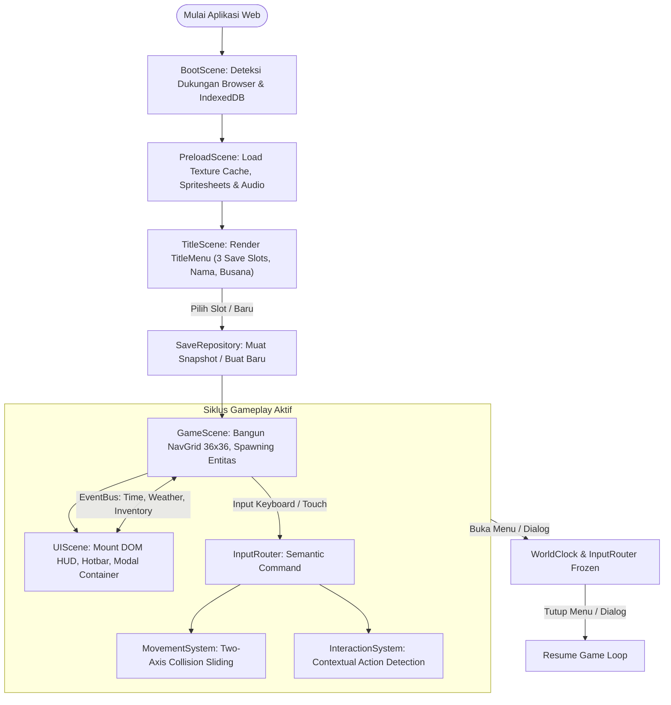
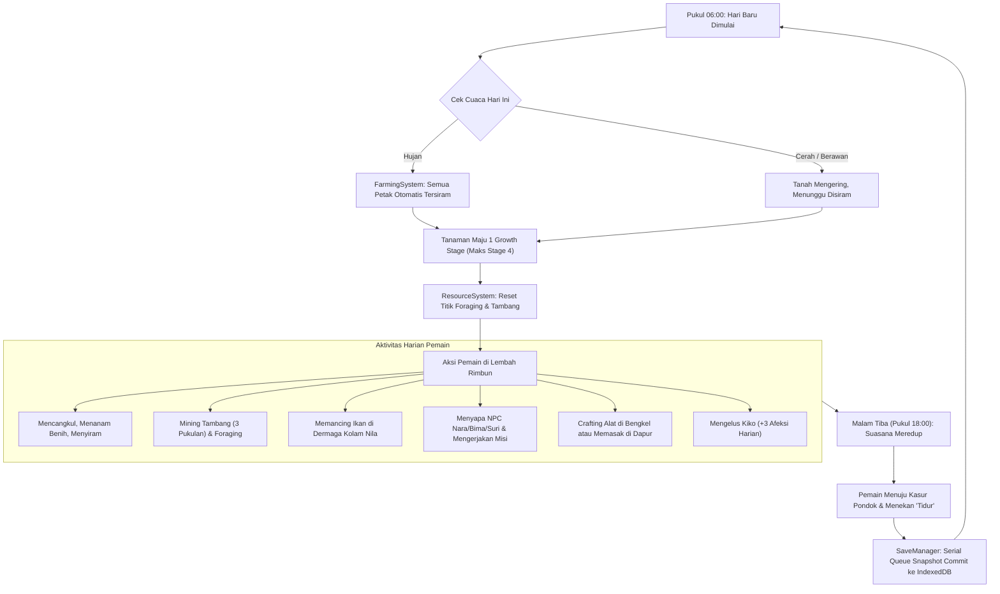
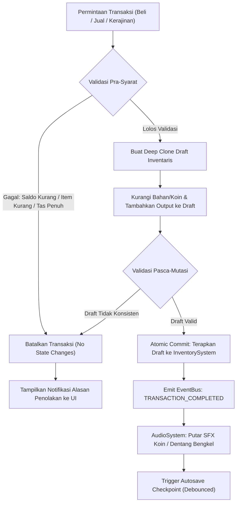
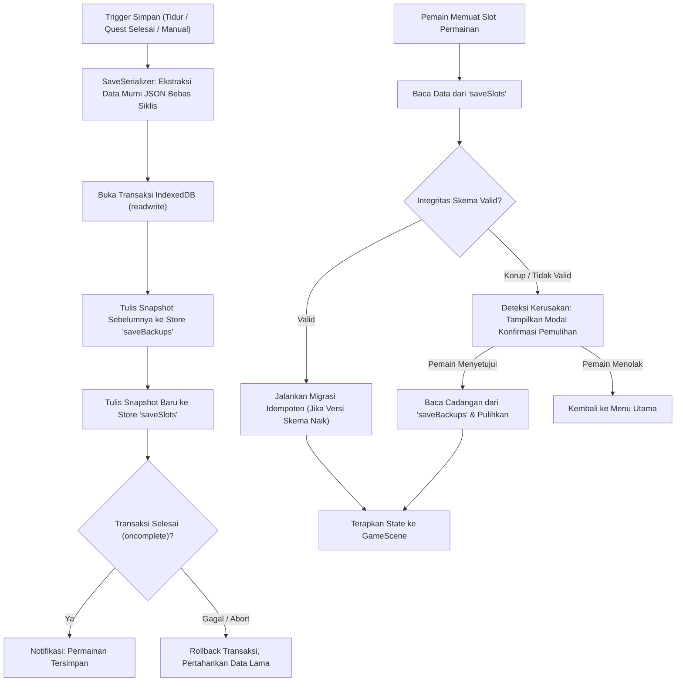
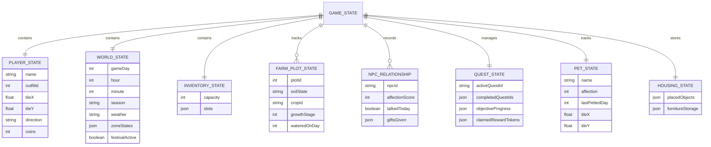
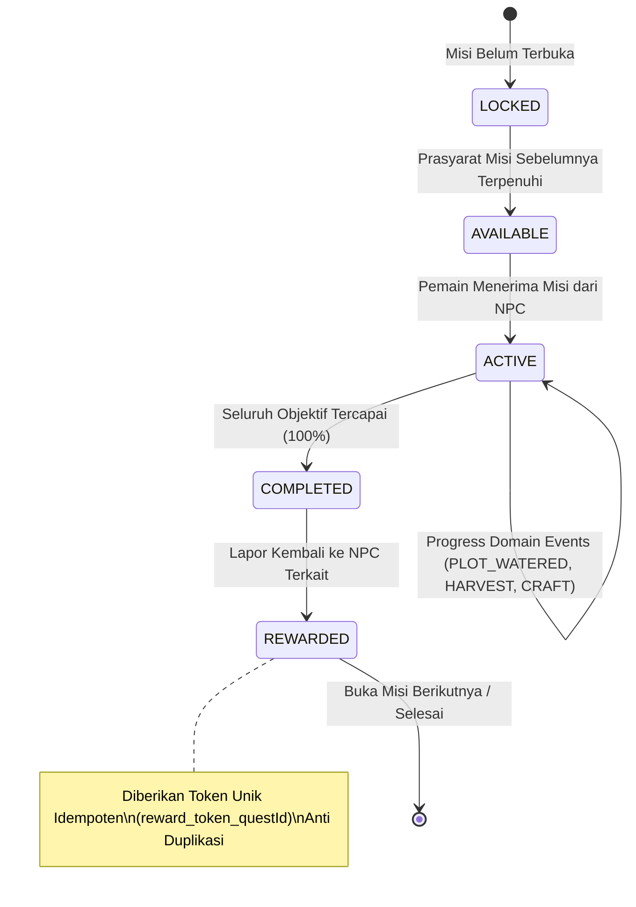

# Repository Guidelines

Dokumen spesifikasi arsitektur teknis kanonikal untuk game **Seasons of Home (Lembah Rimbun)**. Dokumen ini dirancang sebagai *single source of truth* komprehensif bagi pengembang dan agen AI (*Agentic AI Code Generator*) untuk memahami konteks, struktur modul, alur data, konvensi kode, serta pedoman implementasi aplikasi secara menyeluruh.

---

## Project Overview

**Seasons of Home (Lembah Rimbun)** adalah permainan simulasi kehidupan pedesaan isometrik 2D (*cozy rural life simulation*) yang terinspirasi oleh kekayaan budaya dan lanskap agrikultur Nusantara (Indonesia). 

### Nilai Inti & Filosofi Desain:
1. **Cozy, Restorative, & Non-Violent:** Tidak ada musuh, mekanik pertarungan, ancaman kematian, atau batas waktu yang menekan (*no timers/penalties*). Ritme permainan rileks dan meditatif.
2. **Kekayaan Budaya Nusantara:** Menampilkan arsitektur pondok panggung kayu, dinding papan, genteng tanah liat bertingkat, sawah terasering berundak, komoditas lokal (*Sunroot*, *Mossberry*, *Goldenleaf*), serta tradisi perayaan syukur "Malam Lentera Panen".
3. **Zero-Build Runtime Architecture:** Berjalan langsung di peramban web modern menggunakan Native ECMAScript Modules (ESM) murni tanpa ketergantungan runtime compiler, sekaligus menyediakan pipeline bundle statis mandiri (`dist/`) untuk deployment hosting ringan.
4. **Anti-AI-Slop Visual Quality:** Mengacu ketat pada kurasi 14 palet warna alami (*earthy/warm*). Larangan keras penggunaan warna primer jenuh murni (`#FF0000`, `#00FF00`, `#0000FF`, `#FFFF00`), efek *neon glow*, *bloom* murahan, atau bentuk geometris primitif tanpa tekstur.
5. **Robust Multi-Platform Support:** Mendukung kendali penuh desktop (keyboard, mouse, mouse-wheel zoom) serta layar sentuh mobile (Virtual D-pad, tombol aksi kontekstual, swipe hotbar) dengan penyesuaian dinamis terhadap berbagai rasio layar dan orientasi (*portrait/landscape*).

---

## Tech Stack

| Lapisan / Komponen | Teknologi & Versi | Peran Teknis |
|---|---|---|
| **Core Game Engine** | [Phaser 3.88.2](https://phaser.io/) (Local Bundle) | Orkestrasi scene, render canvas 2D, kalkulasi camera viewport, loading tekstur & spritesheet |
| **Language Standard** | JavaScript ECMAScript 2022+ (ESM) | Logika simulasi domain, modularitas murni tanpa transpilasi |
| **UI Presentation Layer** | Vanilla HTML5 DOM + CSS3 Tokens | Layer antarmuka decoupled (`UIScene`), modal perkamen, hotbar, jurnal, panel interaksi |
| **Persistence Layer** | IndexedDB API (`lembah-rimbun-db` v1) | Penyimpanan transaksional 3-slot independen, snapshot serialisasi, backup otomatis, toleransi korupsi |
| **Audio Synthesizer** | Web Audio API Native (Procedural Synthesizer) | Efek suara interaksi halus (langkah, cangkul, air, tambang) berstatus autoplay-safe (resume on first user gesture) |
| **Testing Suite** | Node.js Native Assert (`node:assert/strict`) + fake-indexeddb | 11 unit test suites invariant matematika, FSM, transaksi, dan snapshot roundtrip |
| **Build & Preview Tooling** | Node.js ES Scripts (`scripts/build.mjs`, `scripts/serve.mjs`) | Generator bundle mandiri (`dist/`) dan server HTTP statis lokal |

---

## Design System

Desain visual dan antarmuka mengacu pada sistem token CSS terpusat di `src/styles/tokens.css` dan `src/styles/ui.css`, yang mencerminkan palet kurasi anti-slop di `src/config/palette.js`.

### 1. Palet Warna Kurasi (14-Color Earthy Palette)

| Token CSS | Kode Hex | Penggunaan Desain |
|---|---|---|
| `--soh-forest-deep` | `#223832` | Bingkai terluar UI, bayangan solid, teks kontras tinggi |
| `--soh-forest-mid` | `#304B43` | Header panel modal, background tombol hover, lencana status |
| `--soh-sage` | `#5B756C` | Indikator posisi valid furnitur, aksen teks sekunder |
| `--soh-clay-bright` | `#D98A6C` | Sorotan aktif, seleksi hotbar, tombol aksi primer |
| `--soh-clay-base` | `#BC7654` | Tombol standar, border kotak dialog, tombol konfirmasi |
| `--soh-clay-dark` | `#8A523D` | Bayangan tombol tertekan, batas pemisah elemen |
| `--soh-parchment` | `#F2E8D5` | Latar belakang utama kertas dialog, modal, dan tooltip |
| `--soh-parchment-dark` | `#E1D3BA` | Latar belakang slot inventaris kosong, baris tabel selang-seling |
| `--soh-gold-leaf` | `#DDAA55` | Ikon Leafcoins, rating bintang, lentera festival menyala |
| `--soh-gold-dark` | `#B88432` | Bayangan elemen koin, batas lencana afeksi |
| `--soh-terracotta` | `#A84B3D` | Peringatan bahaya, indikator penempatan furnitur terhalang |
| `--soh-night-sky` | `#1A242B` | Overlay suasana malam hari, kanopi langit redup |
| `--soh-wood-dark` | `#523B2B` | Bingkai kayu furnitur pondok, lis luar jendela |
| `--soh-wood-mid` | `#87674E` | Dinding kayu pondok, papan lantai terasering |

> [!IMPORTANT]
> Dilarang keras menambahkan kode hex di luar palet resmi atau memakai warna primer murni (seperti `#FF0000`, `#00FF00`, `#0000FF`, `#FFFF00`) untuk menjaga estetika hangat pedesaan.

### 2. Tipografi & Ukuran Interaktif
- **Font Stack:** `'Segoe UI', -apple-system, BlinkMacSystemFont, 'Nunito', 'Segoe UI Emoji', sans-serif`
- **Minimum Touch Target:** $\ge 44\text{px} \times 44\text{px}$ pada seluruh elemen yang dapat diklik atau disentuh (WCAG 2.1 Compliance).
- **Z-Index Layering:**
  - Canvas Phaser Game: `0`
  - Dynamic Atmosphere / Night Overlay: `1`
  - HUD Quick Bar & Clock: `10`
  - Virtual Touch Controls (D-pad & Action): `15`
  - Modal Menus (Tas, Jurnal, Kios, Bengkel): `20`
  - Dialogue Box & Story Prompts: `25`
  - System Alerts & Autosave Notifications: `30`

---

## Folder & File Project Structure

```
d:\GAME\SOH\
├── index.html                       # Entry point aplikasi web & mounting canvas
├── package.json                     # Konfigurasi skrip test, build, dan dependensi
├── blueprint.md                     # Dokumen blueprint perancangan game v1.0
├── task.md                          # Master WBS tasklist seluruh fase (Phase 0 - 6)
├── AGENTS.md                        # Aturan pengembang & integrasi Agentic AI
├── .gitignore                       # Berkas pengecualian git (termasuk dist/ & logs)
│
├── asset/                           # Asset pipeline visual pixel-art
│   ├── building/                    # Sprite eksterior & interior bangunan desa
│   ├── characters/                  # Spritesheets karakter 4x4 (313x313) & busts
│   ├── crops/                       # Sprite fase tumbuh tanaman (stage 1-4)
│   ├── items/                       # Ikon alat tani, benih, komoditas, dan perabot
│   ├── nature/                      # Pohon tropis, semak, mineral node, dan lentera
│   └── terrain/                     # Ubin rumput, tanah garapan, jalur, dermaga
│
├── docs/                            # Dokumentasi teknis proyek
│   ├── specs.md                     # Spesifikasi arsitektur komprehensif (dokumen ini)
│   ├── task.md                      # Log checkpoint penyelesaian fase
│   ├── changelog.md                 # Log riwayat perubahan berkelanjutan
│   └── superpowers/plans/           # Arsip rencana teknis fase pengembangan
│
├── lib/
│   └── phaser.min.js                # Bundle lokal library Phaser 3.88.2
│
├── scripts/                         # Otomasi build dan server lokal
│   ├── build.mjs                    # Generator bundle produksi mandiri ke dist/
│   └── serve.mjs                    # Server HTTP statis lokal berbasis Node.js
│
├── src/
│   ├── main.js                      # Inisialisasi engine Phaser, config RESIZE & lifecycle
│   │
│   ├── config/                      # Parameter konstanta & palet anti-slop
│   │   ├── constants.js             # Skala ubin (64x32), tick waktu, batas inventory
│   │   └── palette.js               # Palet kurasi 14 warna kanonikal
│   │
│   ├── data/                        # Kamus data statis game
│   │   ├── crops.js                 # Data varietas tanaman (Sunroot, Mossberry, Goldenleaf)
│   │   ├── items.js                 # Kamus data 30+ item (alat, bibit, hasil, material)
│   │   ├── npcDialogue.js           # Pohon percakapan narasi warga desa
│   │   ├── quests.js                # Definisi 3 beat misi narasi utama
│   │   └── recipes.js               # Resep crafting, cooking, dan alchemical dew
│   │
│   ├── entities/                    # Entitas dinamis dunia game
│   │   ├── FarmPlot.js              # Entitas petak garapan sawah (3 state, 4 stage)
│   │   ├── NPC.js                   # Entitas warga desa (Nara, Bima, Suri) & jadwal
│   │   ├── Pet.js                   # Entitas pendamping Kiko (musang hutan)
│   │   ├── Player.js                # Entitas protagonis (Joni) & state koordinat
│   │   └── ResourceNode.js          # Entitas node mineral tambang & foraging
│   │
│   ├── input/                       # Router masukan multi-platform
│   │   ├── CameraControls.js        # Kontrol zoom keyboard (+/-), scroll wheel, & clamping
│   │   ├── DesktopInput.js          # Pembaca keyboard WASD / Panah / Hotkeys
│   │   ├── InputRouter.js           # Penggabung masukan semantik & pembekuan interaksi
│   │   ├── ResponsiveViewport.js    # Sinkronisasi canvas RESIZE & ResizeObserver viewport
│   │   └── TouchControls.js         # Virtual D-pad sentuh & tombol aksi kontekstual
│   │
│   ├── persistence/                 # Arsitektur penyimpanan data IndexedDB
│   │   ├── SaveManager.js           # Manajer serial autosave & sinkronisasi
│   │   ├── SaveRepository.js        # Akses IndexedDB lembah-rimbun-db (3 slot)
│   │   ├── SaveSerializer.js        # Serializer snapshot JSON murni bebas referensi siklis
│   │   ├── SettingsRepository.js    # Penyimpanan pengaturan audio & preferensi kontrol
│   │   └── migrations.js            # Pipeline migrasi skema data idempotent
│   │
│   ├── scenes/                      # State siklus hidup Phaser Scene
│   │   ├── BootScene.js             # Pemeriksaan dependensi & deteksi IndexedDB
│   │   ├── PreloadScene.js          # Pemuatan aset spritesheet, tekstur, & audio
│   │   ├── TitleScene.js            # Scene menu awal, pemilihan 3 save slot
│   │   ├── GameScene.js             # Orkestrator simulasi dunia aktif 36x36
│   │   └── UIScene.js               # Scene DOM overlay paralel independen
│   │
│   ├── styles/                      # Lembar gaya antarmuka
│   │   ├── tokens.css               # Variabel CSS warna, spasi, radius, & bayangan
│   │   └── ui.css                   # Tata letak HUD, modal, dialog, hotbar, & D-pad
│   │
│   ├── systems/                     # Subsistem logika domain simulasi
│   │   ├── AudioSystem.js           # Synthesizer audio prosedural Web Audio API
│   │   ├── CraftingSystem.js        # Sistem kerajinan bengkel Bima & validasi bahan
│   │   ├── DecorationSystem.js      # Dekorasi interior pondok 6x6 & validasi grid
│   │   ├── DialogueSystem.js        # Logika pohon dialog, respons, & update hubungan
│   │   ├── EconomySystem.js         # Transaksi jual-beli Kios Nara & validasi atomik
│   │   ├── FarmingSystem.js         # Logika cangkul, tanam, siram, tumbuh, & panen
│   │   ├── FestivalSystem.js        # Event "Malam Lentera Panen" pasca misi narasi
│   │   ├── FishingSystem.js         # Minigame memancing di dermaga Kolam Nila
│   │   ├── InteractionSystem.js     # Deteksi radius kedekatan & penentu target prioritas
│   │   ├── InventorySystem.js       # Manajemen tas 16 slot, stack merge, & swap
│   │   ├── MovementSystem.js        # Perhitungan vektor gerak & two-axis collision sliding
│   │   ├── PetSystem.js             # Kecerdasan buatan Kiko (breadcrumb follow & petting)
│   │   ├── QuestSystem.js           # Finite State Machine misi & token idempoten
│   │   ├── RelationshipSystem.js    # Skor afeksi warga (0-100) & sapaan harian
│   │   ├── ResourceSystem.js        # Manajemen penambangan & reset harian sumber daya
│   │   └── inventoryTransaction.js  # Utilitas mutasi transaksi inventaris atomik
│   │
│   ├── ui/                          # Pengontrol antarmuka visual
│   │   ├── DialoguePanel.js         # Kotak dialog warga & potret karakter
│   │   ├── HUDController.js         # Indikator jam, musim, cuaca, saldo, & hotbar
│   │   ├── LifePanels.js            # Panel minigame pancing, dapur, alchemical, & dekorasi
│   │   ├── MenuController.js        # Pengendali pembukaan modal tas & jurnal
│   │   ├── Phase4Panels.js          # Modal transaksi Kios Nara & Meja Kerajinan Bima
│   │   ├── TitleMenu.js             # Menu utama interaktif (3 slot save, nama, busana)
│   │   └── settingsView.js          # Panel kontrol volume suara & preferensi tampilan
│   │
│   ├── utils/                       # Utilitas matematika & pub/sub
│   │   ├── EventBus.js              # Event dispatcher terpusat pemutus ketergantungan
│   │   ├── math.js                  # Fungsi pembantu kalkulasi jarak & clamping
│   │   └── rng.js                   # Pseudo-random number generator deterministik ber-seed
│   │
│   └── world/                       # Geometri & perenderan dunia isometrik
│       ├── DepthSorter.js           # Dynamic z-ordering berbasis foot-Y layar
│       ├── IsoWorldRenderer.js      # Perender multi-layer (tanah, entitas, kanopi)
│       ├── LifeWorld.js             # Integrasi interaksi node dunia, pancing, & dekorasi
│       ├── WorldAtmosphere.js       # Efek pencahayaan siang/malam & partikel cuaca
│       ├── WorldClock.js            # Kalender siklus 24 jam, musim, cuaca, & tidur
│       ├── isoMath.js               # Konversi matematis koordinat isometrik 2:1
│       ├── navGrid.js               # Matriks collision dua sumbu 36x36
│       └── zoneDefinitions.js       # Tata letak tata ruang desa Lembah Rimbun
│
└── tests/                           # Pengujian unit otomatis invariant & FSM
    ├── audio.test.js                # Uji synthesizer Web Audio API & gesture context
    ├── browserPersistenceChecks.js  # Acceptance test IndexedDB asli di browser
    ├── browserResponsiveChecks.js   # Acceptance test layout responsif & kontrol sentuh
    ├── build.test.js                # Uji integritas bundle produksi mandiri (dist/)
    ├── cameraControls.test.js       # Uji zoom kamera, batasan clamping, & deadzone
    ├── farming.test.js              # Uji 4 siklus tanaman & proteksi panen aman
    ├── inventory.test.js            # Uji batas stack 99, penolakan transaksi, & swap
    ├── isoMath.test.js              # Invariant proyeksi koordinat 2:1 (toleransi ±1e-6)
    ├── lifeSystems.test.js          # Uji gathering, fishing, crafting, & Kiko
    ├── persistence.test.js          # Uji isolasi 3 slot, atomic rollback, & consent
    ├── quests.test.js               # Uji FSM quest narasi & token reward idempoten
    ├── save-roundtrip.test.js       # Uji serialisasi/deserialisasi snapshot murni
    ├── transactions.test.js         # Uji atomisitas mutasi ekonomi & crafting
    └── zoneLayout.test.js           # Uji konektivitas jalan desa & reachability NPC
```

---

## Workflow (Mermaid Charts)

### 1. Game Lifecycle & Scene Management Flow
Bagan alur inisialisasi engine, seleksi save slot, transisi scene aktif, dan orkestrasi parallel scene:



### 2. Core Simulation Loop (Siklus Bertani, Warga, dan Malam Hari)
Alur harian pemain dari pagi hingga malam hari:



### 3. Atomic Transaction Workflow (Ekonomi & Crafting)
Mekanisme pengamanan mutasi inventaris dan saldo koin untuk mencegah korupsi atau eksploitasi:



### 4. Persistence Architecture & Disaster Recovery Flow
Alur penyimpanan data IndexedDB 3-slot dengan backup transaksional dan pemulihan korupsi:



---

## Data Model (Mermaid Charts)

### 1. Canonical GameState Entity-Relationship Diagram
Struktur snapshot data lengkap yang disimpan ke dalam IndexedDB:



### 2. Quest Narrative Finite State Machine
Siklus hidup setiap beat misi narasi utama di `QuestSystem`:



---

## Commands

Panduan perintah operasional CLI pengembangan, eksekusi tes, dan pembuatan paket produksi:

```bash
# 1. Menjalankan Seluruh Automated Unit Test Suites (12 Test Suites Lengkap)
npm test

# 2. Menjalankan Uji Bundle Produksi Mandiri
npm run test:build

# 3. Menjalankan Uji Satuan Secara Spesifik
node tests/isoMath.test.js          # Invariant proyeksi koordinat 2:1 (±1e-6)
node tests/inventory.test.js        # Uji batas tumpukan 99 & slot swap/merge
node tests/farming.test.js          # Uji siklus tanam 4 stage & proteksi panen aman
node tests/quests.test.js           # Uji FSM quest narasi & token reward idempoten
node tests/zoneLayout.test.js       # Uji penerimaan layout & navigasi 5 zona mandiri
node tests/zoneTransitions.test.js  # Uji registry zona, portal dua arah & ZoneManager
node tests/cameraControls.test.js   # Uji kontrol zoom & deadzone clamping
node tests/transactions.test.js     # Uji mutasi atomik ekonomi & crafting
node tests/save-roundtrip.test.js   # Uji integritas siklus snapshot JSON murni
node tests/persistence.test.js      # Uji 3 slot IndexedDB & isolasi penghapusan
node tests/lifeSystems.test.js      # Uji gathering, fishing, alchemy, & Kiko
node tests/audio.test.js            # Uji synthesizer Web Audio API & gesture context

# 4. Membangun Bundle Mandiri Produksi (Output ke direktori dist/)
npm run build

# 5. Menjalankan Server Preview dari Bundle Produksi (Port 8001)
npm run preview

# 6. Menjalankan Server Pengembangan Lokal Standar (Port 8080)
npm start
# Atau menggunakan modul Python bawaan:
python -m http.server 8080 --directory "d:\GAME\SOH"

# 7. Sinkronisasi Git & Push ke Remote Repository
git add .
git commit -m "feat: complete Phase 0-6 systems and update master docs"
git push origin main
```

---

## Code Style

### TypeScript & JSDoc Typing
Meskipun proyek dieksekusi sebagai Vanilla ES Modules murni di peramban tanpa build compiler, seluruh fungsi, metode kelas, dan modul publik wajib dilengkapi anotasi JSDoc standar TypeScript untuk menjamin *type safety*, kejelasan parameter, dan dokumentasi API:

```javascript
/**
 * @typedef {Object} TransactionItem
 * @property {string} itemId - Pengenal unik item dalam kamus items.js
 * @property {number} quantity - Jumlah item yang terlibat dalam transaksi
 */

/**
 * Mengeksekusi transaksi pertukaran inventaris dan koin secara atomik.
 * @param {InventorySystem} inventory - Referensi sistem inventaris pemain
 * @param {number} currentCoins - Saldo Leafcoins saat ini
 * @param {TransactionItem[]} itemsToRemove - Daftar item yang ditarik dari tas
 * @param {TransactionItem[]} itemsToAdd - Daftar item yang ditambahkan ke tas
 * @param {number} costInCoins - Total biaya koin (positif: bayar, negatif: terima uang)
 * @returns {{ success: boolean, newCoins: number, errorReason?: string }}
 */
export function executeInventoryTransaction(inventory, currentCoins, itemsToRemove, itemsToAdd, costInCoins) {
  // Implementasi validasi atomik dan rollback...
}
```

### Components
1. **Pemisahan Logika & Presentasi (Decoupling):** Modul logika permainan (*pure logic*) dilarang memanggil langsung API canvas Phaser atau menyentuh elemen DOM. Seluruh koordinasi wajib melalui *return values* atau event broadcast melalui `EventBus`.
2. **Pembersihan Bersih (Lifecycle Cleanup):** Setiap komponen yang mendaftarkan event listener DOM, interval timer, atau listener `EventBus` wajib menyediakan metode `destroy()` atau `cleanup()` guna mencegah kebocoran memori saat pergantian scene.

### Imports
- Selalu cantumkan ekstensi `.js` secara eksplisit pada setiap pernyataan `import`:
  ```javascript
  // BENAR:
  import { tileToScreen, screenToTile } from '../world/isoMath.js';
  import { EventBus, EVENTS } from '../utils/EventBus.js';

  // SALAH (Menyebabkan runtime error pada native browser ESM):
  import { tileToScreen } from '../world/isoMath';
  ```

### Naming Conventions
- **Nama Kelas / Tipe / Enums:** `PascalCase` (contoh: `Player`, `InventorySystem`, `DialoguePanel`).
- **Fungsi / Metode / Variabel:** `camelCase` (contoh: `resolveCollision`, `recordDailyTalk`, `activePlotId`).
- **Konstanta Global / Event Names:** `UPPER_SNAKE_CASE` (contoh: `TILE_WIDTH`, `MAX_SLOTS`, `EVENTS.CROP_HARVESTED`).
- **ID Item / Quest / Sprite Keys:** `snake_case` (contoh: `tool_hoe`, `crop_sunroot`, `quest_beat_1`).

### Error Handling
- **Idempotensi Wajib:** Setiap operasi pemberian reward naratif atau transaksi bernilai wajib dilindungi token unik. Jika operasi dieksekusi ulang, sistem wajib menolak secara aman tanpa memicu crash atau duplikasi saldo/item.
- **Defensive Null-Safety:** Jangan berasumsi elemen DOM atau referensi entitas selalu ada. Lakukan validasi `if (!target) return;` sebelum memanipulasi objek.
- **Debounced Interactions:** Seluruh tombol antarmuka dan interaksi klik pada canvas diberi waktu tenggang (*debouncing*) minimum 250–300ms untuk mencegah eksploitasi ketukan ganda (*double-tap glitch*).

---

## UI Components

### 1. HUD Controller (`src/ui/HUDController.js`)
- **Kalender, Cuaca & Waktu:** Menampilkan musim aktif (*Musim Semi*), penanggalan hari, ikon cuaca (cerah/berawan/hujan), serta jam format 24 jam (`06:00` s/d `24:00`).
- **Saldo Leafcoins:** Menampilkan jumlah koin aktif pemain secara real-time dengan ikon daun keemasan.
- **4-Slot Quick Hotbar:** Menampilkan slot 1 s/d 4 di bagian bawah layar. Mendukung klik mouse, ketukan layar sentuh, atau hotkey keyboard `1`, `2`, `3`, `4`.
- **Indikator Zoom Kamera:** Menampilkan persentase zoom saat ini (50% – 175%) dengan tombol cepat reset `[100%]`.

### 2. Dialogue Panel (`src/ui/DialoguePanel.js`)
- **Kotak Dialog Perkamen:** Mengambang di bagian bawah layar dengan tema kertas perkamen dan bingkai kayu hangat.
- **Potret Karakter 128×128:** Menampilkan bust ekspresif karakter warga desa disertai lencana nama, profesi, dan skor afeksi (contoh: `Sahabat Lembah (38 ♥)`).
- **Opsi Respons Bernomor:** Pilihan jawaban interaktif pemain dengan navigasi keyboard instan (`1`–`9`, `Space`, `Enter`, `E`, `Esc`).

### 3. Inventory & Quest Journal Modal (`src/ui/MenuController.js`)
- **Tas 16 Slot (Grid 4×4):** Menampilkan inventaris lengkap pemain dengan dukungan klik untuk menukar (*swap*) posisi atau menggabungkan (*merge*) tumpukan hingga kapasitas 99.
- **Jurnal Misi (`J`):** Menampilkan daftar misi aktif, ceklis pemenuhan objektif `[✓]`, dan rincian imbalan hadiah secara langsung.

### 4. Life & Production Panels (`src/ui/LifePanels.js` & `Phase4Panels.js`)
- **Kios Pasar Nara:** Antarmuka jual-beli bibit, perkakas, dan hasil bumi secara atomik.
- **Meja Kerajinan Bima:** Antarmuka crafting alat dengan pratinjau kebutuhan bahan dan validasi otomatis.
- **Minigame Memancing Kolam Nila:** Panel kontrol tegangan tali pancing (tahan/lepas Spasi atau tombol sentuh) dengan indikator progress tangkapan deterministik.
- **Dapur & Meja Alkimia:** Panel memasak sup herba, pai beri, dan peracikan tonik embun.
- **Dekorasi Pondok (Grid 6×6):** Penempatan furnitur (karpet tenun, pot tanaman, rak) dengan pratinjau flat transparan (hijau sage jika valid, terakota merah jika terhalang kasur/pintu).
- **Panel Pengaturan (`src/ui/settingsView.js`):** Kontrol slider volume suara (Master, Music, SFX), tombol Mute toggle, dan opsi ukuran tombol kontrol.

---

## Accessibility

1. **Touch Target Size Compliance:** Seluruh tombol antarmuka pengguna (Hotbar, Tombol Aksi, Opsi Dialog, Tombol Tutup Modal) memiliki area interaktif minimum $\ge 44\text{px} \times 44\text{px}$ sesuai pedoman aksesibilitas mobile WCAG 2.1.
2. **Aksesibilitas Semantik & Layar Pembaca:** Modal dilengkapi atribut ARIA standar (`role="dialog"`, `aria-modal="true"`, `aria-label="Percakapan"`) untuk keterbacaan perangkat bantu.
3. **Pencegahan Gesture Bawaan Browser:** Panggilan `e.preventDefault()` aktif pada canvas game untuk mencegah *accidental page refresh*, *pinch-to-zoom*, atau scrolling yang tidak diinginkan saat bermain di perangkat mobile.
4. **Input Focus & Movement Freeze:** Karakter dan waktu permainan secara otomatis dibekukan saat pemain sedang membuka dialog atau modal menu, memastikan pemain tidak kehilangan waktu atau tertabrak rintangan saat membaca narasi.
5. **Keterbacaan Kontras Tinggi:** Warna teks gelap (`#2D3835`) di atas kertas perkamen terang (`#F2E8D5`) memberikan rasio kontras tinggi (>7:1) yang sangat nyaman dibaca tanpa melelahkan mata.
6. **Autoplay-Safe Audio Bridge:** Web Audio API tidak memicu suara secara otomatis saat load halaman untuk mencegah browser policy rejection; konteks audio diinisialisasi secara anggun pada ketukan/interaksi pertama pengguna.

---

## Multi-Zone Topology & Free-Form Dynamic Farming (Phase 7)

Arsitektur multi-zona mandiri dan sistem pertanian dinamis tanpa batas petak statis:

### 1. Partisi 5 Zona Mandiri
1. **Kebun Privat Joni (`farm`, 32×32):**
   - Area khusus pertanian bebas Joni, terpisah dari hiruk pikuk pasar dan warga.
   - Dilengkapi eksterior pondok panggung, kolam air tawar pengisi kaleng siram, 12 petak sawah awal (dapat diperluas tanpa batas), dan area bermain musang Kiko.
   - Portal: Pintu masuk pondok (`cottage`), jalan timur ke Pasar Desa (`village`), jalan selatan ke Danau Lembah (`lake`).

2. **Interior Pondok Joni (`cottage`, 14×14):**
   - Ruang dalam pondok kayu nyaman nusantara.
   - Dilengkapi ranjang tidur (`joni_bed`) untuk istirahat dan memajukan hari (autosave pagi), karpet anyaman nusantara (`woven_rug`), pot tanaman hias (`plant_pot`), dan pintu keluar ke kebun.

3. **Pasar & Alun-Alun Desa (`village`, 34×34):**
   - Pusat kehidupan komunitas desa Lembah Rimbun.
   - Menghadirkan Kios Bibit & Hasil Tani Nara, Bengkel Perkakas & Pandai Besi Paman Bima, Paviliun Diskusi Nenek Suri, dan Papan Festival Panen.
   - Portal: Jalan barat ke Kebun Joni (`farm`), gerbang hutan utara ke Gunung & Gua Tambang (`mine`), dan jalan selatan ke Danau Lembah (`lake`).

4. **Danau Lembah (`lake`, 32×32):**
   - Cekungan danau air jernih dengan dermaga kayu panggung panjang (`fishing_pier`, 3×10 ubin walkable).
   - Titik memancing ikan nila dan lele, bebatuan tepian air, dan vegetasi bambu air.
   - Portal: Jalan utara barat ke Kebun Joni (`farm`), jalan utara timur ke Pasar Desa (`village`).

5. **Kaki Gunung & Gua Tambang (`mine`, 32×32):**
   - Kaki tebing pegunungan berbatu dengan jalan setapak mendaki.
   - Memuat 8 node mineral tambang (bijih besi, batu kali) dengan sistem reset harian serta jamur hutan liar.
   - Portal: Mulut gua tambang dan jalan keluar selatan kembali ke Pasar Desa (`village`).

### 2. Komponen ZoneManager (`src/world/ZoneManager.js`)
- **Transisi Sinematik 200ms Fade-Out / 200ms Fade-In:**
  - Pembekuan input (`inputRouter.setFrozen(true)`) dan pemutaran SFX transisi (`hoe` / pintu).
  - Fade-out kamera ke hitam dalam 200ms.
  - Pembersihan entitas visual lama melalui `IsoWorldRenderer.clearZone()`.
  - Pembangunan ulang NavGrid sesuai dimensi zona target (`zoneDef.width` × `zoneDef.height`).
  - Unmount dan spawn NPC khusus zona target (Nara, Bima, Suri hanya di-spawn di Desa).
  - Pembangunan ubin, bangunan, vegetasi, dan sumber daya zona target via `IsoWorldRenderer.buildZone()`.
  - Reposisi pemain ke koordinat spawn tujuan yang aman dan sinkronisasi kamera follow.
  - Fade-in kamera dalam 200ms, pembukaan kunci input, dan notifikasi UI toast nama zona baru.

### 3. Sistem Pertanian Dinamis Bebas (`FarmingSystem.tillTile` & `clearPlot`)
- **Cangkul Bebas di Kebun Joni:** Pemain dapat menggunakan cangkul (`tool_hoe`) di ubin rumput/tanah mana saja di dalam `tillableBounds` (`8..29, 7..29`) yang tidak terhalang jalan setapak atau kolam air.
- **Pembersihan Lahan Kosong (`clearPlot`):** Petak tilled/watered yang belum ditanami benih dapat dibersihkan kembali menjadi rumput alami menggunakan alat cangkul/arit, memberikan kendali penuh penataan kebun.
- **Persistensi State Dinamis:** Seluruh petak dinamis yang dicangkul pemain disimpan ke dalam array `farm.plots` pada IndexedDB dan diregenerasi secara otomatis saat pemain masuk kembali ke kebun atau memuat ulang save game.
