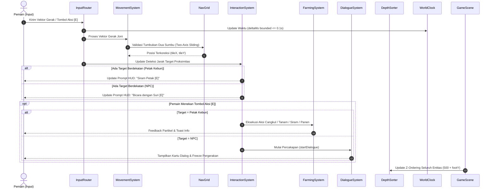
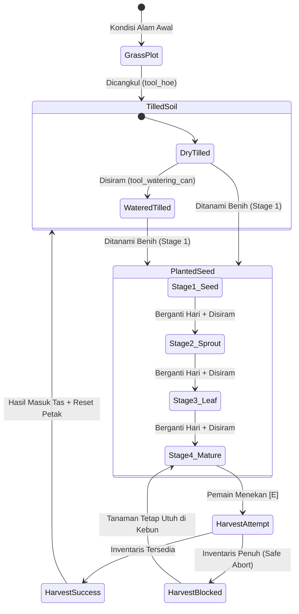
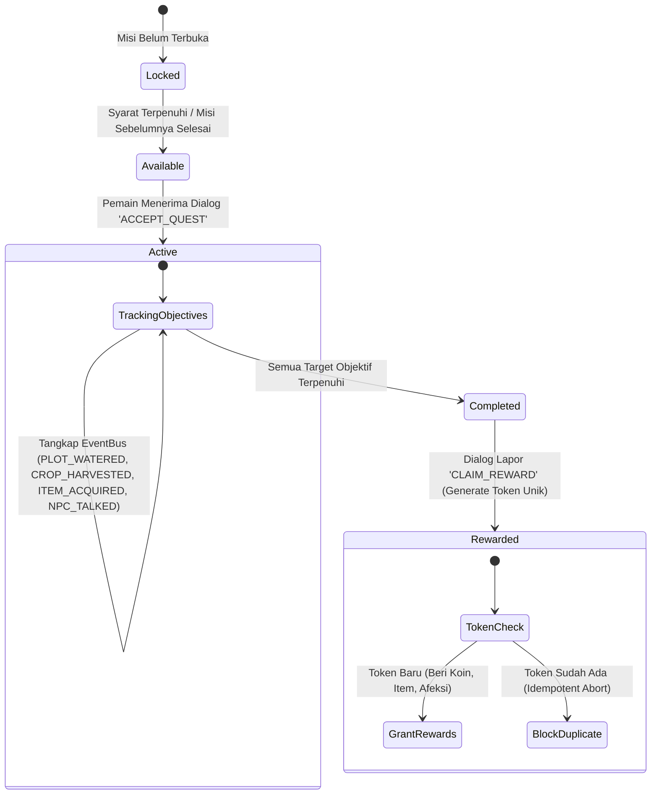
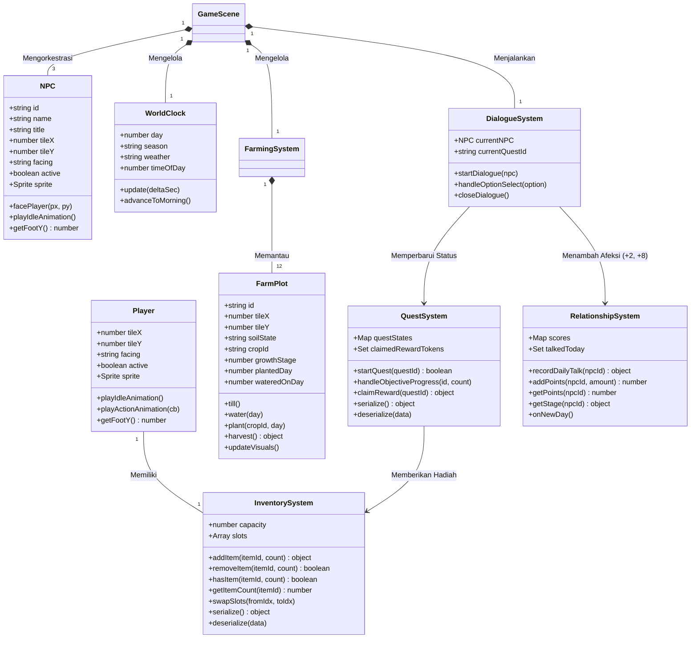

# Repository Guidelines

Dokumen ini merupakan panduan arsitektur, standar teknis, dan spesifikasi komprehensif untuk pengembangan game **Seasons of Home (Lembah Rimbun)**. Dokumen ini dirancang sebagai acuan utama bagi pengembang manusia maupun *agentic AI code generator* agar memahami konteks sistem, desain arsitektur, dan konvensi kode secara utuh.

---

## Project Overview

- **Judul Game:** Seasons of Home (Lembah Rimbun)
- **Genre:** Isometric Cozy Rural Life Simulation / Farming RPG
- **Target Platform:** Web Modern (Desktop Canvas/WebGL & Layar Sentuh Mobile Responsif)
- **Arsitektur Utama:** Zero-Build Single-Page Application (Vanilla ES Modules murni tanpa bundler runtime seperti Webpack/Vite untuk deployment statis instan).
- **Filosofi & Nilai Inti:**
  - **Cozy & Non-Violent:** Tanpa pertarungan, tanpa *time-pressure* yang menghukum, dan tanpa mekanik manipulatif.
  - **Identitas Pedesaan Tropis:** Mengangkat estetika arsitektur panggung kayu, bebatuan kali, kebun terasering berundak, tanaman lokal (*Sunroot*, *Mossberry*, *Goldenleaf*), serta tradisi "Malam Lentera Panen".
  - **Anti-AI-Slop Manifesto:** Melarang keras palet warna jenuh neon (`#FF0000`, `#00FF00`, `#0000FF`, dll.), gradien plastik murahan, atau filter blur artifisial. Semua visual disajikan dalam pixel-art terkurasi dengan penskalaan *nearest-neighbor* yang tajam.
  - **Multi-Input Parity:** Menjamin pengalaman bermain yang setara antara Desktop (Keyboard/Mouse) dan Mobile (Virtual Touch D-pad & Contextual Action Button).

---

## Tech Stack

| Layer | Teknologi / Modul | Deskripsi |
|---|---|---|
| **Game Engine** | Phaser 3.88.2 (`lib/phaser.min.js`) | Rendering 2D WebGL/Canvas, sprite atlas, frame animation, scene manager, dan camera follow. |
| **Bahasa Pemrograman** | JavaScript ES2022+ (Native ES Modules) | Sintaks modular standar `import/export` dengan ekstensi `.js` eksplisit dan anotasi JSDoc bertipe ketat. |
| **UI Presentation Layer** | DOM / Vanilla CSS (`src/styles/*.css`) | UI terisolasi di atas canvas melalui `UIScene` paralel; memanfaatkan CSS Variables (Design Tokens) untuk performa 60 FPS bebas lag. |
| **State & Event Pipeline** | Custom EventBus (`src/utils/EventBus.js`) | Pola Observer pub/sub terdesentralisasi untuk komunikasi lintas sistem tanpa tight-coupling. |
| **Data Persistence** | IndexedDB & JSON Storage Serialization | Sistem penyimpanan terisolasi 3-slot dengan skema versi dan migrasi data otomatis. |
| **Automated Testing** | Node.js Test Runner & `node:assert` | Unit test suite cepat berbasis invariant matematika, state-machine, dan operasi transaksi inventaris. |
| **Asset Pipeline** | Python 3.12 (Pillow / OpenCV) | Script slicing otomatis untuk memotong master spritesheet (1254×1254) menjadi frame atlas (313×313) dan potret dialog (256×256). |

---

## Design System

### 1. Curated Earthy Palette (14 Warna Kurasi Resmi)
Dilarang menggunakan hex warna di luar palet resmi berikut (didefinisikan di `src/config/palette.js` dan `src/styles/tokens.css`):

| Token CSS | Hex | Peran & Penggunaan |
|---|---|---|
| `--color-deep-pine` | `#304B43` | Warna dasar kanvas, tajuk pohon cemara, bayangan dalam, teks header penting. |
| `--color-moss` | `#4C6B55` | Rumput liar, lumut batu, daun tanaman, lencana status selesai (*completed*). |
| `--color-sage` | `#76936B` | Sorotan daun tropis, tunas muda, aksen tombol sekunder. |
| `--color-dry-grass` | `#A6AB78` | Jerami kering, tepian jalan setapak, semak savana. |
| `--color-warm-cream` | `#EEE1C4` | Latar kartu UI, lencana afeksi, teks tombol, warna busana katun. |
| `--color-clay-brown` | `#87674E` | Bingkai jendela modal, kayu pagar, tiang pondok, batas slot inventaris. |
| `--color-soil` | `#59483B` | Tanah gembur hasil cangkulan, bayangan kontak tanah entitas. |
| `--color-terracotta` | `#BC7654` | Genteng tanah liat, tombol aksi utama (*primary button*), aksen peringatan. |
| `--color-golden-straw` | `#D9AE6B` | Umbi Sunroot matang, lentera festival, mata koin Leafcoins. |
| `--color-stone-slate` | `#697A77` | Bebatuan kali, dinding pondasi, bijih tambang. |
| `--color-pond-blue` | `#749C9A` | Permukaan air Kolam Nila, pantulan langit air tenang. |
| `--color-night-blue` | `#354D5C` | Langit malam hari, kabut bayangan senja. |
| `--color-ui-ink` | `#2D3835` | Teks tubuh utama (*body text*), ikon interaksi, kontur luar pixel art. |
| `--color-ui-parchment` | `#F2E8D5` | Permukaan kertas dokumen jurnal, kotak dialog, panel inventaris. |

### 2. Geometri Isometrik (True 2:1 Diamond)
- **Dimensi Dasar Ubin:** Lebar Ubin ($W$) = 64px, Tinggi Ubin ($H$) = 32px.
- **Transformasi Proyeksi Matematika:**
  $$\text{screenX} = (tx - ty) \times \frac{W}{2} = (tx - ty) \times 32$$
  $$\text{screenY} = (tx + ty) \times \frac{H}{2} = (tx + ty) \times 16$$
- **Transformasi Balik (Inverse Hit-Testing):**
  $$tx = \frac{\text{screenX}}{W} + \frac{\text{screenY}}{H} = \frac{\text{screenX}}{64} + \frac{\text{screenY}}{32}$$
  $$ty = \frac{\text{screenY}}{H} - \frac{\text{screenX}}{W} = \frac{\text{screenY}}{32} - \frac{\text{screenX}}{64}$$
- **Depth Sorting Dinamis:**
  $$\text{Depth} = 500 + \lfloor\text{screenFootY}\rfloor$$

---

## Folder & File Project Structure

```
d:\GAME\SOH\
├── index.html                   # Entry point aplikasi web, deklarasi viewport dan link stylesheet
├── package.json                 # Metadata npm, konfigurasi ESM type module, dan script 'npm test'
├── package-lock.json
├── blueprint.md                 # Dokumen spesifikasi game design kanonikal (Source of Truth v1.0)
├── task.md                      # Master tasklist WBS bertahap (Phase 0 hingga Phase 6)
├── asset.md                     # Panduan kurasi dan spesifikasi pemotongan aset visual
├── .gitignore                   # Mengabaikan node_modules, log, dan file sampah sistem
│
├── asset/                       # Direktori aset game yang telah di-slice dan terorganisasi
│   ├── 1254x1254/               # Aset master mentah karakter dari sumber artwork
│   ├── 1448x1086/               # Aset master mentah lingkungan dan bangunan
│   ├── building/                # Tekstur bangunan (joni_cottage, bima_workshop, nara_stall, dll.)
│   ├── characters/              # Spritesheet karakter 4x4 313x313 (joni, suri, bima, nara, kiko)
│   │   └── portraits/           # Potret bust dialog 256x256 (*_bust.png)
│   ├── crops/                   # Fase pertumbuhan tanaman stage 1 s/d 4 (sunroot, mossberry, goldenleaf)
│   ├── items/                   # Ikon alat cangkul, penyiram, bibit, hasil panen, dan koin daun
│   ├── nature/                  # Pepohonan tropis, semak, kayu tumbang, bijih tambang, lentera
│   └── terrain/                 # Ubin rumput (grass_tile), jalan setapak (dirt_path), dermaga pancing
│
├── docs/                        # Dokumentasi teknis repositori
│   └── specs.md                 # Spesifikasi sistem dan arsitektur repositori ini
│
├── lib/                         # Pustaka eksternal offline mandiri
│   └── phaser.min.js            # Phaser 3.88.2 production bundle
│
├── scripts/                     # Perkakas bantu Python untuk ekstraksi dan manipulasi aset
│   ├── slice_transparent_assets.py
│   └── test_slice.py
│
├── src/                         # Sumber kode aplikasi permainan (Vanilla ES Modules)
│   ├── config/                  # Konfigurasi konstanta global
│   │   ├── constants.js         # Konstanta grid, kecepatan gerak, waktu game, durasi musim
│   │   └── palette.js           # Definisi palet warna 14-warna resmi anti-slop
│   │
│   ├── data/                    # Konfigurasi data kanonikal game
│   │   ├── crops.js             # Data varietas tanaman, siklus hari panen, dan hasil panen
│   │   ├── items.js             # Katalog item, tipe alat, batas stack (99/1), harga jual
│   │   ├── quests.js            # Data objektif 3 beat narasi ("Benih Pertama", dll.)
│   │   └── npcDialogue.js       # Naskah percakapan bercabang Suri, Bima, dan Nara
│   │
│   ├── entities/                # Kelas entitas visual dan logika dunia
│   │   ├── Player.js            # Entitas Joni: posisi fraksional, hadap 4-arah, animasi jalan/cangkul
│   │   ├── NPC.js               # Entitas warga desa: animasi idle, hadap pemain, depth sorting
│   │   └── FarmPlot.js          # Entitas petak kebun: status tanah (grass/tilled/watered), pertumbuhan
│   │
│   ├── input/                   # Subsistem kontrol multi-platform
│   │   ├── InputRouter.js       # Penghubung abstraksi komando input dan status pembekuan (freeze)
│   │   ├── DesktopInput.js      # Penanganan keyboard 8-arah (WASD/Panah), aksi E, menu I/J/Esc
│   │   └── TouchControls.js     # Virtual D-pad dan tombol sentuh kontekstual responsif
│   │
│   ├── scenes/                  # Siklus scene Phaser
│   │   ├── BootScene.js         # Verifikasi lingkungan peramban dan IndexedDB
│   │   ├── PreloadScene.js      # Pemuatan seluruh spritesheet, potret, audio, dan aset visual
│   │   ├── TitleScene.js        # Menu utama game: Mulai Petualangan, Lanjutkan, Slot Simpan
│   │   ├── GameScene.js         # Loop utama dunia gameplay: simulasi tanaman, waktu, kamera follow
│   │   └── UIScene.js           # Scene overlay transparan untuk mengelola DOM HUD, dialog, dan modal
│   │
│   ├── styles/                  # Lembar gaya CSS
│   │   ├── tokens.css           # Variabel token warna palet, tipografi, dan scale
│   │   └── ui.css               # Gaya tampilan HUD, Hotbar, Modal Tas, Dialog, dan Jurnal
│   │
│   ├── systems/                 # Modul sistem logika gameplay independen
│   │   ├── MovementSystem.js    # Perhitungan vektor gerak 2D independen frame rate (deltaMs capped)
│   │   ├── InteractionSystem.js # Seleksi target kedekatan interaktif kontekstual dan debouncing
│   │   ├── InventorySystem.js   # Pengelolaan 16 slot tas, penggabungan stack, swap, serialisasi
│   │   ├── FarmingSystem.js     # Logika pencangkulan, penyiraman, pergantian hari, proteksi panen
│   │   ├── RelationshipSystem.js# Sistem nilai afeksi (0–100), sapaan harian (+2), tahapan sahabat
│   │   ├── QuestSystem.js       # Finite State Machine quest, pelacak event, token imbalan idempoten
│   │   └── DialogueSystem.js    # Orkestrasi percakapan bercabang dan pemicu aksi narasi
│   │
│   ├── ui/                      # Komponen pengontrol antarmuka pengguna (DOM)
│   │   ├── HUDController.js     # Jam dunia, cuaca, saldo koin, 4-slot hotbar, banner prompt
│   │   ├── MenuController.js    # Modal 16-slot tas inventaris dan Jurnal Misi Lembah
│   │   └── DialoguePanel.js     # Kartu dialog percakapan NPC dengan potret bust 128x128
│   │
│   ├── utils/                   # Utilitas umum
│   │   ├── EventBus.js          # Pola pub/sub EventBus dan konstanta EVENTS kanonikal
│   │   └── math.js              # Fungsi matematika kalkulasi jarak dan clamping
│   │
│   └── world/                   # Fondasi dunia isometrik
│       ├── isoMath.js           # Transformasi koordinat tileToScreen dan screenToTile
│       ├── navGrid.js           # Grid collision 2D dengan sliding dua sumbu (two-axis sliding)
│       ├── DepthSorter.js       # Pengurutan z-order dinamis berbasis tapak kaki (foot-y)
│       ├── IsoWorldRenderer.js  # Render multi-layer tanah rumput, air kolam, petak, pohon, bangunan
│       ├── WorldClock.js        # Siklus waktu 10-menit per hari game, musim, cuaca, dan advance day
│       └── zoneDefinitions.js   # Definisi data dunia 32x32: posisi bangunan, ubin jalan, danau, NPC
│
└── tests/                       # Suite pengujian unit otomatis Node.js
    ├── isoMath.test.js          # Uji akurasi bolak-balik proyeksi isometrik (toleransi ±1e-6)
    ├── inventory.test.js        # Uji kapasitas inventaris, batas stack, dan penolakan saat penuh
    ├── farming.test.js          # Uji siklus pertumbuhan tanaman dan proteksi pembatalan panen
    └── quests.test.js           # Uji FSM quest, tangkapan domain event, dan token reward idempoten
```

---

## Workflow (Mermaid Charts)

### 1. Scene Lifecycle & System Initialization
Bagan alur inisialisasi lifecycle game dari boot awal hingga loop gameplay aktif:

```mermaid
flowchart TD
    A[Peramban Membuka index.html] --> B[BootScene: Cek WebGL & Fitur Browser]
    B --> C[PreloadScene: Pemuatan Spritesheet, Potret, Ubin, Bangunan]
    C --> D[TitleScene: Tampilan Menu Utama & Slot Pemain]
    D -->|Klik 'Mulai Petualangan'| E[Inisialisasi GameScene]
    
    subgraph GameScene Engine Loop
        E --> F1[Inisialisasi NavGrid 32x32 & DepthSorter]
        E --> F2[Inisialisasi InventorySystem 16-Slot]
        E --> F3[Inisialisasi WorldClock & FarmingSystem]
        E --> F4[Inisialisasi RelationshipSystem & QuestSystem]
        E --> F5[Inisialisasi DialogueSystem]
        E --> F6[IsoWorldRenderer: Bangun Medan, Jalan, Bangunan & Ubin Air]
        E --> F7[Spawn Joni & Entitas NPC: Suri, Bima, Nara]
    end

    E -->|Launch Paralel dengan Data State| G[UIScene: DOM UI Shell]
    
    subgraph UIScene DOM Shell
        G --> H1[HUDController: Jam, Kalender, Koin, Hotbar 1-4]
        G --> H2[MenuController: Modal Tas 16-Slot & Jurnal Misi]
        G --> H3[DialoguePanel: Potret Bust 128x128 & Pilihan Respons]
    end

    GameScene Engine Loop <-->|EventBus & Input Freeze Bridge| UIScene DOM Shell
```

---

### 2. Real-Time Gameplay Update Loop
Bagan eksekusi loop per frame (`GameScene.update`):



---

### 3. Agricultural Crop Lifecycle
Bagan siklus hidup petak kebun dan tanaman:



---

### 4. Quest State Machine & Idempotent Narrative Loop
Bagan alur FSM sistem misi dan perlindungan imbalan idempoten:



---

## Data Model (Mermaid Charts)

Struktur kelas, entitas, dan hubungan relasi data game:



---

## Commands

Panduan perintah operasional CLI untuk pengembangan, pengujian, dan eksekusi server:

```bash
# 1. Menjalankan Seluruh Unit Test Suite (Automated Invariant & FSM Tests)
npm test

# 2. Menjalankan Tes Satuan Spesifik
node tests/isoMath.test.js      # Uji transformasi koordinat isometrik
node tests/inventory.test.js    # Uji kapasitas dan transaksi inventaris
node tests/farming.test.js      # Uji siklus agrikultur dan proteksi panen
node tests/quests.test.js       # Uji FSM quest, idempotensi, dan serialisasi

# 3. Menjalankan Server Lokal Pengembangan (Port 8080)
python -m http.server 8080 --directory "d:\GAME\SOH"

# 4. Melakukan Git Remote Setup & Push ke GitHub
git init
git add .
git commit -m "feat: complete Phase 3 NPC, dialogue, quest FSM and 32x32 expanded world"
git remote add origin https://github.com/tamaproject360/season-of-home.git
git branch -M main
git push -u origin main
```

---

## Code Style

### TypeScript & JSDoc Typing
Meskipun proyek dieksekusi sebagai Vanilla ES Modules murni di peramban, seluruh kode wajib dilengkapi anotasi JSDoc standar TypeScript untuk memastikan *intellisense* dan kepatuhan arsitektur:

```javascript
/**
 * @typedef {Object} InteractionTarget
 * @property {'farm_plot' | 'npc' | 'door' | 'bed' | 'fishing' | 'crafting'} type
 * @property {string} prompt - Label aksi ramah pengguna (contoh: 'Cangkul Tanah [E]')
 * @property {number} priority - Nilai deterministik penentu prioritas interaksi
 * @property {Object} [npc] - Referensi entitas NPC jika bertipe 'npc'
 * @property {Object} [plot] - Referensi FarmPlot jika bertipe 'farm_plot'
 */

/**
 * Memproses aksi kontekstual pemain terhadap target terdekat.
 * @param {Player} player
 * @param {string|null} activeItemId
 * @returns {{ success: boolean, action: string, message?: string }}
 */
```

### Components & Scene Architecture
1. **Pemisahan Logika & Tampilan:** Logika permainan murni (*pure logic*) seperti FSM, kalkulasi inventaris, dan waktu dunia dilarang keras memanggil langsung API canvas Phaser. Seluruh komunikasi wajib melalui *event* atau nilai kembalian (*return values*).
2. **Lifecycle Konsisten:** Setiap komponen UI atau pengontrol yang menyentuh DOM atau listener global wajib mengimplementasikan metode pembersihan `destroy()` atau `shutdown()` untuk mencegah *memory leak* saat scene di-restart.

### Imports
- Selalu gunakan format path relatif eksplisit yang mencantumkan ekstensi `.js`.
  ```javascript
  // BENAR:
  import { tileToScreen } from '../world/isoMath.js';
  import { EventBus, EVENTS } from '../utils/EventBus.js';

  // SALAH:
  import { tileToScreen } from '../world/isoMath';
  ```

### Naming Conventions
- **Kelas & Entitas:** `PascalCase` (contoh: `Player`, `QuestSystem`, `DialoguePanel`).
- **Fungsi & Metode:** `camelCase` (contoh: `startQuest`, `resolveCollision`, `recordDailyTalk`).
- **Konstanta & Event Enums:** `UPPER_SNAKE_CASE` (contoh: `QUEST_STATES`, `EVENTS.CROP_HARVESTED`).
- **ID Data & Kunci Aset:** `snake_case` (contoh: `crop_sunroot`, `tool_watering_can`, `quest_beat_1`).

### Error Handling & Idempotency
- **Idempotensi Wajib:** Setiap operasi pemberian reward naratif atau transaksi bernilai wajib dilindungi token unik. Jika operasi dieksekusi ulang, sistem wajib menolak secara aman tanpa memicu crash atau duplikasi saldo/item.
- **Proteksi Null-Safety:** Jangan berasumsi data DOM atau data scene selalu tersedia saat *instantiation*. Gunakan pengecekan defensif `if (this.element) ...`.
- **Debounced Interactions:** Seluruh interaksi tombol dan klik dunia wajib diberi *debouncing* (minimum 300ms) untuk mencegah eksploitasi ketukan ganda (*double-tap exploit*).

---

## UI Components

### 1. HUD Controller (`src/ui/HUDController.js`)
- **Kalender & Jam:** Menampilkan musim aktif (*Musim Semi*), urutan hari, indikator cuaca bergambar, serta jam format 24 jam (`06:00` s/d `24:00`).
- **Saldo Koin:** Menampilkan saldo Leafcoins dinamis pemain dengan ikon daun keemasan.
- **4-Slot Quick Hotbar:** Menampilkan slot 1 s/d 4 di bagian bawah layar. Mendukung klik mouse, ketukan layar sentuh, atau hotkey keyboard `1`, `2`, `3`, `4`.
- **Banner Tombol Aksi:** Mengambang di atas kepala karakter atau di kanan bawah untuk menampilkan label aksi kontekstual saat ini (contoh: `Siram Petak [E]`, `Bicara dengan Nenek Suri [E]`).

### 2. Dialogue Panel (`src/ui/DialoguePanel.js`)
- **Letak & Gaya:** Mengambang di bagian bawah layar (`bottom: 24px`, lebar responsif maksimal 680px), bertema perkamen dengan bingkai kayu hangat.
- **Panel Potret:** Bingkai kiri khusus berukuran 112×112 piksel merender potret bust karakter dengan penskalaan pixelated, disertai lencana status afeksi (contoh: `Sahabat Lembah (38 ♥)`).
- **Panel Narasi:** Memuat nama karakter pembicara berhuruf tebal, gelar/profesi warga desa, serta teks percakapan 1–3 baris.
- **Daftar Opsi Tanggapan:** Tombol pilihan respons bernomor `[1]`, `[2]` dengan tinggi sentuh $\ge 44\text{px}$. Mendukung navigasi keyboard instan (`1`-`9`, `Space`, `Enter`, `E`, `Esc`).

### 3. Inventory Modal (`src/ui/MenuController.js`)
- **Grid 16 Slot (4×4):** Menampilkan inventaris tas Joni. Setiap slot menampilkan ikon item, jumlah tumpukan (*stack count* $\le 99$), dan status seleksi.
- **Sistem Swap & Merge:** Klik slot pertama untuk memilih, klik slot kedua untuk menukar posisi (*swap*) atau menumpuk item identik (*stack merge*).
- **Rincian Item:** Panel bawah menampilkan nama item, kategori, deskripsi lengkap, serta harga jual koin.

### 4. Quest Journal Modal (`src/ui/MenuController.js`)
- **Daftar Misi Aktif & Tersedia:** Dibuka melalui tombol HUD `[📜 Jurnal (J)]` atau tombol keyboard `J`.
- **Ceklis Objektif Real-Time:** Menampilkan indikator centang hijau `[✓]` untuk tugas yang telah selesai dan lingkaran `[○]` dengan penghitung fraksional target (contoh: `Sirami petak kebun yang ditanami (1/1)`).
- **Status Lencana:** Menandai misi dengan status *Tersedia*, *Sedang Berjalan*, *Siap Lapor [✓]*, atau *Selesai*.

---

## Accessibility

1. **Touch Target Size Compliance:** Seluruh tombol antarmuka pengguna (Hotbar, Tombol Aksi, Opsi Dialog, Tombol Tutup Modal) memiliki area interaktif minimum $\ge 44\text{px} \times 44\text{px}$ sesuai pedoman aksesibilitas mobile WCAG 2.1.
2. **Aksesibilitas Semantik & Layar Pembaca:** Modal dilengkapi atribut ARIA standar (`role="dialog"`, `aria-modal="true"`, `aria-label="Percakapan"`) untuk keterbacaan perangkat bantu.
3. **Pencegahan Gesture Bawaan Browser:** Panggilan `e.preventDefault()` aktif pada canvas game untuk mencegah *accidental page refresh*, *pinch-to-zoom*, atau scrolling yang tidak diinginkan saat bermain di perangkat mobile.
4. **Input Focus & Movement Freeze:** Karakter dan waktu permainan secara otomatis dibekukan saat pemain sedang membuka dialog atau modal menu, memastikan pemain tidak kehilangan waktu atau tertabrak rintangan saat membaca narasi.
5. **Keterbacaan Kontras Tinggi:** Warna teks gelap (`#2D3835`) di atas kertas perkamen terang (`#F2E8D5`) memberikan rasio kontras tinggi (>7:1) yang sangat nyaman dibaca tanpa melelahkan mata.
