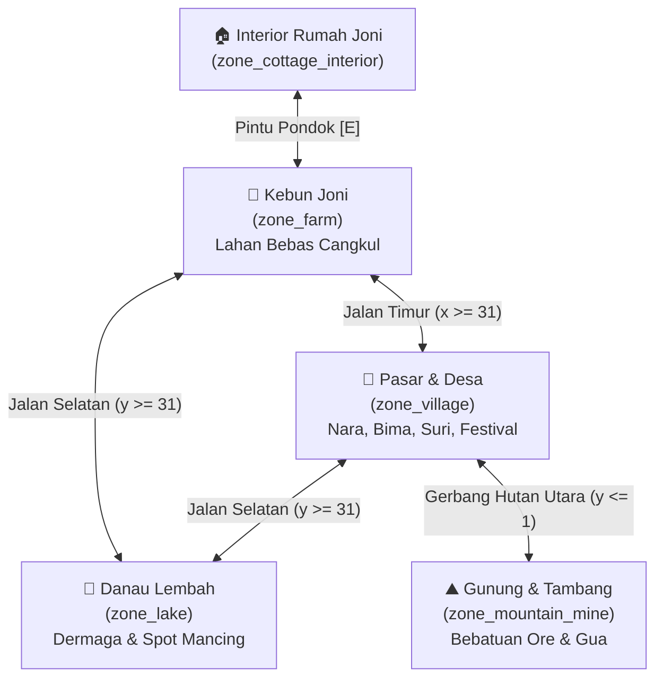
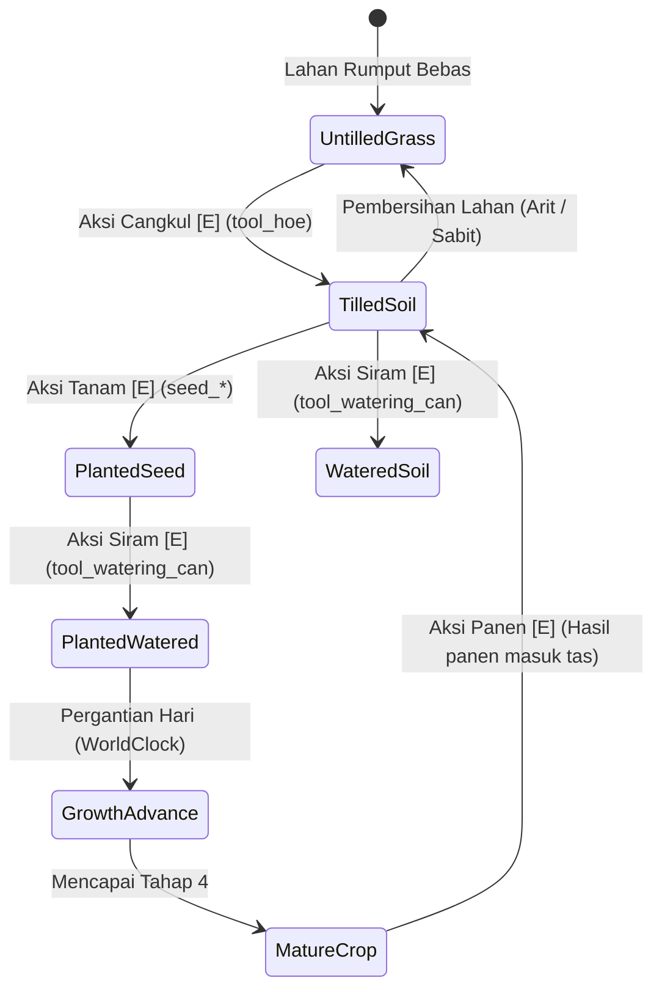

# Multi-Zone World Architecture & Dynamic Free-Form Farming Specification

- **Tanggal Dokumen:** 2026-10-17
- **Status:** Approved (Disetujui Pengguna)
- **Tujuan Arsitektur:** Memecah dunia permainan dari peta tunggal (*monolithic map*) menjadi 5 zona mandiri dengan transisi halus, serta membebaskan sistem pertanian agar pemain dapat mencangkul (*free-form tilling*) tanah di mana saja di kebun Joni tanpa batasan petak kaku.

---

## 1. Problem Statement & Design Objectives

### Problem Statement
Sebelumnya, seluruh elemen game (kebun Joni, eksterior pondok, kios pasar Nara, bengkel Bima, paviliun Suri, kolam ikan nila, dan batuan tambang) terkumpul dalam satu peta 36x36 petak. Keterbatasan ini menyebabkan:
1. Kebun Joni terasa sempit dan terbatas hanya pada 12 petak statis.
2. Tidak ada variasi lingkungan (interior rumah tidak bisa dimasuki, pasar desa tidak terasa seperti perkampungan mandiri, danau dan gunung tidak memiliki ruang eksplorasi tersendiri).
3. Pemain tidak memiliki kebebasan mencangkul tanah (*hoeing*) untuk memperluas kebun secara organik layaknya game agrikultur klasik (*Harvest Moon*, *Stardew Valley*).

### Design Objectives
1. **Pemisahan 5 Zona Tematik Mandiri:**
   - `zone_farm`: Kebun & Pekarangan Pribadi Joni (lapang, luas, bebas cangkul).
   - `zone_cottage_interior`: Interior Kamar & Rumah Joni (cozy, tempat tidur istirahat/skip hari, perabot).
   - `zone_village`: Alun-Alun & Pusat Pasar Desa (Kios Nara, Bengkel Bima, Paviliun Suri, Papan Festival).
   - `zone_lake`: Danau Lembah & Dermaga Memancing (danau luas, dermaga kayu nila/lele).
   - `zone_mountain_mine`: Kaki Gunung & Gua Tambang (tebing bebatuan mineral, mulut gua, ranting liar).
2. **Sistem Bertani Bebas & Dinamis (*Free-Form Dynamic Tilling*):**
   - Setiap ubin rumput/tanah terbuka yang valid di `zone_farm` dapat dicangkul (`tool_hoe`) dengan aksi interaksi `[E] Cangkul Tanah`.
   - Petak baru langsung tercipta sebagai entitas `FarmPlot`, siap ditanami bibit, disiram, dan dipanen.
   - Mendukung pembersihan atau perataan kembali ke rumput menggunakan alat pembersih/sabit.
3. **Mekanisme Transisi Halus (*Seamless Zone Teleportation*):**
   - Transisi pintu (interaksi `[E]`) dan batas jalan/gapura (berjalan melintasi batas ubin).
   - Efek transisi kamera *fade-out* (200ms) -> pemindahan posisi pemain & penggantian aset zona -> *fade-in* (200ms) dengan SFX langkah/pintu kayu.
4. **Konsistensi Data Transaksional (*State Persistence*):**
   - Tanaman yang sedang tumbuh di kebun, status petak basah/kering, waktu dunia (*WorldClock*), inventaris, dan relasi NPC tetap tersimpan transaksional di IndexedDB tanpa risiko data hilang saat berpindah zona.

---

## 2. World Topology & Zone Specifications



### 2.1. Zona 1: Kebun Joni (`zone_farm`)
- **Dimensi:** 32 × 32 ubin.
- **Topografi:** Lahan datar hijau asri dengan tanah subur gembur.
- **Struktur & Bangunan:**
  - Pondok Panggung Joni di sudut barat laut (`tileX: 6, tileY: 6`). Pintu masuk di `tileX: 7.5, tileY: 9.5` (memicu teleportasi ke `zone_cottage_interior`).
  - Kolam Air Segar di sisi barat daya (`tileX: 4..7, tileY: 22..25`) untuk mengisi air kaleng siram (*Watering Can*).
  - Kotak Pengiriman & Peti Panen di dekat teras pondok.
  - Hewan peliharaan Kiko berkeliaran di pekarangan.
- **Pertanian Dinamis:**
  - Seluruh petak rumput di area koordinat `tileX: 10..28, tileY: 8..28` (yang bukan jalan/kolam) berstatus *tillable* (bebas dicangkul).
  - Pemain dapat membuat 10, 20, 50, atau lebih dari 100 petak sesuai keinginannya.
- **Titik Portal Keluar:**
  - **Pintu Pondok:** Masuk ke `zone_cottage_interior` (spawn di `x: 6.5, y: 10.5`).
  - **Jalan Timur:** Menuju `zone_village` (spawn di `x: 2.5, y: 15.5`).
  - **Jalan Selatan:** Menuju `zone_lake` (spawn di `x: 15.5, y: 2.5`).

### 2.2. Zona 2: Interior Rumah Joni (`zone_cottage_interior`)
- **Dimensi:** 14 × 14 ubin.
- **Topografi:** Lantai papan kayu nusantara (`#87674E`) dengan dinding kayu hangat.
- **Struktur & Furnitur:**
  - Tempat Tidur Joni (`joni_bed`) di `tileX: 4, tileY: 4` (`[E] Tidur & Lewati Hari`).
  - Karpet anyaman (`woven_rug`) di tengah ruangan `tileX: 6.5, tileY: 6.5`.
  - Rak dinding kayu (`wall_shelf`) dan pot tanaman (`plant_pot`).
  - Pintu keluar di sisi selatan (`tileX: 6.5, tileY: 11.5`).
- **Titik Portal Keluar:**
  - **Pintu Keluar:** Kembali ke pekarangan `zone_farm` di depan pintu pondok (`x: 7.5, y: 11.0`).

### 2.3. Zona 3: Pusat Desa & Pasar (`zone_village`)
- **Dimensi:** 34 × 34 ubin.
- **Topografi:** Alun-alun batu tanah liat berpadu jalan setapak melingkar, dikelilingi pepohonan rindang.
- **Struktur & Toko Warga:**
  - **Kios Nara (`nara_stall`):** Di barat laut alun-alun (`tileX: 10, tileY: 10`). Nara menjual bibit dan membeli hasil panen.
  - **Bengkel Paman Bima (`bima_workshop`):** Di timur laut alun-alun (`tileX: 24, tileY: 10`). Meja kerja upgrade cangkul dan perabot.
  - **Paviliun Nenek Suri (`suri_pavilion`):** Di tenggara (`tileX: 22, tileY: 22`). Taman bunga herbal dan dialog bersahabat.
  - **Alun-Alun Lentera & Papan Pengumuman:** Di tengah (`tileX: 16.5, tileY: 16.5`). Lokasi festival panen tahunan.
- **Titik Portal Keluar:**
  - **Jalan Barat:** Menuju `zone_farm` (spawn di `x: 30.5, y: 15.5`).
  - **Gerbang Hutan Utara:** Menuju `zone_mountain_mine` (spawn di `x: 16.5, y: 30.5`).
  - **Jalan Selatan:** Menuju `zone_lake` (spawn di `x: 24.5, y: 2.5`).

### 2.4. Zona 4: Danau Lembah (`zone_lake`)
- **Dimensi:** 32 × 32 ubin.
- **Topografi:** Danau air tawar alami luas di sisi selatan (`y: 12..30`) dengan perairan biru jernih (`#749C9A`).
- **Struktur & Fitur:**
  - Dermaga Kayu Panjang (`fishing_pier`) menjorok ke danau (`tileX: 15, tileY: 10` hingga `tileY: 20`).
  - Spot memancing ikan nila/lele di ujung dermaga (`[E] Lempar Pancing`).
  - Pepohonan pinus dan semak tepian pantai danau.
- **Titik Portal Keluar:**
  - **Jalan Utara-Barat:** Kembali ke `zone_farm` (spawn di `x: 15.5, y: 29.5`).
  - **Jalan Utara-Timur:** Menuju `zone_village` (spawn di `x: 24.5, y: 29.5`).

### 2.5. Zona 5: Kaki Gunung & Gua Tambang (`zone_mountain_mine`)
- **Dimensi:** 32 × 32 ubin.
- **Topografi:** Lereng bukit berbatu cadas, tanah pegunungan, dan tebing tinggi di utara.
- **Struktur & Sumber Daya:**
  - Mulut Pintu Gua Tambang (`forest_gateway` / `mine_cave_tile`) di tebing utara (`tileX: 15, tileY: 4`).
  - 10–12 Formasi Batu Tambang Mineral (`mining_ore_node` & `ore_node_intact`) berisi bijih tembaga, batu belah, dan mineral langka.
  - Pohon pinus ramping, semak liar, jamur hutan (`forage_mushroom`), dan ranting kayu.
- **Titik Portal Keluar:**
  - **Jalur Selatan:** Kembali ke `zone_village` (spawn di `x: 16.5, y: 3.5`).

---

## 3. Dynamic Free-Form Farming Architecture

### 3.1. Penentuan Petak Valid (*Tillable Invariant*)
Sebuah ubin di `zone_farm` dapat dicangkul jika dan hanya jika:
1. Zona aktif saat ini adalah `zone_farm`.
2. Koordinat berada di dalam area pekarangan yang diizinkan (`10 <= tx <= 28` dan `8 <= ty <= 28`).
3. Bukan jalan setapak (`!zoneDef.isPath(tx, ty)`).
4. Bukan perairan (`!zoneDef.isWater(tx, ty)`).
5. Tidak tertimpa bangunan atau rintangan solid (`!navGrid.isSolid(tx, ty)`).
6. Belum ada petak `FarmPlot` aktif pada koordinat tersebut.

### 3.2. Siklus Hidup Petak Tanam Dinamis (*Dynamic Plot FSM*)


---

## 4. Zone Switching & Teleportation Architecture

### 4.1. `ZoneManager` Component
Modul baru `src/world/ZoneManager.js` yang bertanggung jawab atas:
1. Registrasi kamus definisi zona (`ZONE_FARM`, `ZONE_COTTAGE`, `ZONE_VILLAGE`, `ZONE_LAKE`, `ZONE_MINE`).
2. Pelacakan zona aktif (`currentZoneId`).
3. Eksekusi transisi zona:
   ```javascript
   async changeZone(targetZoneId, spawnCoord = null) {
     if (this.isTransitioning) return;
     this.isTransitioning = true;
     
     // 1. Freeze input & audio cue
     this.scene.inputRouter.setFrozen(true);
     this.scene.audio.play('door');
     
     // 2. Camera fade out (200ms)
     await this.fadeCamera(0, 200);
     
     // 3. Tear down current zone render entities
     this.scene.worldRenderer.clearZone();
     
     // 4. Build target zone
     const nextZoneDef = this.getZoneDefinition(targetZoneId);
     this.currentZoneId = targetZoneId;
     this.scene.worldRenderer.buildZone(nextZoneDef, targetZoneId === 'farm' ? this.scene.farmingSystem : null);
     
     // 5. Reposition player & camera
     const targetSpawn = spawnCoord || nextZoneDef.spawnPoint;
     this.scene.player.setPosition(targetSpawn.tileX, targetSpawn.tileY);
     this.scene.cameras.main.centerOn(this.scene.player.x, this.scene.player.y);
     
     // 6. Camera fade in (200ms) & unfreeze
     await this.fadeCamera(1, 200);
     this.scene.inputRouter.setFrozen(false);
     this.isTransitioning = false;
   }
   ```

---

## 5. Persistence & Data Integrity

1. **Struktur Save Snapshot Terpadu:**
   `saveData.world` menyimpan status seluruh zona secara independen:
   - `saveData.world.activeZone`: ID zona terakhir pemain (`'farm'`, `'village'`, `'lake'`, `'mine'`, atau `'cottage'`).
   - `saveData.world.farmPlots`: Daftar seluruh petak dinamis yang pernah dicangkul pemain di kebun Joni beserta tahapan tumbuh tanaman.
   - `saveData.world.resources`: Status keterambilan batu/kayu/ore di setiap zona.
2. **Autosave Tolerant:**
   Setiap kali pemain berpindah zona, `SaveManager.save()` dipanggil secara otomatis sehingga progres pemain langsung aman tersimpan.

---

## 6. Acceptance Criteria

1. **Pemisahan 5 Scene / Zona Berfungsi Penuh:**
   - Pemain bisa berpindah antara Kebun, Rumah, Pasar Desa, Danau, dan Gunung dengan mulus tanpa error.
2. **Cangkul Dinamis di Kebun:**
   - Pemain memegang Cangkul (`tool_hoe`) di kebun Joni -> muncul prompt `[E] Cangkul Tanah`.
   - Pemain bisa mencangkul petak baru sebanyak yang diinginkan.
   - Tanaman yang ditanam di petak baru dapat disiram, tumbuh tiap hari, dan dipanen dengan normal.
3. **Persistensi Data Lintas Zona:**
   - Tanaman yang ditanam di kebun tetap ada dan terus tumbuh saat pemain berada di pasar, danau, atau tambang.
4. **Kualitas Pengujian:**
   - Seluruh unit test suite lulus 100% tanpa regresi.
